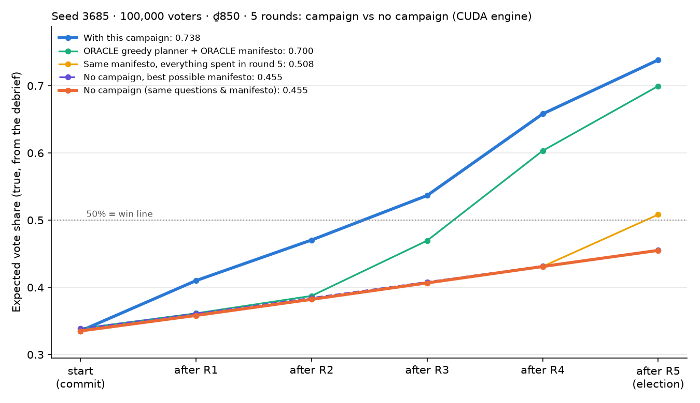

# Demo: why campaigning matters (seed 3685)

## Without campaigning you lose with 45.4%. With this campaign you win with 73.8%.

Both games use the same world, the same two survey questions and the same manifesto. The only difference is what you
do in the five campaign rounds. With an empty plan every round, 45,439 of 100,000 voters vote for you: a **defeat**.
With the plan below, 73,821 do: a **landslide victory**.

No manifesto can win this election without a campaign. The best possible manifesto, computed with full information
about every voter, reaches only 45.5% when you spend nothing.

Every number here comes from the real game engine, played through the same HTTP API the web game uses
(`Demo/win/verification.json`). They are exact on any CUDA engine; CPU numbers are in section 7.

## 1. Setup screen: what to type

| Field | Value |
|---|---|
| Voters | **100,000** |
| Seed | **3685** |
| Rounds | **5** |
| Treasury (budget) | **₫850** |

At the start the screen shows 4 regions: **North** 19,923 voters, **South** 23,941, **East** 15,869 and **West**
40,267. Media prices per round are N ₫39.85, S ₫47.88, E ₫31.74 and W ₫80.53 (all four together cost ₫200.00).
A worker costs ₫20 and a survey question costs ₫10. The full starting screen is in `initial_observation.json`.

## 2. Survey phase: ask 2 questions (₫20 in total)

In the survey form, choose Sector A, Sector B and the region. The form then asks "What share of *region* voters want
more *Sector B* than *Sector A*?"

| # | Region | Sector A | Sector B | Answer (CUDA engine) | What it reveals |
|---|---|---|---|---|---|
| 1 | **North** | **Industry** | **Environment** | **10.1%** (±1.3) | North strongly prefers Industry to Environment, so it is a **Knowledge hub**. This also settles the other regions almost completely. |
| 2 | **South** | **Agriculture** | **Industry** | **≈100%** (±0.1) | South wants Industry far more than Agriculture, which confirms an **Industrial belt**. |

Question 1 is the game's Bayesian planner's choice: the question with the highest expected information (0.93 nats)
on the starting screen. After its answer the planner is already 99.99% sure of the whole map: North Knowledge hub,
South Industrial belt, **East Balanced middle**, **West Welfare-reliant**. Its own stopping rule would not ask again.
Question 2 is the next-best information-gain question, and it confirms the South. The debrief at the end shows all
four guesses are right.

## 3. Manifesto: set the 5 sliders, then commit

| Education | Welfare | Agriculture | Industry | Environment |
|---|---|---|---|---|
| **19%** | **28%** | **14%** | **23%** | **16%** |

Reason in one line: lead with Welfare for the big West (Welfare-reliant, 40% of all voters) and stay broad for the
rest. This is the best possible election-day manifesto with one point moved from Welfare to Industry: the campaign
is what wins the West, so the promise can reach a bit further toward the South.

## 4. The five rounds: exactly what to click

Workers are given per region as North / South / East / West. "Media" lists the regions to switch on.

| Round | Workers N / S / E / W | Media regions | Cost | Treasury left | Poll after round | True expected share after round | Same game, no campaign |
|---|---|---|---|---|---|---|---|
| (start) | | | ₫20.00 (2 questions) | ₫830.00 | 33.5% (round-1 poll) | 0.335 | 0.335 |
| 1 | **0 / 0 / 0 / 10** | **N, S, E, W** (all) | ₫400.00 | ₫430.00 | 37.0% | 0.410 | 0.358 |
| 2 | 0 / 0 / 0 / 0 | **N, S, E, W** (all) | ₫200.00 | ₫230.00 | 47.5% | 0.471 | 0.382 |
| 3 | 0 / 0 / 0 / 0 | **N, S, W** (not East) | ₫168.26 | ₫61.74 | 54.5% | 0.537 | 0.407 |
| 4 | 0 / 0 / 0 / 0 | **S** only | ₫47.88 | ₫13.86 | 61.3% | 0.658 | 0.431 |
| 5 | 0 / 0 / 0 / 0 | none (lock in an empty plan) | ₫0.00 | ₫13.86 | 73.5% (pre-election) | **0.738** | **0.455** |

Polls are samples of 400 voters (about ±5 points), so they wobble. The true expected share comes from the debrief.

The 10 workers hired in round 1 stay on the team for the whole game. They are the only workers. Voters converted by
the canvassing cascade per round: 78, 594, 4,973, 26,967 and 23,164, about 55,800 in total.

For the no-campaign comparison: after the same questions and manifesto, lock in an empty plan (no workers, no media)
in all five rounds, or press forfeit each round. Both do the same thing.

## 5. Final result (CUDA engine)

| | Votes | Vote share | Expected share | Result |
|---|---|---|---|---|
| **With this campaign** | **73,821** | **73.8%** | 0.738 | **VICTORY** |
| No campaign (same questions and manifesto) | 45,439 | 45.4% | 0.455 | defeat |
| No campaign, best possible manifesto (19/29/14/22/16) | 45,427 | 45.4% | 0.455 | defeat |

Final expected share by region, campaign vs no campaign: North 0.68 vs 0.42, South 0.65 vs 0.35, East 0.79 vs 0.69,
West 0.80 vs 0.44.

## 6. Why this works

These points match the experiment findings in `reports/v3/experimentation/experiments.md`.

- **A manifesto alone cannot win here.** The electorate is divided: Knowledge hub, Industrial belt, Balanced middle
  and Welfare-reliant regions want different things. With no campaign, even the full-information best manifesto
  (optimised for election day by the ORACLE and confirmed by 78-start projected gradient) tops out at 45.5%. Voters
  drift a little toward any promise (0.335 → 0.455) but never cross 50%.
- **The manifesto is aimed at election day.** It is the ORACLE's election-day optimum, adjusted by one point.
- **A few workers, early, where the manifesto is liked and the network is dense.** Ten workers in round 1 in the
  West (40% of the voters, "Receptive to canvassing", the highest mean degree, 33.7) start an Independent Cascade.
  Each hop reaches further than the last, so it explodes in rounds 4–5: about 50,000 conversions. Workers bought
  late would get too few hops.
- **Heavy, early media.** Media everywhere in rounds 1–2 raises support before the cascade arrives. Converts then sit
  among friendly neighbours, and the social step keeps them. Later airings are dropped where they are weak: each
  repeat airing in a region is weaker (decay), and the East already likes the manifesto.
- **Spend early.** 94% of the money spent on the campaign goes out by round 3. Spending ₫820 all in round 5 (media
  everywhere plus 31 West workers) scrapes only 50.8%.

Other plays on the same seed (CUDA engine, final vote share):

| Play | Final vote share | Result |
|---|---|---|
| **This script** | **73.8%** | **win** |
| ORACLE greedy planner + ORACLE manifesto (full-information benchmark) | 69.9% | win |
| Even 20% manifesto + this exact campaign | 62.9% | win |
| This manifesto, everything spent in round 5 | 50.8% | barely wins |
| This manifesto, no campaign | 45.4% | **defeat** |
| Even 20% manifesto, no campaign (the naive play) | 37.2% | **defeat** |

## 7. CUDA vs CPU engine, and robustness

Random draws (survey samples, which voters become workers, cascades, media exposure, polls and the ballot) depend on
the engine's device. On any **CUDA** engine the game is exact. `cuda:0` and `cuda:2` give identical answers, polls
and votes. On a **CPU** engine the starting electorate is identical, but the draws differ slightly:

- survey answers 9.9% (±1.3) and 100.0%;
- campaign polls 40.5%, 49.5%, 50.8%, 68.5% and 76.5%;
- campaign expected share after each round 0.410, 0.471, 0.537, 0.658 and 0.737;
- **campaign: 73,565 votes (73.6%), victory**;
- **no campaign: 45,283 votes (45.3%), defeat**;
- best possible manifesto with no campaign: 45,372 votes, defeat.

With no campaign the expected share is 0.455 on every engine, because no random draws are involved.

Robustness on 10 alternative random streams (all in-game streams re-salted):

- the campaign's expected share is 0.730–0.742 (mean 0.736), with vote shares of 73.1–74.3%: **10/10 wins**;
- with no campaign, the vote shares are 45.2–45.6% with this manifesto and 45.2–45.6% with the best possible one:
  **0/10 wins**.

To replay both games and assert the contrast (repo root, conda env `mas`):
`python Demo/win/replay_win.py --device cuda:0` (or `--device cpu`).
The search that found this seed and plan is in `Demo/win/search/` (see `screening_summary.json`).
