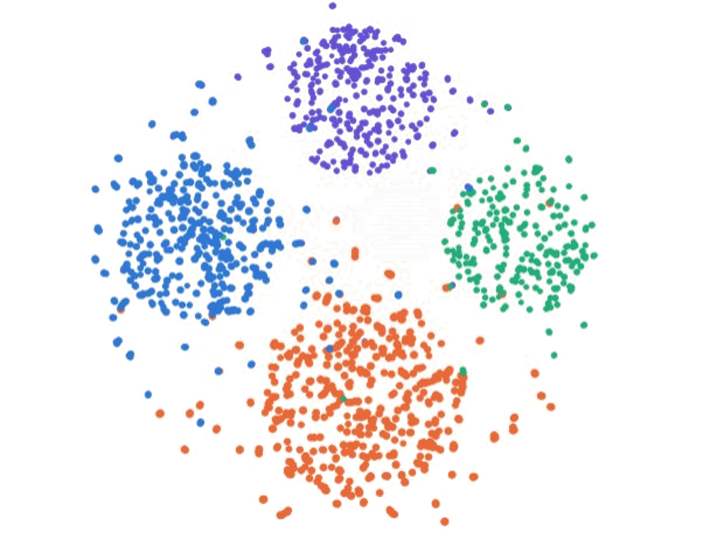

# Clout

**An election game on a simulated social network.**

You run a campaign for a party. Thousands of simulated voters live in four regions and talk to their friends. You
cannot see what they want. You survey them, promise a budget, then spend money on party workers and local media to
win more than half the vote in a few rounds.

Clout is also a research tool. One PyTorch code path simulates a single game in a browser or thousands of games on a
GPU. That let us test the game against multi-agent systems theory: opinion dynamics, contagion, optimisation, and
epistemic and temporal logic.

<p align="center">
  
</p>

Built by **Team Dumbocracy** as a Multi-Agent Systems course project at IIT Hyderabad.

---

## Contents

- [What's inside](#whats-inside)
- [Quick start](#quick-start)
- [How the game works](#how-the-game-works)
- [Using the engine from Python](#using-the-engine-from-python)
- [Experiments](#experiments)
- [Project layout](#project-layout)
- [Documentation](#documentation)
- [Team](#team)
- [Contributing](#contributing)
- [License](#license)

---

## What's inside

| Part | What it does |
|---|---|
| **Simulation core** (`src/dumbocracy`) | Generates the electorate and runs opinion drift, worker cascades, media and voting as PyTorch tensor operations. It runs on CPU or GPU, and many worlds can run at once. |
| **Game engine** | Enforces the rules: phases, prices, an exact-decimal treasury, validation and replay. Every game can be replayed exactly from its seed. |
| **Web game** (`web/`) | A Next.js app for human play, served by a FastAPI engine. |
| **Computer players** | An all-seeing *Oracle*, a Bayesian *smart player* that sees only what you see, and simple scripted players. |
| **Logic layer** | Works out what the player *knew* during the game: possible, known and guaranteed victory, plus temporal properties of the campaign. |
| **Experiments** (`experiments/`) | Over 60 scripts that produced the results in the report. |

## Quick start

### 1. Requirements

- **Linux or macOS** with [conda](https://docs.conda.io/) (Miniconda is enough)
- **Python 3.11 or newer** and **Node.js 20.9 or newer**. The conda environment below installs both.
- **Optional:** an NVIDIA GPU with CUDA. Everything also runs on CPU.

### 2. Install

```bash
git clone https://github.com/saikaushhikp/CLOUT.git
cd CLOUT

conda env create -f environment.yml        # the "mas" environment: Python, Node.js, PyTorch, FastAPI and Clout itself
conda activate mas

cd web && npm ci && cd ..                   # the web game's dependencies
```

PyTorch comes as the default build for your platform. For a specific CUDA version, or CPU only, run the install
command from [pytorch.org](https://pytorch.org/get-started/locally/) inside the environment afterwards.

**Without conda:** use any Python 3.11+ virtual environment, then `pip install -r requirements.txt`. It lists only
the packages Clout imports, with compatible version ranges. You will also need Node.js 20.9+ for the web game.

### 3. Play

```bash
scripts/run_game.sh            # starts the engine (port 61008) and the web game (port 61007)
```

Open **http://127.0.0.1:61007** and press **Start campaign**. The first run builds the web app, which takes a minute.

- **Developing the frontend?** Use `scripts/run_game.sh dev` for hot reload.
- **On a remote server?** Forward the port first: `ssh -L 61007:127.0.0.1:61007 <user>@<host>`.
- **No Python at all?** Run the web game against a built-in mock engine:
  `cd web && NEXT_PUBLIC_DUMBOCRACY_MOCK=1 npm run dev`.

New to the game? Read **[HOW_TO_PLAY.md](HOW_TO_PLAY.md)**. It takes five minutes.

## How the game works

```
 Setup ──► Survey ──► Campaign rounds (3–5) ──► Election ──► Debrief
           ask questions,   hire workers, air media;        votes counted,   hidden truth and
           commit manifesto voters drift towards friends    > 50% wins       what you knew, round by round
```

| Model piece | How it works |
|---|---|
| **Electorate** | 1,000 to 1,000,000 voters in four regions (each at least 15%), linked by a stochastic block model with about 30 friends per voter, most of them in their own region. |
| **What voters want** | Each voter has an ideal budget split over five sectors. Each region has a hidden *archetype*, such as agrarian or industrial. |
| **How voters move** | Each round voters move part of the way towards their friends' average opinion (a damped DeGroot step). 5% are *zealots* who never move. |
| **Party workers** | Real voters pinned to your manifesto. They start an *Independent Cascade* that converts friends one hop per round, with at most 3 attempts per voter. |
| **Media** | Reaches 60% of a region at once and gives a temporary pull, which weakens with each repeat airing. |
| **Voting** | A voter supports you with a probability that rises steeply once their agreement with your manifesto passes 82.5%. |

The full model, with every equation and default value, is in the [report](reports/v3/latex/main.pdf).

## Using the engine from Python

The engine is a set of pure functions over immutable game states. This plays a complete game:

```python
from dumbocracy.config import ElectorateConfig, GameConfig
from dumbocracy.game import Allocate, Commit, GameEngine, Query, observation_for

config = GameConfig(seed=7, rounds=5, device="cpu",
                    electorate=ElectorateConfig(num_voters=2_000))
state = GameEngine.new_game(config)                            # a hidden electorate is drawn

state = GameEngine.apply(state, "p0", Query("Edu", "Industry", "N")).state    # a paid survey question
state = GameEngine.apply(state, "p0", Commit((0.2, 0.2, 0.2, 0.2, 0.2))).state  # fix the manifesto

for t in range(config.rounds):         # 3 workers in North in round 1, media in East for 3 rounds
    plan = Allocate(hires_by_region=(3, 0, 0, 0) if t == 0 else (0, 0, 0, 0),
                    media_regions=(False, False, t < 3, False))
    step = GameEngine.apply(state, "p0", plan)
    assert step.accepted, step.message
    state = step.state

obs = observation_for(state, "p0")     # only what the player is allowed to see
print(obs["phase"], obs["result"])     # DONE {'votes': ..., 'vote_share': ..., 'victory': ...}
```

Sectors are `Edu`, `Welfare`, `Agri`, `Industry` and `Env`. Regions are `N`, `S`, `E` and `W`. A rejected action
never changes the state; it comes back with `accepted=False` and an error code such as `INSUFFICIENT_FUNDS`.

## Experiments

Each script in `experiments/` writes raw per-game rows and a JSON summary with its seeds, device and git revision.
Every arm of an experiment runs on the same worlds, so comparisons are paired. For example:

```bash
OMP_NUM_THREADS=4 python experiments/s5_worker_spread.py --seeds 50 --first-seed 14000 --device cuda:0
```

The results and the figures behind the slides are in [`reports/v3/`](reports/v3/). Some headline findings:

- **No manifesto wins on day one.** Even the best reaches about 37% before any campaigning.
- **A few early workers go a long way.** Five workers bought in round 1 lift the expected vote share from 45% to 58%,
  and the cascade crosses region borders.
- **When you hire matters about ten times more than where.** Each round of delay costs the cascade one hop.
- **Planning beats seeing.** The Bayesian smart player sees only what a human sees, yet beats the all-seeing greedy
  Oracle (0.639 vs 0.628 expected vote share).

## Project layout

```
CLOUT/
├── src/dumbocracy/      the Python package
│   ├── electorate/      regions, friendship network, preferences, personalities, zealots
│   ├── dynamics/        opinion drift, worker cascade, media
│   ├── voting.py        agreement, vote probability, election
│   ├── information/     surveys, polls, knowledge log
│   ├── game/            rules engine: states, actions, ledger, observations
│   ├── strategies/      Oracle, Bayesian smart player, manifesto optimisation, planner
│   ├── logic/           possible worlds, epistemic and temporal logic, debrief
│   ├── analysis/        spectral and robustness tools
│   └── api/             FastAPI server for the web game
├── web/                 Next.js web game (React, sigma.js network view)
├── tests/               pytest suite (unit, integration, GPU)
├── experiments/         experiment scripts
├── reports/             results, figures and the project report
├── docs/                design spec, decisions, API contract, plans
├── Demo/                two scripted games for live demos (one win, one loss)
├── slides/              presentation slides (HTML, rendered to PDF)
└── scripts/             run_game.sh and the smart-player advisor
```

## Documentation

| Document | What's in it |
|---|---|
| [HOW_TO_PLAY.md](HOW_TO_PLAY.md) | A guide for first-time players |
| [reports/v3/latex/main.pdf](reports/v3/latex/main.pdf) | The project report: model, algorithms, logic, experiments |
| [reports/v3/report.md](reports/v3/report.md) | The full experiment record |
| [docs/v2/technical_spec_v2.md](docs/v2/technical_spec_v2.md) | The technical specification |
| [docs/v2/web_api_v2.md](docs/v2/web_api_v2.md) | The HTTP API between the web game and the engine |
| [Demo/README.md](Demo/README.md) | Two fixed games for live demos |
| [CONTRIBUTING.md](CONTRIBUTING.md) | How to set up, test and contribute |

**Want hints while you play?** `scripts/advisor.py` reads your game through the API and says what the smart player
would do next. It never acts for you and never sees hidden information.

## Team

**Team Dumbocracy**, Indian Institute of Technology Hyderabad

| Name | Main area |
|---|---|
| Pakki Sai Kaushik | Epistemic and temporal logic, game engine, GPU experiment harness |
| G. Madhava Asrith Murthy | Smart player, manifesto optimisation, strategy experiments |
| Vuppula Hemanth Reddy | Information model, surveys, workers and media, price calibration |
| Vishank Singh | Web game and web API |
| B. U. Deekshith Patel | Electorate model, opinion drift, voting |

## Contributing

Contributions are welcome. See **[CONTRIBUTING.md](CONTRIBUTING.md)** for setup, testing and the pull request
process.

## License

Clout is released under the [MIT License](LICENSE).
