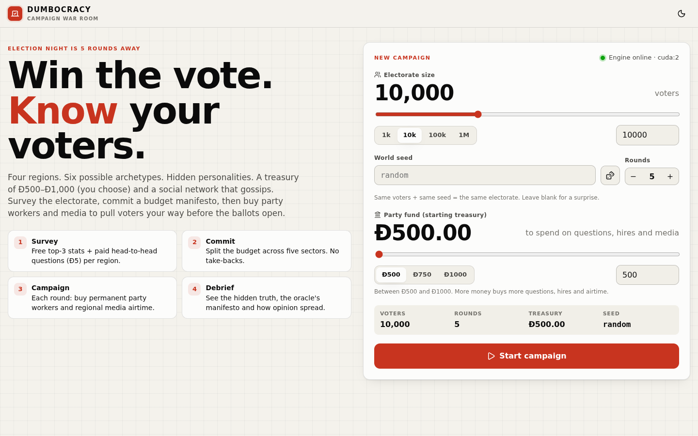
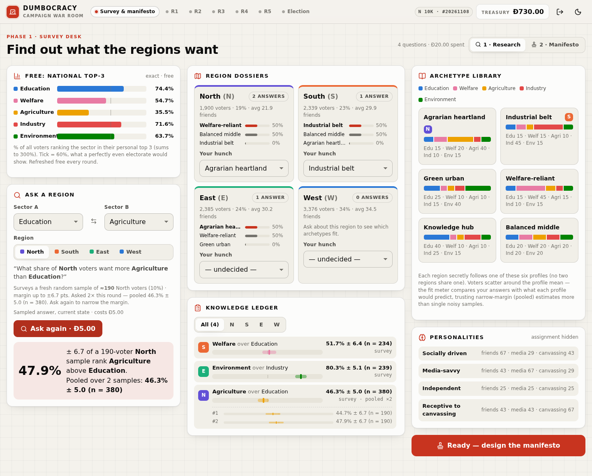
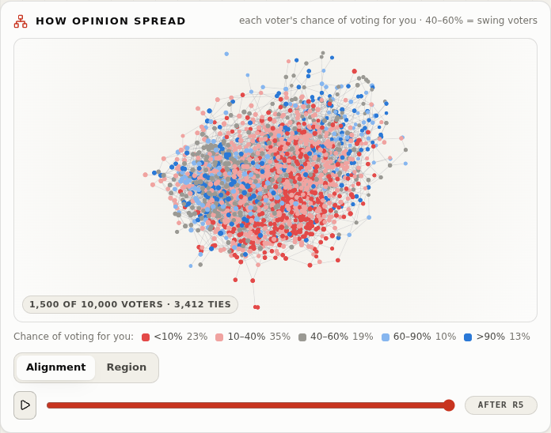
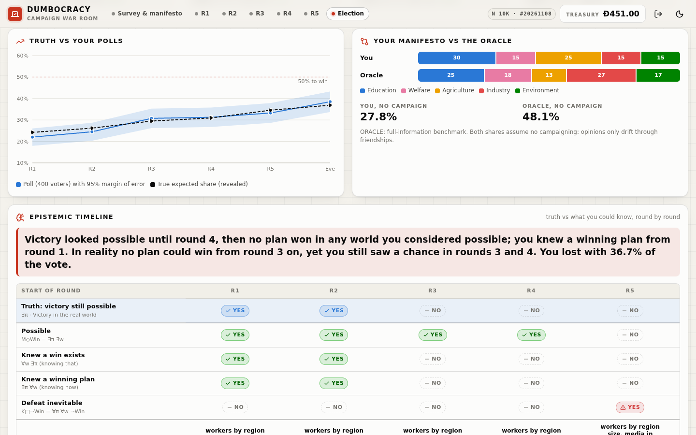

# Dumbocracy v2: an election-campaign game on a GPU-simulated multi-agent electorate

**Final report, Multi-Agent Systems course project. Team Dumbocracy:** Mad (strategy), Deek (MAS model),
Hem (resources and information), Psk/Kaushik (logic), Vis (UI).
**Code state:** branch `v2-revamp`, spec v2.1 (calibration frozen 2026-11-07), experiments at git `d9f74c9`
plus the P7 experiment scripts.

> **How to read the numbers.** Every number below comes from a saved artefact, and the file is named next to it:
> `reports/v2/*.json`, `reports/v2/p7_results.md`, `reports/v2/scenario_table.md`, or the phase handoffs in
> `docs/v2/plans/`. Paths are relative to the repository root unless they are embedded images, which are
> relative to `reports/v2/`. All intervals are 95 %: Wilson intervals for rates and t-intervals for means.
> "Paired" means the same seeds in every arm. "ORACLE" is a full-information benchmark and never a player.

---

## 1. Abstract

Dumbocracy is a single-player web game. The player runs a five-round election campaign for N voters (10 000
in play, up to 10⁶ in experiments) who live in four regions of a sparse stochastic-block social network.
Each voter holds a preferred budget split over five sectors, which is a point on the probability simplex Δ⁴. The
player sees only partial, noisy information: a free national statistic, paid 10 % sample surveys with margins of
error, and a 400-voter poll each round. The player commits a manifesto b ∈ Δ⁴ once and then spends a fixed
treasury on party workers, whose contacts start an SIR-style word-of-mouth cascade, and on region-targeted
media with diminishing returns. Between rounds, opinions follow DeGroot averaging (W-MSR resilient consensus is
an option), with stubborn zealots. Each voter then votes with probability σ(β(S − z)), where S is the
similarity between the voter's preference and b.

On top of the game we built four things:
1. a Bayesian player that keeps a posterior over the 360 hidden archetype maps and picks survey questions by
   expected information gain;
2. manifesto optimisation by projected gradient, i.e. the prox of the simplex indicator, with a consensus-ADMM
   variant that reaches the same answer;
3. a rollout planner;
4. an epistemic and temporal logic layer. It evaluates possible victory, guaranteed victory ("knowing how"),
   "knowing that" a win exists, and inevitable defeat over Kripke worlds consistent with what the player knew,
   and shows the result in the game's debrief.

After calibration the game is non-degenerate:
- a uniform manifesto with no campaign wins 6 % of 200 seeds;
- the informed BayesPlanner wins 91 % [86, 94];
- the full-information ORACLE wins 96 % [92, 98].

Seven experiments compare course theory with measurements:
- **Spectral-gap consensus speed (E1).** Confirmed (Spearman 0.995) once the gap is taken from D⁻¹A rather
  than λ₂(L).
- **W-MSR (E2).** Gives partial protection against zealots only where the F-local threat model nearly holds.
- **Cascades (E3).** Collapse onto the SIR parameter x = τλ_max/ρ, and workers overtake media right at x ≈ 1.
- **Information (E4).** About two survey questions are enough to identify the archetype map, but what stays
  hidden (personalities, zealots, network) caps "knowing how to win" at about 70 % of games.
- **Budget (E5).** More money helps with diminishing returns per coin.
- **Scale (E7).** A round takes 4.8 ms at N = 10⁴ and 28 ms at N = 10⁶ on one RTX A5000.

---

## 2. Motivation and the proposal's objectives

The proposal (`Proposal_sept-15`) set out to build "an interactive web-based game in which the player implements
effective campaign strategies… The voting population is modeled as a multi-agent system", with three real-world
difficulties: partial information, media of different cost and effectiveness, and both local and global
influence. The first implementation (v1, archived at tag `v1-final`) produced a working engine, but the game was
strategically flat (§5). v2 is a ground-up rewrite against a frozen specification
(`docs/v2/technical_spec_v2.md`) and a decision register (`docs/v2/decisions_v2.md`).

| # | Proposal objective | What we built | Evidence |
|---|---|---|---|
| 1 | **Graph-based electorate**: voters with preferences, susceptible to peers and media to different extents; local and global connectivity | Four regions; ER stochastic block model with one sparsity factor (k̄ = 30); 6 public archetypes assigned to regions by a hidden injective map σ; voter preferences drawn from a Dirichlet around the archetype; 4 region personalities (social / media / canvassing susceptibility, Beta-distributed); 5 % zealots; DeGroot or W-MSR dynamics on the simplex (§3) | spec §2, §4; P1 and P2 handoffs (49 → 120 tests); E1 and E2 |
| 2 | **Resource sinks** with costs and varying effectiveness | Treasury of 500; free and paid party workers whose contacts start an SIR word-of-mouth cascade; region-priced media with diminishing returns; paid sampled surveys | spec §3, §6.3, §14; balance gate criteria 4 and 5 (`balance_gate_v2.1.json`); E3, E5 |
| 3 | **Interactive decision-support dashboard** with partial information and visualisations | Next.js web game: free top-3 bars, survey desk with margins of error and pooling, archetype fit meters, polls with an MoE band, region map with census, WebGL network sample, round clock; debrief with a region reveal, truth-vs-poll chart, oracle comparison, alignment animation and epistemic timeline | P6 handoff (browser end-to-end 5/5, 27 screenshots); §4 |
| 4 | **Formal specification with temporal and epistemic logic**: possible or guaranteed victory, inevitable defeat, information sufficiency | `logic/`: Kripke information sets over sampled consistent worlds; K/M operators; Possible (∃π∃w), Guaranteed or knowing-how (∃π∀w), knowing-that (∀w∃π), Inevitable defeat (∀π∀w¬); bounded LTL and STL robustness; per-game epistemic timeline in the UI | `scenario_table.md`, `info_sufficiency.json`, P5 handoff; §7 |
| 5 | **Optimal strategy under partial information** | Bayesian posterior over σ, information-gain queries, manifesto by projected gradient (prox) and consensus ADMM, rollout planner; compared with baselines and an ORACLE | `strategies_r12.json`: BayesPlanner 91 % vs ORACLE 96 %, gap 0.011 expected share; §6 |

The proposal's Phase 3 asks "the optimal partial information to relay back to the player". E4 answers this: the
archetype map is cheap to learn, and the remaining uncertainty is about things surveys cannot reveal (§7.4, R13).

---

## 3. The model

Notation follows spec §1. Sectors are [Edu, Welfare, Agri, Industry, Env] and regions are N, S, E, W. Unless
stated otherwise, every parameter is the frozen v2.1 default (spec §14).

### 3.1 Electorate

**Regions (R7).** Every region gets at least 15 % of the voters, and the rest is split at random:
m = ⌈0.15 N⌉, π ~ Dir(2·1₄), n_r = m + Multinomial(N − 4m, π)_r.

**Social graph: ER stochastic block model with a sparsity factor (R4/R5/R6).** We draw the design document's
"10 numbers": p_r ~ U[0.5, 0.9] for the four regions and p_rs ~ U[0.01, 0.2] for the six region pairs. The
original design (`docs/v2/sources/graph_construction.md`) used [0.1, 0.4] for p_rs, which E1 keeps as its "high"
cell. A single scale factor makes the graph sparse while keeping the owner's relative probabilities exactly:

$$P_{rr}=s\,p_r,\quad P_{rs}=s\,p_{rs},\qquad s=\frac{\bar k\,N}{\sum_r p_r n_r(n_r-1)+\sum_{r\neq s}p_{rs}n_r n_s},\quad \bar k=30 .$$

Each block is sampled as an independent Bernoulli(P) ER graph by drawing a Binomial edge count and uniform
endpoints, then removing duplicates. This costs O(E) time and memory and never materialises an N × N matrix.
Edges are unweighted. The public census shows the intra-region and inter-region edge counts, but not the
p values or s.

**Preferences (U11, R1).** The six public archetypes (Agrarian heartland, Industrial belt, Green urban,
Welfare-reliant, Knowledge hub, Balanced middle) each have a mean vector μ_k ∈ Δ⁴. A hidden injective map σ
assigns one archetype to each region: 6·5·4·3 = **360** possibilities, uniform prior. Voter i in region r starts at

$$v_i(0)\sim \mathrm{Dirichlet}(\kappa\,\mu_{\sigma(r)}),\qquad \kappa=60 .$$

**Personalities and zealots (I3, U12).** A hidden permutation τ (24 possibilities) assigns one of four
personalities to each region. Each personality gives Beta distributions for social α, media β and campaign γ
susceptibility: socially driven, media-savvy, independent, or receptive to canvassing. Each voter is a zealot
with probability ζ = 0.05. Zealots never update (α = β = γ = 0) but still broadcast their opinion. The hidden
discrete type is θ = (σ, τ), 8 640 possibilities. Everything else (graph, Dirichlet draws, Beta draws, zealots)
is continuous micro-state.

### 3.2 Opinion dynamics: DeGroot / W-MSR on the simplex

Once per round, after the campaign, every voter updates synchronously:

$$v_i \leftarrow (1-a_i-c_i)\,v_i + a_i\,\mathrm{Agg}_i(v) + c_i\,b,\qquad a_i=\omega\,\alpha_i,\ \omega=0.15,$$

Here c_i is the voter's campaign intensity, scaled down if a_i + c_i > 1. Under **DeGroot**,
Agg_i(v) = (D⁻¹A v)_i is the neighbour mean. Under **W-MSR(F)**, adapted from LeBlanc et al. 2013, the F
neighbours farthest in total-variation distance are dropped before averaging. Each update is a convex
combination of simplex points, so v stays in Δ⁴ (tested to |Σv − 1| < 10⁻⁵). With no campaign this is a lazy
DeGroot map. Its mixing matrix W = I − diag(a) + diag(a) D⁻¹A is the object studied in E1.

### 3.3 Campaign: workers with SIR word of mouth, and media

Campaign exposures from all mechanisms combine as c_i = 1 − Π_e(1 − e). Zealots always get c_i = 0.

* **Party workers (U9).** Each round the player gets 10 free workers and can buy extras at 4.00 each. Each
  worker contacts q = 0.25 % · N voters of its region (25 at N = 10⁴), giving exposure e = η_w γ_i with
  η_w = 0.5.
* **Word of mouth as an SIR cascade.** The contacted voters start out infectious. For L = 3 hops, every infectious
  voter transmits to each neighbour with probability τ_c = 0.03. A newly reached voter j gets e = 0.15 γ_j and
  becomes infectious. Each infectious voter recovers with probability ρ = 0.5 after each hop. The linearised
  hop-to-hop growth is g = 1 + ρ(x − 1) with **x = τ_c λ_max / ρ**. This is the discrete counterpart of the lecture
  threshold βλ_max(A)/γ > 1 (p7_results E3).
* **Media (U10).** The player chooses which regions to air in. An airing costs m0 · n_r/(N/4) with m0 = 50, so a
  quarter-sized region costs 50.00. Each voter in an aired region is exposed with probability 0.6, with
  e = η_m(n) β_i and **diminishing returns** η_m(n) = 0.25/(1 + 0.5 n), where n is the player's earlier airings
  in that region.

### 3.4 Voting

$$S_i=1-\tfrac12\lVert v_i-b\rVert_1,\qquad P_i=\sigma\big(\beta_v(S_i-z)\big),\ \beta_v=20,\ z=0.825 .$$

The official result is a seeded Bernoulli vote. The player wins **iff votes > N/2**, so ties lose. The
deterministic expected share E = mean_i P_i is recorded for analysis, and the logic layer evaluates on E (I5).
With z = 0.825 a voter is a coin flip only when her preference is within total-variation distance 0.175 of b.
A single manifesto therefore cannot please four regions with different archetypes. This tension is what makes
both the manifesto choice and the campaign matter.

### 3.5 Information model

* **Public:** N, T, rules and prices, region sizes, archetype and personality *libraries* (not σ or τ), and the
  structural census.
* **Free statistic:** at the start and every round, the share of all voters whose personal top 3 includes each
  sector. It is exact and sums to 300 %.
* **Paid query (R12):** Query(s₁, s₂, r) costs 5.00. It surveys a fresh random sample of m = round(0.10 n_r) voters
  and returns p̂ = % of the sample with v[s₂] > v[s₁], with
  MoE = 1.96·100·√(p̃(1−p̃)/m · (n_r−m)/(n_r−1)) and p̃ = (yes+1)/(m+2). Repeating a query in the same round draws
  a new sample, and the answers are pooled.
* **Free poll (U15):** 400 random voters each say "yes" with probability P_i. The game reports p̂ ± 1.96√(p̂(1−p̂)/400).
* **Privacy (spec §6.6):** no payload ever contains per-voter values, σ, τ, p values, edges or seeds. This is
  enforced by allowlist serialisers and recursive leak tests.

---

## 4. The game and its architecture

**Flow (spec §7).** SURVEY (query any number of times, then commit b) → ROUND 1…T (optional queries, then
one `allocate` or `forfeit`) → automatic ELECTION → DONE. Every action is validated purely. A rejection returns
a stable error code (`INVALID_PHASE`, `INSUFFICIENT_FUNDS`, …) and changes nothing: the state, treasury and log
stay the same.

**Engine.** `GameState` is an immutable snapshot, and every accepted action produces a new state. The engine is
player-keyed: every route takes `{player_id}`, a two-player smoke test passes, and an `LLMPlayer` stub documents
the observation and prompt contract (U3). `Observation.for_player` builds a JSON-safe view from an allowlist
(the observation boundary). The engine reproduces the reference single-world simulator exactly for the same
seed, manifesto and allocations (P3 handoff).

**Web game (R11).** FastAPI engine on 127.0.0.1:61008; Next.js 16 + React 19 + TypeScript on :61007, rewriting
`/api/*` to the engine; sigma.js/graphology for the WebGL network; launcher `scripts/run_game.sh`. The contract
is `docs/v2/web_api_v2.md`. Measured UI timings at N = 10k (P6 handoff):
- game creation ≈ 1.2–2 s;
- query ≤ 0.25 s;
- round 167 ms mean, 194 ms max;
- epistemic timeline ≈ 3.3 s on first request, then cached.

Final test status (P6 handoff): Python 233 passed; web unit 43 passed; Playwright end-to-end 5/5 against the
real engine, covering the full game, rejection toasts, the round-clock forfeit, the phone layout, dark mode, a
privacy scan of every `/api` payload before DONE, and WebGL pixels.

| Setup | Survey desk (pooled answers) | Manifesto |
|---|---|---|
|  |  |  |

| Campaign HQ (round 2 planned) | Debrief: network reveal | Debrief: epistemic timeline |
|---|---|---|
|  |  |  |

*Screens from `reports/v2/screenshots/` (27 desktop and mobile captures, light and dark). The network panel
shows only regions during play (R3). At DONE it colours each sampled voter by vote-probability bin
(<10 %, 10–40 %, 40–60 % swing, 60–90 %, >90 %) for every round (R15).*

**Reproducibility (R8/R9).** The player chooses (N, seed). The electorate is drawn from named CPU seed streams
(BLAKE2b → `torch.Generator`) and then moved to the device, so the same (N, seed) gives a bit-identical initial
electorate and identical free statistics on any machine with the same torch version. Draws after setup (survey
samples, cascades, media, polls, election) use device generators keyed by (stream, round, player). While
rehearsing the demo (`docs/v2/demo_script.md`) we confirmed that:
- the same action sequence gives bit-identical answers, polls and votes on two different CUDA devices
  (the live server's cuda:0 and an in-process engine on cuda:2);
- a CPU engine gives the same electorate but different per-round draws, while telling the same story;
- the debrief and epistemic payloads differ between CUDA replays only at the ~10⁻⁸ float level, with identical
  verdicts.

**GPU-first and scale (U17, E7).** All electorate, dynamics, campaign and voting operations are torch
edge-list/CSR operations with an optional leading batch dimension. Results are in §8.5.

---

## 5. Calibration and the balance gate

**Why v1 was degenerate.** In the archived v1 strategy study (N = 1 000, 20 paired seeds,
`reports/archive/v1/week5_self_review.md`):
- doing nothing (NoOp) won 45 % of seeds;
- a uniform-budget policy and a greedy policy both won **100 %** [83.9, 100].

Every reasonable policy won, so there was nothing to learn. The first v2 draft had the same problem in a
different form. With τ_c = 0.25, every region's word-of-mouth cascade was far above the SIR threshold
τ_c λ_max(A_rr) > ρ (region λ_max ≈ 6–20 at k̄ = 16), so cascades saturated and worker placement did not matter
(P1 handoff).

**The gate (spec §12).** Before freezing parameters we required five criteria over ≥ 200 seeds at N = 10k.
Parameters were retuned, never the criteria. The final retune (decision C1) set:
- κ 20 → 60, ω 0.5 → 0.15, η_w 0.30 → 0.50, η_wom 0.10 → 0.15;
- m0 20 → 50, η_m0 0.15 → 0.25, β_v 12 → 20, z 0.75 → 0.825;
- τ_c = 0.03, near the regional SIR threshold (R10).

Results (`reports/v2/balance_gate_v2.1.json`, 200 seeds, 256 s on cuda:2):

| §12 criterion | Target | Result | Pass |
|---|---|---|---|
| 1. Uniform manifesto, no campaign | win ≤ 30 % | **6.0 %** [3.5, 10.2] | ✓ |
| 2. Oracle manifesto + oracle planner | win ≥ 85 % | **90.0 %** [85.1, 93.4] | ✓ |
| 3. Survey-informed beats uninformed manifesto (paired) | p < 0.01 | +0.018 expected share, Wilcoxon p = 5.1 × 10⁻²⁹ | ✓ |
| 4a. No fixed paid pattern wins ≥ 80 % | < 80 % | best fixed pattern 77.5 % (workers-only and split) | ✓ |
| 4b. Workers-only and media-only each best on some seeds | both > 0 | best pattern: workers 80, split 73, media 47 seeds | ✓ |
| 5. Personality and zealots change the best allocation | measurable | largest region media-savvy → media best on 32/57 seeds; canvassing-receptive → workers best on 30/49; zealots 0 → 30 % cut the oracle win rate 95 % → 62.5 % | ✓ |

**The "anticipated electorate" insight.** Calibration showed that five rounds of social averaging alone move the
electorate a long way, because voters converge toward their regional means. A manifesto tuned to v(0) is
therefore aimed at an electorate that will no longer exist on election day. Every optimiser in the project
(oracle, BayesPlanner, the debrief's oracle) instead optimises against the **anticipated** electorate: v after
T rounds of social-only dynamics on the true or posterior-sampled worlds (`strategies/oracle.py: anticipate`).

The demo seed shows how large the effect is. In seed 11 the expected share of the committed manifesto is 31.2 %
before round 1. With no campaigning it would reach 40.6 % on election day (`docs/v2/demo_script.md`, debrief
values). The full-information oracle manifesto, evaluated the same way, reaches 40.6 % as well.

---

## 6. Strategies (E6)

All players act only on observation dicts through the `GameEngine` (`strategies/players.py`).

**Belief over σ (`strategies/bayes.py`).** The posterior over all 360 injective maps σ starts from a uniform
prior. Each survey answer y about (a, b, r) contributes a Gaussian likelihood
N(100 p_{σ(r)ab}, sd²). Here p_{kab} = P(v_b > v_a | v ~ Dir(κμ_k)) is precomputed by Monte Carlo
(200 000 samples), and sd = (sampling sd with the finite-population correction) + slack + drift·round. The free
top-3 statistic enters as a size-weighted mixture over regions. τ is **not identifiable**: free statistics and
query answers depend only on v, and v(0) does not depend on τ. So the belief over τ stays uniform at 1/24 each.

**Query choice by information gain.** For each of the 40 candidates (10 sector pairs × 4 regions) the player
computes the mutual information I(σ(r); Y) of one sampled answer Y by numerical integration over Y, and asks the
maximiser. It stops when the posterior entropy falls below 0.05 nats or the expected gain per coin becomes small.
The free statistic alone takes the entropy from 5.89 to 1.66 nats, and about 2 queries resolve σ (P4 handoff).

**Manifesto: projected gradient = prox of the simplex indicator.** The player maximises the smoothed expected
share on the anticipated electorates of 8 posterior-sampled synthetic worlds (1 600 voters each, census-matched
graphs):

$$\max_{b\in\Delta}\ F(b)=\tfrac1{|V|}\sum_i \sigma\!\big(\beta_v(1-\tfrac12 h_\delta(v_i-b)-z)\big),\qquad
b^{k+1}=\Pi_\Delta\!\big(b^k+\eta\nabla F(b^k)\big)=\mathrm{prox}_{\iota_\Delta}\!\big(b^k+\eta\nabla F(b^k)\big),$$

with h_δ a Huber-smoothed ℓ₁ (δ = 10⁻³) and Π_Δ the sort-based Euclidean projection onto the simplex. The
optimiser runs batched multi-start from the uniform point, the mean preference, scaled vertices, the top-3
heuristic and the free statistic. F is non-convex (a sum of sigmoids), so the guarantee is stationarity: the
KKT residual is reported and tested < 10⁻⁴ on a toy instance.

**Consensus ADMM.** Each region r keeps a local copy x_r and must agree on z:

$$\min\ \sum_r f_r(x_r)+\iota_\Delta(z)\ \text{ s.t. } x_r=z,\quad f_r=-\tfrac{n_r}{N}F_r .$$

The scaled-form iteration is:
- x_r ← argmin f_r(x) + ρ/2‖x − z + u_r‖², solved inexactly with 10 gradient steps;
- z ← Π_Δ(mean_r(x_r + u_r)), which is the prox step;
- u_r ← u_r + x_r − z.

With ρ = 5 and Huber δ = 0.02 it converges in ≈ 40 iterations and matches centralised projected gradient within
10⁻³ (P4 handoff, tested). This is the lecture's ADMM-for-distributed-decisions pattern, with each region acting
as an agent.

**Rollout planner (`strategies/planner.py`).** Each round the planner builds a compact set of valid, affordable
candidate allocations. It scores each one by playing it now, then a fixed "even" continuation, in every sampled
world, using one batched simulation with common random numbers. It picks the candidate with the highest mean
election-day E. Mean decision latency is 0.29 s (`strategies_r12.json`).

**E6 results** (`reports/v2/strategies_r12.json`, 200 paired seeds 5000–5199, N = 10k, R12 sampled surveys):

| Player | Win rate | Mean E | Queries | Spend workers / media |
|---|---|---|---|---|
| Random | 0.025 [0.011, 0.057] | 0.147 | 1.9 | 309 / 157 |
| Uniform (no spend) | 0.195 [0.146, 0.255] | 0.443 | 0 | 0 / 0 |
| Top-3 statistic | 0.830 [0.772, 0.876] | 0.559 | 0 | 286 / 212 |
| Bayes (even spend) | 0.880 [0.828, 0.918] | 0.578 | 2.0 | 279 / 209 |
| **BayesPlanner** | **0.910 [0.862, 0.942]** | **0.590** | 2.0 | 211 / 277 |
| ORACLE (benchmark) | 0.960 [0.923, 0.980] | 0.601 | — | 498 total |

Paired differences in E (Wilcoxon, all p < 10⁻²¹):
- Bayes vs Top-3: +0.031;
- planner vs even spend: +0.012, the value of planning;
- ORACLE vs Bayes: +0.011, the value of perfect information.

Sampled surveys (R12) gave the same outcome as the earlier exact-answer queries on 198 of 200 paired seeds
(P4 handoff). The BayesPlanner shifts money toward media and spends it late.


---

## 7. Formal reasoning: temporal and epistemic logic

### 7.1 Kripke worlds and knowledge

A world w = (θ, micro-state) is a complete electorate. The player's **information set** I(K_p) is the set of
worlds that, replayed with the player's own actions, would have produced everything the player observed: free
statistics, query answers, polls and treasury. These worlds form the player's epistemic accessibility relation.
It is an equivalence relation, so S5: the true world is always included (reflexivity), and this is tested.

**Implementation (`logic/worlds.py`).** σ is drawn from the §6 posterior, τ uniformly over its 24 values, and
the micro-state fresh. Each candidate world is replayed through the player's history and kept only if every poll
matches: |E_w − p̂| ≤ 2.5·(SE + 0.01). With W the sample of consistent worlds:
- K_p φ ⟺ φ holds in every w ∈ W;
- M_p φ = ¬K_p¬φ ("considers possible"); the duality is tested on random fixtures.

### 7.2 Properties

Let Π be a declared finite policy set (14–16 stationary plans for the remaining rounds) and let Victory mean
election-day E > 0.5 (spec §10.2; API contract):

| Property | Formula | Reading |
|---|---|---|
| Possible victory | ∃π ∃w Victory (M_p◇Win) | some plan wins in some world I cannot rule out |
| **Knowing that** a win exists | ∀w ∃π Victory | in every world some plan wins, but maybe a different one each time |
| **Knowing how** (guaranteed) | ∃π ∀w Victory | one plan wins in every world I cannot rule out |
| Inevitable defeat | ∀π ∀w ¬Victory (K_p□¬Win within Π) | no plan wins anywhere |
| Truth | ∃π Victory in the *true* world | a fact, whether or not the player knew it |

Knowing-how implies knowing-that, but not conversely. This is the ∃∀ vs ∀∃ quantifier swap from the epistemic
logic lecture: knowing that a winning strategy exists is weaker than knowing a winning strategy. The **truth**
row is shown separately because truth ≠ knowledge. A win can be possible while the player considers it
impossible, and the player can see "a chance" in worlds that are not the real one.

**Temporal layer (`logic/temporal.py`).** Bounded LTL over the per-round trace (atoms Lead, Victory,
BudgetLeft, Viable); STL robustness with min/max semantics on the margin signal E − 0.5 (positive robustness ⇔
satisfaction, tested); CTL-style ∃◇ / ∀◇ over worlds × policies. The web debrief computes the per-round
timeline once at DONE (R14). The cost is a few seconds per game; 4.7 s mean in the scenario run.

### 7.3 Scenario table

From `reports/v2/scenario_table.md` (60 seeds 7000–7059, N = 10k, 16 worlds per round):

| Player (win rate) | Round | Possible ∃π∃w | Guaranteed ∃π∀w | Knows-that ∀w∃π | Inevitable ∀π∀w¬ | Truth: win possible | σ entropy |
|---|---|---|---|---|---|---|---|
| BayesPlanner (78.3 % [66, 87]) | 1 | 97 % | 70 % | 72 % | 3 % | 82 % | 0.00 |
| | 5 | 93 % | 72 % | 72 % | 7 % | 82 % | 0.00 |
| Top-3 (70.0 % [57, 80]) | 1 | 82 % | 63 % | 67 % | 18 % | 72 % | 1.69 |
| | 5 | 82 % | 68 % | 68 % | 18 % | 72 % | 1.69 |

The truth-vs-knowledge breakdown, pooled over rounds:
- **Knowing-how was never wrong.** It was asserted at 0 of the 136 decision points where no plan could truly win
  (Bayes 0/51, Top-3 0/85).
- **"Possible" errs on the optimistic side.** It was asserted at 35 + 33 such points; there were false hopes,
  but no missed chances.
- **Knowledge predicts outcomes:**
  - P(win | guaranteed at round 1) = 100 % (Bayes n = 42, Top-3 n = 38);
  - P(win | never guaranteed) = 19 % for Bayes and 5 % for Top-3;
  - P(win | not possible at round T) = 0 %.
- **Temporal:** ◇Lead held in 78 % of Bayes traces but □Lead in 0 %. Every winner came from behind, which matches
  the "anticipated electorate" effect. Mean STL robustness of ◇(margin > 0) was +0.077 for Bayes and +0.044 for
  Top-3.

The win rates here are on a different seed set than E6 (7000–7059 vs 5000–5199), so they are not directly
comparable.

### 7.4 E4: information sufficiency

Sources: `reports/v2/info_curve_r12.json` (BayesPlanner forced to ask exactly k queries, 60 seeds) and
`reports/v2/info_sufficiency.json` (40 seeds × {gain, random} query choice).

| k queries | Win rate, forced k (n = 60) | Mean E | K_p(Guaranteed) at round 1, gain | Same, random |
|---|---|---|---|---|
| 0 | 0.87 [0.76, 0.93] | 0.5785 | 0.65 [0.50, 0.78] | 0.65 |
| 1 | 0.87 [0.76, 0.93] | 0.5807 | 0.70 [0.55, 0.82] | 0.68 |
| 2 | 0.87 [0.76, 0.93] | 0.5812 | 0.68 [0.52, 0.80] | 0.68 |
| 8 | 0.85 [0.74, 0.92] | 0.5773 | 0.68 [0.52, 0.80] | 0.68 |
| 12 | 0.83 [0.72, 0.91] | 0.5750 | — | — |

Under gain selection the σ entropy at round 1 falls from 1.60 nats (k = 0) to 0.52 (k = 1) and 0.045 (k = 2).
Random selection needs about 8 queries. Two queries are worth +0.0027 E (p = 0.05). Twelve cost 0.0034 E
(p = 0.003), because each query is money not spent on campaigning.

**Prediction vs observation.** Epistemic logic predicts that K_p(GuaranteedVictory) becomes true once the
information set is small enough. σ does become known after about 2 queries, yet K_p(Guaranteed) at round 1 rises
only from 0.65 to about 0.70. What still separates the worlds is τ (personalities), the zealots, the network and
campaign randomness, and no survey can reveal those. Knowledge then grows through the polls: knowing-how rises
from 0.68 at round 1 to 0.80 at round 5 at k = 2. This is the R13 conclusion: archetypes are cheap to learn,
and what limits knowing *how* to win is what stays hidden.


---

## 8. Course-theory experiments (P7)

All from `reports/v2/p7_results.md` (data in the JSON named per experiment; 200 paired seeds per cell unless
stated). Figures are regenerated from JSON by `experiments/plot_p7.py`.

### 8.1 E1: consensus speed vs spectral gap (`e1_topology.json`)

**Prediction.** For a uniform step ā, the lazy DeGroot map W = (1 − ā)I + ā D⁻¹A contracts disagreement per
round by ρ = 1 − ā(1 − μ₂(D⁻¹A)): a larger spectral gap means faster mixing (Distributed Learning lecture). The
Laplacian form ρ_L = 1 − ā λ₂(L)/k̄ is the regular-graph version of "speed ∝ λ₂(L)".

**Observation** (k̄ ∈ {8, 16, 30, 48} × p_g ∈ {low, default, high}, 2 400 worlds):

* **Uniform step: confirmed.** The observed contraction tracks ā(1 − μ₂) with Spearman 0.995 and a median
  predicted/observed ratio of 0.98. The λ₂(L)/k̄ form is much worse (Spearman 0.67, median ratio 0.68). On
  irregular graphs λ₂(L) is held down by low-degree voters, so the random-walk gap is the right speed for DeGroot.
* **Heterogeneous steps (the actual game) and the long run.** Over 4 000 rounds the decay follows the exact
  operator ν₂ (Spearman 0.98) and is unrelated to λ₂ (Spearman 0.06, p = 0.13). ν₂ ≈ 0.96 · min_i a_i, so the
  slowest mode sits on the most stubborn voter. The lecture result assumes a homogeneous mixing matrix.
* **Outcomes.** Win rates rise with k̄ and p_g for every player. ORACLE at the default k̄ = 30 goes 0.77 → 0.91 →
  1.00 from low to high p_g. The best paid mechanism flips with k̄: media is best on about half the seeds at
  k̄ = 8, workers on 61–64 % at k̄ = 48. This is E3's threshold showing up through k̄.


### 8.2 E2: zealots × W-MSR vs LeBlanc et al. (`e2_zealots.json`)

**Prediction (LeBlanc et al. 2013).** W-MSR reaches resilient consensus under the **F-total** model iff the
graph is (F+1, F+1)-robust (Thm 1). Under the **F-local** model, (2F+1)-robustness is sufficient (Thm 2). In
first order, a voter with z_i zealot neighbours feels zealot weight z_i/d_i under DeGroot and
max(0, z_i − F)/(d_i − F) under W-MSR.

**Topology vs threat model.** The best certified upper bound on r-robustness equals the minimum degree, mean 8.5
[8.2, 8.7] (range 2–12). The graphs are not refuted as 3-robust in 99.5 % of seeds or as 5-robust in 95.5 % (these
are upper bounds only, since the exact check is coNP-hard). The threat models fail badly, however:
- ζN ≈ 500–3 000 zealots is far more than F, so the F-total model does not hold;
- at ζ = 5 %, 44 % (F = 1) and 20 % (F = 2) of normal voters already have more than F zealot neighbours, so the
  F-local model does not hold either.

| ζ | DeGroot ORACLE win | Persuasion (E points) | Drag ratio W-MSR/DeGroot at T = 30, F = 1 / F = 2 (first-order prediction) |
|---|---|---|---|
| 0 | 0.955 [0.917, 0.976] | 0.128 | — |
| 0.05 | 0.915 [0.868, 0.946] | 0.119 | 0.56 (0.49) / 0.37 (0.19) |
| 0.15 | 0.815 [0.755, 0.863] | 0.102 | 0.86 (0.79) / 0.67 (0.59) |
| 0.30 | 0.720 [0.654, 0.778] | 0.079 | 0.99 (0.91) / 0.94 (0.82) |

**Observation.**
- Zealots block persuasion roughly linearly (paired p < 10⁻³³), and the ORACLE win rate falls from 95.5 % to 72 %.
- W-MSR roughly halves extreme-zealot drag at 5 % zealots, where the F-local model nearly holds. The protection
  disappears at 30 %, as the theorem's hypothesis predicts. The first-order formula underestimates the remaining
  drag because zealot influence also travels two hops through already-shifted normal voters.
- W-MSR does **not** measurably slow campaign persuasion (differences within ±0.001, p ≥ 0.29). It does slow
  social convergence, which a good manifesto relies on: ORACLE wins fall from 95.5 % to 91.5 % (F = 1) and 89 %
  (F = 2) at ζ = 0.


### 8.3 E3: SIR spectral threshold; workers vs media (`e3_cascades.json`)

**Prediction (Infection Models lecture).** The linearised SIR grows iff βλ_max/γ > 1. For the engine's
hop-synchronous cascade, the per-hop growth is g = 1 + ρ(x − 1) with x = τ_c λ_max/ρ. The regional threshold is
τ* = ρ/λ_max(A_rr) = 0.025 [0.025, 0.026] (λ_max(A_rr) = 21.3), and the whole-graph threshold is 0.015.

| τ_c | x_rr | Reach per seed | Hop growth obs. (pred.) | P(workers beat media) | ORACLE win |
|---|---|---|---|---|---|
| 0.005 | 0.21 | 0.26 | 0.65 (0.61) | 0.18 [0.13, 0.24] | 0.87 |
| 0.02 | 0.85 | 1.54 | 1.01 (0.93) | 0.55 [0.48, 0.61] | 0.91 |
| **0.03** (default) | 1.28 | 2.86 | 1.23 (1.14) | 0.74 [0.68, 0.80] | 0.94 |
| 0.045 | 1.92 | 5.55 | 1.50 (1.46) | 0.92 [0.87, 0.95] | 0.98 |
| 0.12 | 5.11 | 24.3 | 1.81 (3.06) | 0.79 [0.73, 0.84] | 1.00 |

**Observation.**
- **Reach collapses onto one curve in x_rr.** Across τ, regions and seeds, reach follows x_rr, and within a fixed
  τ, λ_max(A_rr) explains regional differences (Spearman 0.79 at τ = 0.03).
- **Growth turns on at x ≈ 1.** Observed hop growth crosses 1 at x_rr ≈ 0.87, between the regional and
  whole-graph predictions, because cross-region edges add paths.
- **Saturation above x ≈ 3.** Growth saturates at about 1.8 because of depletion and the L = 3 cap.
- **Workers vs media follows the threshold.** Workers beat media on 18 % of seeds well below threshold, 55 % near
  it, and 92–97 % above it.

The default τ_c = 0.03 sits just above threshold, so workers are usually but not always best. Criterion 4 of the
balance gate needs exactly this.


### 8.4 E5: budget (`e5_budget.json`)

**Prediction.** The oracle planner is a greedy marginal-value (knapsack) rule. Media returns diminish as
1/(1 + 0.5n), so P(Victory | B) should be concave and the spend mix should move toward workers as B grows.

| B | ORACLE win | BayesPlanner win | Top-3 win | Bayes E | Bayes spend workers / media / queries |
|---|---|---|---|---|---|
| 250 | 0.835 [0.777, 0.880] | 0.815 [0.755, 0.863] | 0.690 [0.623, 0.750] | 0.557 | 35 % / 61 % / 4 % |
| 500 | 0.960 [0.923, 0.980] | 0.910 [0.862, 0.942] | 0.830 [0.772, 0.876] | 0.590 | 42 % / 56 % / 2 % |
| 1000 | 1.000 [0.981, 1.000] | 0.990 [0.964, 0.997] | 0.995 [0.972, 0.999] | 0.640 | 60 % / 39 % / 1 % |

**Observation.** Returns diminish per coin as predicted: 1.5 × 10⁻⁴ E per coin from 250 to 500, against
1.0 × 10⁻⁴ from 500 to 1000. Per *doubling*, however, the share gain does not shrink. Win probability saturates
because the electorate threshold is crossed. The spend mix moves from media to workers as predicted (Bayes 35 % →
60 % workers). The BayesPlanner stays within 0.011 E of the ORACLE at every budget. B = 500 reproduces E6 exactly,
since it uses the same seeds.


### 8.5 E7: scale (`e7_scale.json`)

**Prediction.** Everything is edge-list based, so cost is O(k̄N) per round. CPU time should be linear in N. GPU
kernels should stay latency-bound until the device saturates.

| N | Edges | Canonical generation | Engine round GPU / CPU | Full game Top-3 GPU / CPU | Full game BayesPlanner GPU / CPU | Peak GPU |
|---|---|---|---|---|---|---|
| 10⁴ | 0.15 M | 0.42 s | 4.8 ms / 16 ms | 0.03 s / 0.09 s | 3.4 s / 3.2 s | 0.05 GiB |
| 10⁵ | 1.50 M | 0.40 s | 6.4 ms / 149 ms | 0.03 s / 0.74 s | 3.3 s / 3.8 s | 0.33 GiB |
| 10⁶ | 15.0 M | 6.3 s | 28 ms / 2.06 s | 0.14 s / 10.5 s | 3.2 s / 13.5 s | 3.2 GiB |

**Observation.**
- CPU rounds scale roughly linearly: ×9.3 and ×13.8 per decade.
- GPU rounds are flat up to 10⁵, and at 10⁶ are 74× faster than CPU.
- Peak memory at 10⁶ is 13 % of a 24 GB A5000.

All spec §9 targets are met with wide margins: N = 10k interactive in under 1 s per round; 10⁵ batched; 10⁶ on
one GPU. The BayesPlanner's time is independent of N because it plans on 1 600-voter posterior worlds.


---

## 9. Limitations and threats to validity

1. **Finite worlds and plans.** Every epistemic verdict is over a *sample* of 16 consistent worlds of 1 600
   voters and a finite plan set Π of 14–16 stationary plans. "Guaranteed" means one plan in Π wins in every
   sampled world. It is not a proof over all of I(K_p) or over all policies. The UI states this scope in every
   timeline. A larger W would make "guaranteed" rarer; a richer Π would make it more common.
2. **Approximate likelihoods.** The σ posterior uses independent Gaussian approximations. The five top-3
   components (which sum to 300 %) and overlapping samples of the same region are treated as independent, which
   slightly over-counts evidence; slack terms partly compensate. The world filter accepts poll matches within
   2.5·(SE + 0.01), and a 400-voter poll (SE ≈ 2.4 pp) barely identifies τ. The UI fit meter uses a further
   normal approximation of the Dirichlet answer distribution.
3. **Archetypes are cheap to learn (R13).** With distinct archetypes and an exact free statistic, σ is identified
   after about 2 queries. The information-gathering part of the game is therefore shallow. Under the owner's
   decision, the remaining uncertainty (τ, zealots, network) carries the epistemic story. A richer information
   design is future work.
4. **Single player.** No opponent is modelled. "Votes" against the player are abstentions or others. Multi-party
   softmax voting is specified (spec §5) but not built.
5. **Synthetic calibration.** All parameters were calibrated to make the game *playable* (§12 gate), not
   fitted to any real electorate. Real-world conclusions about campaigns cannot be drawn.
6. **Non-convexity and optimality.** Projected gradient and ADMM reach stationary points of a sum of sigmoids
   (multi-start mitigates this). The ORACLE is itself a heuristic (greedy marginal-value planner). Its win rate
   varies with the seed set: 90 % on gate seeds 1000–1199, 96 % on E6 seeds 5000–5199, 91–95.5 % in E1–E3
   default cells. We did not reconcile these beyond noting that the seed sets differ and that the oracle code was
   refactored between P2 and P4.
7. **Theory checks are partly first-order.** E1's prediction slightly underestimates the speed on the most
   modular graphs. E2's drag formula ignores two-hop influence. E3's mean-field reach overestimates by 20–30 %
   below threshold and by 2–4× in saturation. Robustness values are upper bounds only.
8. **Plan deviations.** E1 used k̄ ∈ {8, 16, 30, 48}, not the planned {8, 16, 32}. E5 used B ∈ {250, 500, 1000}
   because the default became 500 (R2), not the planned {50, 100, 200}. E4 and E6 were consolidated from earlier
   runs rather than rerun in P7.
9. **Loaded, shared hardware.** Load averages were 12–56 and GPUs were shared with other users. E7 CPU times are
   conservative. Some runs had to move from GPU to CPU (E5, E6, the logic runs). Results depend only on seeds,
   but timings depend on the moment.
10. **Device-dependent randomness.** Same (N, seed) gives the same electorate everywhere, but per-round draws
    differ between CPU and CUDA engines (§4). Exact replays need the same device type.
11. **Known UI leftovers** (P6 handoff): a single-poll chart in round 1, toasts briefly covering buttons, the mobile
    top bar hiding the round track, and a few low-degree stragglers in the network drawing. We found one more
    while writing this report and fixed it: the epistemic timeline's "Uncertainty" row labelled the σ posterior
    entropy (computed in nats by `strategies/bayes.py`) as bits; the UI now converts it (bits = nats / ln 2).

## 10. Future work

* **LLM opponent.** The engine, routes and observations are already player-keyed, and an `LLMPlayer` stub
  documents a LiteLLM-style contract. A second party would also turn the vote into the specified multi-party
  softmax.
* **Multi-party voting and turnout.** Softmax over parties with an abstain option (spec §5) and a real turnout
  model.
* **Richer information.** Noisy or biased free statistics, cost-varying questions about personalities and zealots,
  and repeated pooled questions that make in-round surveying worthwhile. These would make E4 non-trivial for σ as
  well.
* **Real data.** Calibrate archetypes and region sizes from survey data, and fit the graph to empirical contact
  networks.
* **Exact logic where possible.** Exact enumeration of the 8 640 θ before sampling micro-state, as spec §10.1
  sketches. A symbolic model checker over an abstracted state space would give sound guarantees.

---

## Appendix A: how to run

```bash
conda activate mas && python -m pip install -e '.[web,analysis,test]'
scripts/run_game.sh                 # engine :61008 + Next.js :61007 (production build)
scripts/run_game.sh dev             # hot-reload frontend
# remote: ssh -L 61007:127.0.0.1:61007 <user>@<host>, then open http://127.0.0.1:61007
curl -s http://127.0.0.1:61007/api/health
# in-browser mock engine, no Python. Run it in a separate checkout (e.g. on a laptop): the web scripts use
# port 61007 and a mock `npm run build` would overwrite the real build in web/.next
cd web && npm ci && NEXT_PUBLIC_DUMBOCRACY_MOCK=1 npm run dev

# tests (export OMP_NUM_THREADS=4 on the shared host)
python -m pytest -q                 # 233 passed at P6; GPU tests auto-skip without CUDA; -m "not slow" for a quick run
cd web && npm test && npm run e2e   # 43 unit; 5 Playwright specs against the real engine
```

Experiments (each a single command; results depend only on seeds; `--workers` only changes speed):
```bash
python experiments/balance.py --seeds 200 --device cuda:2 --out reports/v2/balance_gate_v2.1.json
python experiments/strategies.py --seeds 200 --out reports/v2/strategies_r12.json   # --info-curve 0,1,2,4,8,12 for E4 curve
python experiments/scenario_table.py --seeds 60 --workers 4
python experiments/info_sufficiency.py --seeds 40 --workers 4
python experiments/e1_topology.py --seeds 200 --n 10000 --device cuda:2 --workers 7 --out reports/v2/e1_topology.json
python experiments/e2_zealots.py  --seeds 200 --n 10000 --device cuda:2 --workers 4 --out reports/v2/e2_zealots.json
python experiments/e3_cascades.py --seeds 200 --n 10000 --device cuda:2 --workers 4 --out reports/v2/e3_cascades.json
python experiments/e5_budget.py   --seeds 200 --n 10000 --device cpu    --workers 4 --out reports/v2/e5_budget.json
python experiments/e7_scale.py --n 10000 100000 1000000 --device cuda:2 --cpu-too --out reports/v2/e7_scale.json
python experiments/plot_p7.py && python experiments/plot_strategies.py --in reports/v2/strategies_r12.json --suffix _r12
```

## Appendix B: decision register summary (`docs/v2/decisions_v2.md`)

| Group | Decisions |
|---|---|
| Owner, planning (U1–U17) | v1 archived (U1); manifesto once, after surveying (U2); single player, player-keyed engine (U3); intra-region links likelier (U4); consensus on the simplex (U5); sigmoid Bernoulli vote, win > N/2 (U6); survey → commit → T rounds → election (U7); paid region query (U8, superseded by R12); free and paid workers (U9); one region-targetable media channel priced by size (U10); 6 archetypes, injective assignment (U11); α/β/γ and zealots (U12); all lecture topics in scope (U13); one treasury (U14); free noisy poll each round (U15); map + WebGL graph + optional timer (U16); interactive 10k, batched 10⁵, stretch 10⁶ (U17) |
| Owner review (R1–R15) | Libraries approved (R1); B = 500 (R2); graph shows structure only until DONE (R3); ER probabilities, unweighted edges (R4); sparsity factor s (R5); k̄ = 30 (R6); regions ≥ 15 % (R7); canonical CPU electorate (R8); player picks (N, seed) (R9); τ_c near SIR threshold (R10); web game only (R11); sampled surveys with MoE (R12); information model kept, focus on what stays hidden (R13); logic in both debrief and research layer (R14); debrief colours by vote-probability bins (R15) |
| Implementer (I1–I5) | torch as the single numeric path (I1); pytest (I2); personality library → θ = (σ, τ) (I3); free top-3 refreshed every round (I4); logic on expected share E (I5) |
| Calibration (C1) | κ, ω, η_w, η_wom, m0, η_m0, β_v, z retuned; τ_c = 0.03; all five §12 criteria pass |

## Appendix C: team ownership

| Member | Proposal role | v2 ownership | Main artefacts |
|---|---|---|---|
| **Deek** | MAS model of the electorate, update rules, winner | P1 electorate, P2 dynamics/voting | `electorate/`, `dynamics/social.py`, `dynamics/update.py`, `voting.py`, `analysis/`; E1, E2, E7 |
| **Hem** | Partial-information algorithms, resources and their behaviour | P2 campaign economics, P3 information model and engine | `dynamics/campaign.py`, `information/`, `game/`; balance gate; E3, E5 |
| **Mad** | Optimal strategies under partial information | P4 strategies and optimisation | `strategies/` (bayes, manifesto_opt PG/ADMM, planner, players, oracle); E6 |
| **Psk / Kaushik** | Temporal and epistemic specification and verification | P5 logic | `logic/` (knowledge, worlds, epistemic, temporal, report); scenario table; E4 |
| **Vis** | Interactive web interface and visualisations | P6 API and UI | `api/app.py`, `web/` (Next.js), Playwright end-to-end, screenshots |
