# Experiments

This section answers six questions about how an election campaign plays out in our game, *Dumbocracy*:

| # | Question | In one line |
|---|---|---|
| Q1 | What does the ideal manifesto look like before any campaigning? | The best possible promise, judged on today's voters |
| Q2 | How do voters' opinions change on their own, with no campaign? | What friends do to opinions over time |
| Q3 | Does the best manifesto stay the best as opinions change? | Should the promise be designed for today or for election day? |
| Q4 | How does influence spread from party workers? | How one worker's persuasion travels through friendships |
| Q5 | Given a fixed number of workers, which regions should they go to? | Placement of a team of workers |
| Q6 | Media or party workers: where and when should money be spent? | Splitting the budget between the two campaign tools |

**How this document is organised.**
- Sections 1–3 give the background a first-time reader needs:
  - Section 1, the game in brief;
  - Section 2, how the experiments were run and how to read the numbers;
  - Section 3, how manifestos are built and compared.
- Each question then follows the same pattern:
  - **the question** and why it matters;
  - **what we did**;
  - **what we found**, with tables and figures. Every number comes with a sentence saying what it means;
  - **the takeaway.**
- The document ends with the overall findings, limitations, and an appendix listing every data file, log and command.

---

## 1. The game in brief

**Voters.**
- The electorate has 10,000 simulated voters, split across four regions of unequal size. Every region holds at least
  15% of the voters.
- Every voter has a **preference**: how they would like a public budget split across five sectors (Education,
  Welfare, Agriculture, Industry, Environment). A preference is five shares that add up to 100%. For example, a farming
  voter might want 40% on Agriculture and 15% on each of the others.
- Each region is secretly given one of six **archetypes**, such as "Agrarian heartland" or "Green urban". Its voters'
  preferences are scattered around that archetype, so voters in the same region tend to want similar things.

**Friendships.**
- Voters are linked in a friendship network, with about 30 friends each, mostly in their own region.
- Every round, each voter moves a little towards the average opinion of their friends. How far they move depends on a
  personal "social susceptibility": some voters are easily swayed, others hardly at all.
- About 5% of voters are **zealots**. They never change their own opinion, but their friends still listen to them.

**The party and the vote.**
- The player runs one party and commits to a **manifesto**: the party's own budget split over the same five sectors.
  The manifesto is chosen once, at the start, and can never be changed.
- **Agreement** measures how close a voter's preference is to the manifesto:
  - it runs from 0 (complete opposites) to 1 (perfect match);
  - formally, agreement = 1 − the total-variation (TV) distance, where the TV distance is half the sum of the
    absolute differences over the five sectors;
  - *Example:* a voter wanting (15, 20, 40, 10, 15)% and a manifesto of (20, 20, 30, 15, 15)% differ by 5, 0, 10, 5
    and 0 points. That is 20 points in total, so the distance is 10% and the agreement is 0.90.
- **Voting.** A voter's chance of voting for the party rises steeply with agreement and passes 50% at an agreement of
  0.825. In the example above (agreement 0.90) the chance is about 82%; at agreement 0.70 it is about 8%. A voter at
  agreement ≥ 0.825 is **won over**: more likely than not to vote for the party.
- **Vote share** is the average of these chances over all voters, i.e. the share of votes the party can expect. The
  election is won with more than half the votes, so a vote share above 0.50 means a win is expected.

**The campaign.** The game lasts 5 rounds, and the player has a treasury of ₫500.
- **Party workers** (₫20 each):
  - A worker is a voter who adopts the manifesto permanently.
  - In the round they are bought, the worker tries to persuade each friend once. Each persuaded friend (a
    **convert**) adopts the manifesto and tries their own friends in the next round, and so on. This chain is a
    **cascade**.
  - A friend is more likely to convert if they are receptive to canvassing and already fairly close to the manifesto.
  - Each voter can be approached at most 3 times in a game.
- **Media** (about ₫50 per region per round, scaled by region size): an airing nudges the exposed voters in one region
  towards the manifesto. Repeated airings in the same region have less and less effect.
- **Surveys** (₫10 per question): these reveal what a region wants. They are not studied in this section.

**Hidden from the player:** individual voters, the friendship network, each region's archetype, personalities and
zealots.

---

## 2. How the experiments were run, and how to read the numbers

**Same worlds for every option.**
- Each experiment is repeated on many randomly generated electorates, called **worlds**: 50 or 100, as stated.
- Every option being compared is run on the *same* worlds with the same random events. So when two options differ,
  the difference comes from the option, not from luck.

**Reading the numbers.**
- **Vote share** is between 0 and 1. A difference of **0.01 is about 100 votes out of 10,000**. For example, a gap of
  0.04 means about 400 fewer expected votes.
- **Ranges in brackets** [low, high] are 95% confidence intervals: the true average very likely lies inside.
- **"Better in 100 of 100 worlds"** means the comparison came out the same way in every single world.
- **Significant** means a paired test across worlds, corrected for running many comparisons (Holm correction), gives
  p < 0.01, unless stated otherwise. In plain terms, the difference is very unlikely to be chance.
- A **benchmark** is a reference player that sees everything hidden from a real player. It shows what is possible,
  not what a player can do.

**Default settings** (unless stated): 10,000 voters, 5 rounds, ₫500, workers at ₫20, 5% zealots, about 30 friends per
voter.

**Checks.**
- All runs used a single NVIDIA RTX A5000 GPU.
- Each experiment gave the same results on CPU and GPU.
- The four studies run for this section are covered by unit tests, all passing.

**Glossary**

| Term | Meaning |
|---|---|
| Manifesto | The party's promised budget split over five sectors; fixed for the whole game |
| Agreement | How close a voter is to the manifesto, from 0 (opposite) to 1 (identical) |
| Won over | Agreement ≥ 0.825: the voter is more likely than not to vote for the party |
| Vote share | Expected share of votes; above 0.50 means a win is expected; 0.01 ≈ 100 votes |
| Disagreement | Average distance of voters from the population's average opinion; 0 means everyone agrees |
| Zealot | A voter who never changes their own opinion |
| Party worker, convert, cascade | A bought supporter; a voter they persuade; the chain of persuasion through friendships |
| Friendly / swing / hostile region | The region that likes the manifesto most / is closest to 50–50 / likes it least |
| Benchmark | A reference player that sees all hidden information |

---

## 3. How manifestos are built and compared

Several questions compare manifestos, so this section explains once how a manifesto is produced and how manifestos
are ranked.

### 3.1 Ways of building a manifesto

**(a) Simple rules.** These are built directly from what regions want:

| Rule | How it is built |
|---|---|
| One region | That region's average preference |
| A group of regions | The average preference of 2 or 3 regions, weighted by how many voters each holds |
| Average of everyone | The average preference of all voters |
| Median | The middle value of each sector across voters, rescaled to add up to 100% |
| Geometric median | The single budget that is closest overall to all voters (the smallest total distance) |
| Even split | 20% to every sector |
| Top-3 rule | Budget proportional to how often each sector appears in voters' top three priorities |

**(b) Optimisation: searching for the manifesto with the highest vote share.** We used projected gradient ascent,
which works like climbing a hill:
1. Start from some manifesto, e.g. the even split or one of the rules above.
2. Work out which small change to the five shares would raise the vote share fastest.
3. Take a small step in that direction.
4. Fix the shares so they are again non-negative and add up to 100%. This is the "projection".
5. Repeat until the vote share stops improving (at most 400 steps).

Because a hill can have more than one peak, the climb is started from many points (27 in Q1), and the best end point
is kept. The method needs a smooth slope, so during the climb the sharp distance measure is softened very slightly.
The final comparison always uses the exact vote share.

An earlier experiment compared four climbing methods on the same problem: projected gradient, mirror descent,
Frank–Wolfe, and a region-by-region method (ADMM). All four reach the same best manifesto; they differ only in speed.
In practice the problem is easy: about 10 steps from a good start.

**(c) Which electorate the manifesto is built for.** The same optimisation can target different electorates:
- **today's voters** (round 0);
- the **forecast election-day voters**: start from today's voters, simulate 5 rounds of friends' influence with no
  campaign, and optimise for the result;
- voters at **any chosen round** (Q3).

**(d) How much is known.**
- **Full information** (the true preferences of every voter, and the true network) is used in Q1 and Q3 and by the
  benchmark. It gives the best achievable manifesto, a yardstick.
- A **real player** cannot do this. The game's smart player instead builds 8 *imagined* electorates that match
  everything it knows (region sizes, the friendship census, about 2 survey answers) and optimises on all 8 together.

**(e) Together with the campaign.** One earlier experiment alternated between two steps:
1. optimise the manifesto for a planned campaign;
2. re-plan the campaign for the new manifesto.

This gained 0.008 (about 80 votes) over choosing the manifesto first.

### 3.2 How manifestos are ranked

| Measure | What it tells you |
|---|---|
| **Vote share** on a target electorate | The main score: expected votes |
| Gap to the best | How many votes a manifesto gives away against the best possible one in the same world |
| Share of voters won over | How many voters are on the party's side of the 50% line |
| Regions carried | How many regions have an average vote chance above 50% |
| Support in each region | Who the manifesto pleases and who it loses |
| Distance from the best | How different the budget split is from the best one |
| **Regret** (Q3) | Votes lost by using a manifesto designed for one round when the vote happens at another |

Two rules apply to every comparison:
- **Rankings use the same worlds for every manifesto,** and the gaps are averaged across worlds.
- **A manifesto that ranks well on paper is not automatically best in a played game.** Workers and media act on the
  manifesto during the campaign. For example, the region-by-region (ADMM) manifesto scored slightly *lower* before the
  campaign but *higher* once the game was played, because its broader budget converted more voters. Static scores
  (Q1, Q3) are therefore checked against played games where possible.

---

## 4. Q1: What does the ideal manifesto look like before any campaigning?

**The question.** If we knew every voter's preference at the very start and ran no campaign, how well would different
kinds of manifesto do? Is it better to serve one region, a group of regions, or "the average voter", and how close do
these come to the best possible manifesto?

**Why it matters.** It shows what a manifesto alone can achieve, and what shape a good manifesto has.

**What we did.**
- 100 worlds. In each, 21 manifestos were scored on the voters' starting preferences:
  - the four regions' own preferences;
  - ten group blends;
  - five averages.
- Regions are named by size within each world: "largest", "2nd", "3rd", "smallest".
- The best possible manifesto was found by optimisation (Section 3.1 b) on the true starting preferences.
- We also scored the benchmark's manifesto, which is designed for election day, on the starting voters.

### What we found

**Table 1. Vote share at the start of the game, by manifesto type** (average of 100 worlds).

| Manifesto | Vote share | Voters won over | Votes given away vs the best |
|---|---|---|---|
| **Best possible** | **0.373** [0.363, 0.384] | 37% | — |
| Benchmark's election-day manifesto | 0.365 | 33% | about 80 |
| Geometric median of everyone | 0.353 | 29% | about 210 |
| Average of everyone | 0.343 | 27% | about 310 |
| Blend of the three largest regions | 0.338 | 27% | about 360 |
| Largest region only | 0.334 | 34% | about 400 |
| Even split | 0.302 | 21% | about 710 |
| A smaller region only | 0.230–0.288 | 20–28% | 850–1,440 |

*How to read it:*
- The best possible manifesto would expect about 3,730 of 10,000 votes, far short of the 5,001 needed to win.
- Every other manifesto gives votes away. Serving only the largest region gives away about 400; serving a small region
  gives away up to about 1,440.
- The best manifesto beats every other one in all 100 worlds.

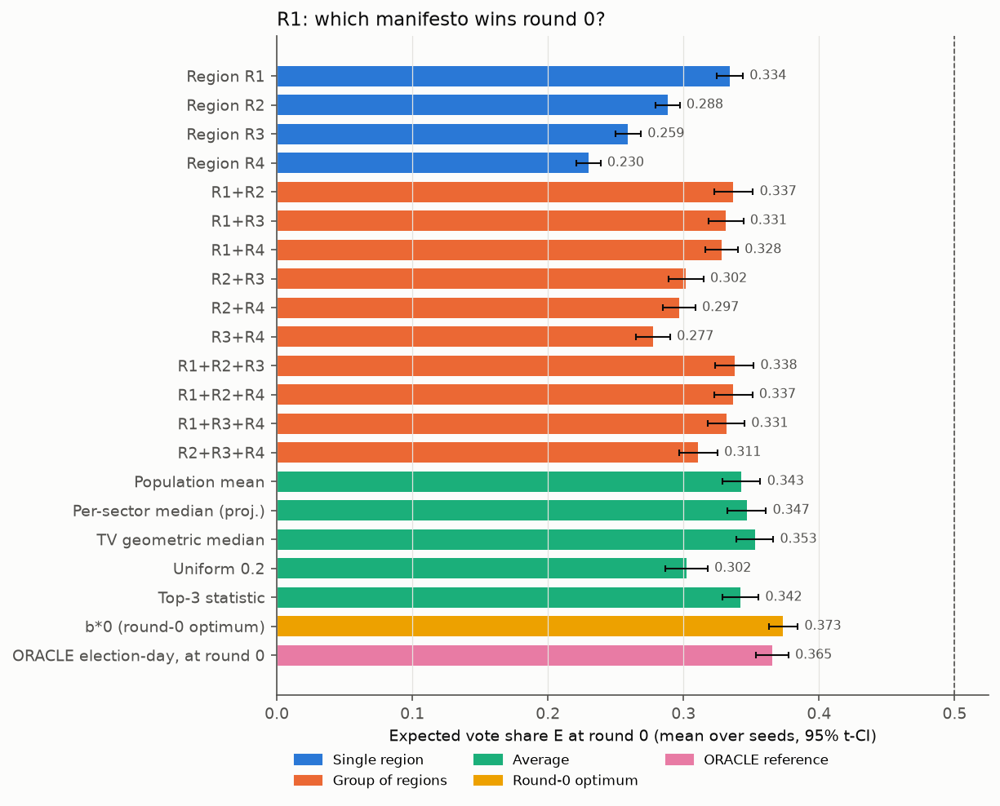

*Figure 1. Vote share of each manifesto at the start, with 95% ranges, grouped by type. No bar reaches 0.50, the
line needed to win.*

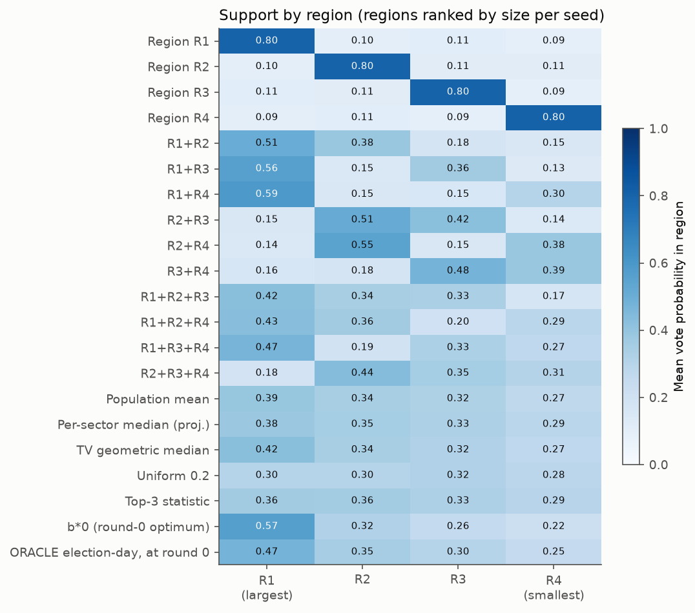

*Figure 2. Support in each region (columns, largest to smallest) under each manifesto (rows). A one-region manifesto
lights up a single column. The best manifesto is strong in the largest region and moderate everywhere else.*

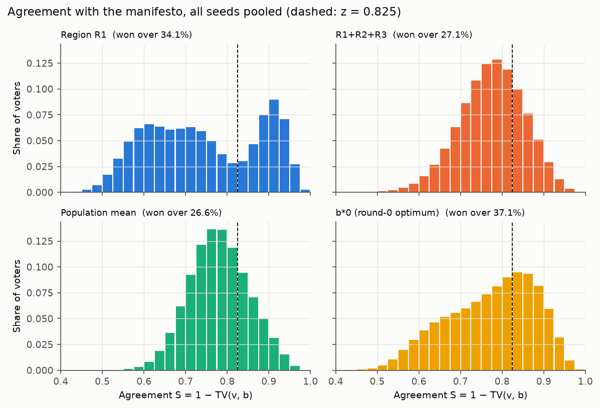

*Figure 3. How close voters are to four manifestos; voters right of the dashed line are won over. A one-region
manifesto splits voters into fans and opponents. The best manifesto puts more voters over the line overall.*

**Divided vs united worlds.**
- A world is **divided** when its two largest regions want clearly different budgets: their archetypes are at least
  0.35 apart. Otherwise it is **united**.
- There were 52 divided and 48 united worlds.

**Table 2. Divided vs united worlds** (votes given away vs the best, per 10,000 voters).

| | Divided | United |
|---|---|---|
| Best possible vote share | 0.340 | 0.409 |
| Blend of the two largest regions | **about 580 given away** | about 140 |
| Largest region only | about 320 | about 480 |
| Best "average"-type manifesto | about 270 | about 100 |

*How to read it:*
- When the two largest regions disagree, even the best manifesto expects about 690 fewer votes.
- Splitting the difference between those two regions becomes the worst group choice: it pleases neither.

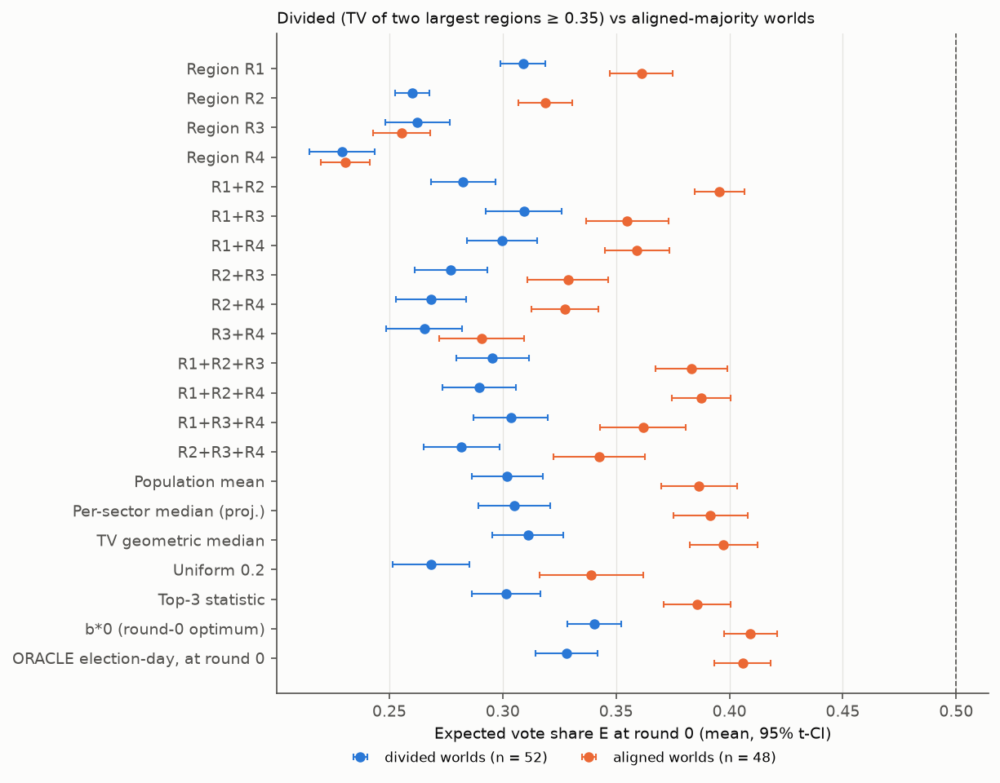

*Figure 4. Vote share of each manifesto in divided and united worlds. Blending the two largest regions works when they
agree and fails when they don't.*

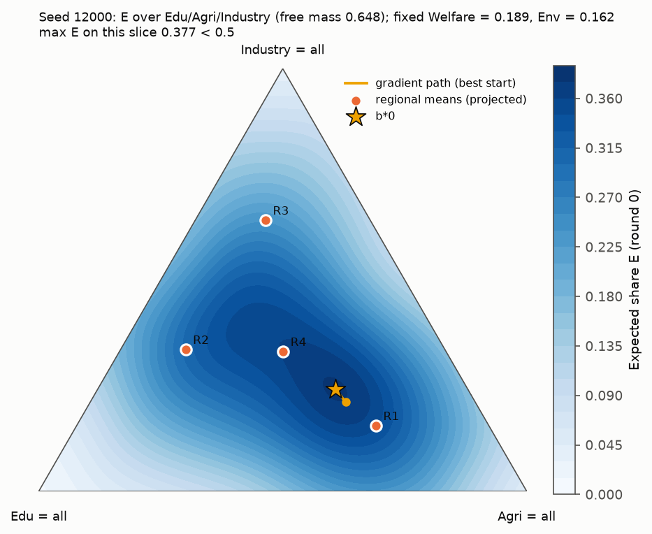

*Figure 5. The vote-share "landscape" of one world. The colour shows the vote share as three of the five sectors vary,
with the other two fixed at their best values. There is a single peak: the best manifesto. The regions' own
preferences sit away from it.*

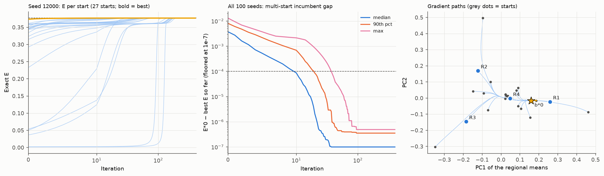

*Figure 6. Climbing to the best manifesto from different starting points. It reaches the peak in about 10 steps
(median), so this is an easy search.*

### Takeaway

- **A manifesto alone cannot win at the start.** The best possible promise reaches about 37% of the vote, and 49% at
  most. The rest must come from opinions changing over time (Q2, Q3) and from campaigning (Q4–Q6).
- **The ideal manifesto is a lopsided compromise.**
  - It wins over about 57% of the largest region and keeps 22–32% support in each of the others.
  - It never tries to please one region completely.
- **Serving one region is the worst approach,** even the largest one: about 400 votes lost.
- **"Aim for the middle" is a fair rule of thumb, but it leaves 200–300 votes behind.** The geometric median is the
  best simple rule.
- **When the two biggest regions disagree, don't split the difference between them.** Build on the largest region and
  add the closest smaller one.
- **Designing for election day costs almost nothing today:** about 80 votes at the start. Q3 shows it pays back quickly.

*Data: study R1. `r1.json`, `raw/r1.jsonl`, `logs/r1.log`; full write-up in [r1.md](r1.md).*

---

## 5. Q2: How do voters' opinions change on their own, with no campaign?

**The question.** If nobody campaigns, how much do opinions drift as voters listen to their friends? Does it matter
that some voters are zealots?

**Why it matters.** The vote happens after 5 rounds. If opinions move during that time, a manifesto should be aimed at
where voters will be, not where they are.

**What we did.**
- 50 worlds, each run twice with no campaign:
  - a **normal** population with no zealots;
  - a population in which **5% are zealots**.
- Everything else was identical: same voters, same friendships, same starting opinions.
- We followed them for 200 rounds, far longer than a game, to see where opinions end up.
- We compared the long run with the theoretical end state. For populations with stubborn voters this is the
  Friedkin–Johnsen model of opinion dynamics.

### What we found

**Table 3. Disagreement over time.** Disagreement is how far, on average, voters are from the population's average
opinion; 0 would mean everyone agrees.

| Round | Normal population | With 5% zealots |
|---|---|---|
| 0 (start) | 0.217 | 0.217 |
| 5 (end of a game) | 0.183 | 0.184 |
| 20 | 0.124 | 0.130 |
| 50 | 0.073 | 0.084 |
| 200 | 0.015 | 0.038 |
| Theoretical end state | 0 (everyone agrees) | **0.028** (disagreement never disappears) |

*How to read it:*
- During a 5-round game, disagreement falls by about 16% and zealots make almost no difference.
- Over a long time the normal population heads to complete agreement, while the zealot population levels off.
- The zealot population had more disagreement in all 50 worlds at every round recorded.

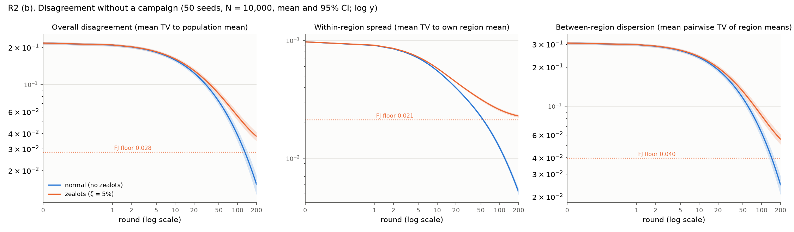

*Figure 7. Three measures over 200 rounds (log scales): overall disagreement, spread inside each region, and distance
between regions. Solid lines: normal; dashed: with zealots; dotted: the theoretical floor with zealots. Without zealots
every measure keeps falling; with zealots they level off.*

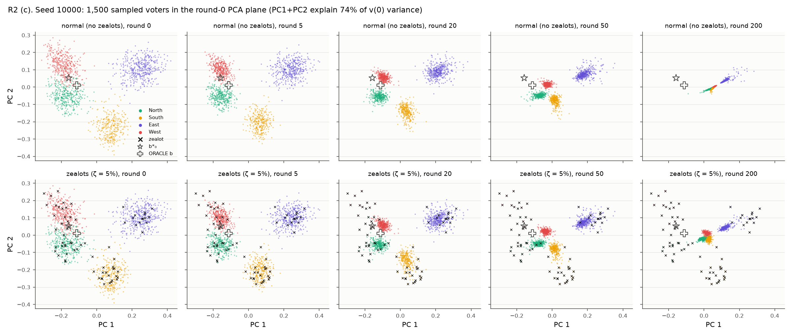

*Figure 8. 1,500 voters of one world, drawn in two dimensions at rounds 0, 5, 20, 50 and 200, coloured by region
(zealots marked ×). Each region first tightens into a cluster, then the clusters slowly move together.*

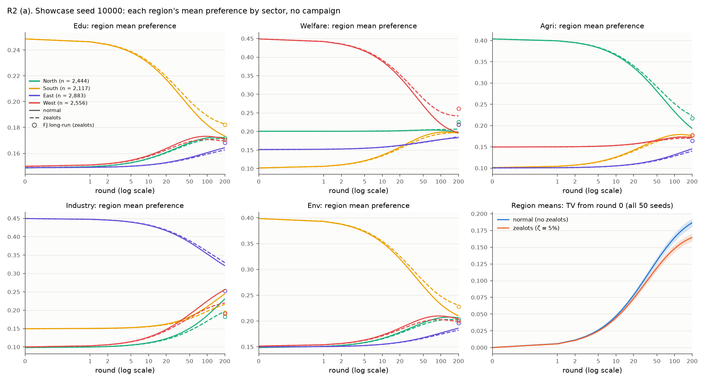

*Figure 9. Each region's average preference for each sector over time, in one world. Regional opinions change slowly.*

**Table 4. Vote share of a fixed manifesto while opinions drift** (no campaign).

| Round | Best manifesto for the start | Election-day manifesto | Election-day manifesto, with zealots |
|---|---|---|---|
| 0 | 0.381 | 0.374 | 0.374 |
| 5 | 0.477 | **0.487** | 0.481 |
| 20 | 0.637 | 0.682 | 0.663 |
| 200 | 0.802 | 0.865 | 0.854 |

*How to read it:*
- With no money spent at all, a fixed manifesto gains about 1,100 votes in five rounds (0.374 → 0.487) just because
  voters drift towards each other.
- These are different worlds from Q1, so the starting values differ slightly.

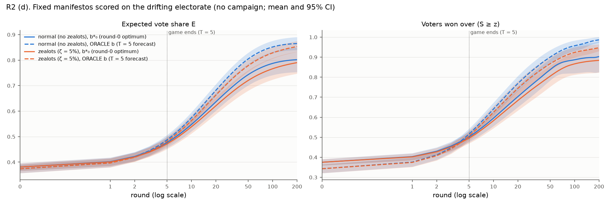

*Figure 10. Vote share of two fixed manifestos as opinions drift. The election-day manifesto overtakes the
best-for-the-start manifesto after about 3 rounds.*

### Takeaway

- **Within a game, opinions change only a little.**
  - The average voter moves about 4 percentage points of budget over 5 rounds.
  - The four regions remain clearly different groups.
- **Drift happens in two stages.**
  1. Each region becomes more uniform: the spread inside regions halves within about 10 rounds.
  2. Regions slowly move towards one another through friendships across region borders.

  The electorate's overall average hardly moves.
- **Without zealots, everyone eventually agrees.** Disagreement halves roughly every 73 rounds.
- **A small share of zealots prevents full agreement.** Disagreement settles at a permanent floor, as theory predicts.
  The effect is tiny within a game but grows over time.
- **Drift helps a central manifesto for free:** about +1,100 votes in five rounds. This is why the manifesto should be
  aimed at election day (Q3).

*Data: study R2. `r2.json`, `raw/r2.jsonl`, `logs/r2.log`; full write-up in [r2.md](r2.md).*

---

## 6. Q3: Does the best manifesto stay the best as opinions change?

**The question.** The manifesto is chosen once, before round 1, but the vote happens after the last round. Q2 showed
that opinions drift in between. So:
- How quickly does the best manifesto change?
- How many votes are lost by keeping a manifesto designed for one moment when the vote happens at another?
- Which round should a manifesto be designed for?

**Why it matters.** This is the most direct test of the game's central design advice: optimise the manifesto for the
electorate expected on election day, not for today's voters.

**What we did.**
- The same 100 worlds as Q1, with 5% zealots (a population without zealots was run for comparison) and no campaign.
- Opinions drifted for 50 rounds.
- At each of rounds 0–10, 20 and 50 we found the **best manifesto for that round** by optimisation (Section 3.1 b).
- We then scored every one of these manifestos at every round. This gives a table of "designed for round s, vote at
  round t".
- The **regret** of a manifesto is the number of votes it gives away, at the moment of voting, against the manifesto
  that is best at that moment.

### What we found

**Table 5. The best achievable vote share keeps rising as voters drift** (average of 100 worlds).

| Round | 0 | 3 | 5 | 10 | 50 |
|---|---|---|---|---|---|
| Best possible vote share at that round | 0.373 | 0.431 | 0.469 | 0.555 | 0.823 |

*How to read it:* with the right manifesto and no campaign at all, expected votes rise from about 3,730 to about
4,690 by the end of a 5-round game.

**Table 6. Votes lost by keeping the manifesto designed for the start** (regret, per 10,000 voters).

| Vote held at round | 3 | 4 | 5 | 10 | 50 |
|---|---|---|---|---|---|
| Votes given away | about 37 | about 64 | **about 99** | about 330 | about 1,280 |

*How to read it:*
- In a 5-round game, a manifesto designed for today's voters gives away about 100 votes [78–120] on election day.
- The loss was positive in all 100 worlds.
- The longer the game, the larger the loss.

**Table 7. Which round to design for, when the game may last 3 to 5 rounds.** The worst-case loss is the largest
loss over the three possible game lengths.

| Manifesto designed for round | 0 | 3 | **4** | 5 |
|---|---|---|---|---|
| Worst-case votes given away (game of 3–5 rounds) | about 99 | about 15 | **about 4** | about 14 |

*How to read it:*
- Designing for the final round (5) or one round earlier (4) loses almost nothing, whatever the actual game length:
  4–15 votes.
- Designing for round 4 is slightly better than round 5, in all 100 worlds.
- Designing for today loses about 25 times as much as designing for round 4.

**How fast the best manifesto moves.**
- On average, the best manifesto's budget changes by about 3 percentage points by round 3 and about 5 by round 5 (TV
  distance 0.032 and 0.047).
- In 31 of 100 worlds it has moved more than 5 points by round 5; in 28 worlds it hardly moves even by round 50.
- The election-day manifesto overtakes the best-for-today manifesto by round 3 in 96 of 100 worlds, and by round 5 in
  all 100.

**Divided vs united worlds.**
- When the two largest regions disagree, the best manifesto moves much more: about 7 points by round 5, against
  about 2.
- Keeping the start-of-game manifesto then costs about 150 votes, against about 40 in united worlds.

**A consistency check.** The benchmark's election-day manifesto (Section 3.1 c) is almost identical to the best
manifesto found at round 5: a difference under 0.4 percentage points, and less than 1 vote apart.

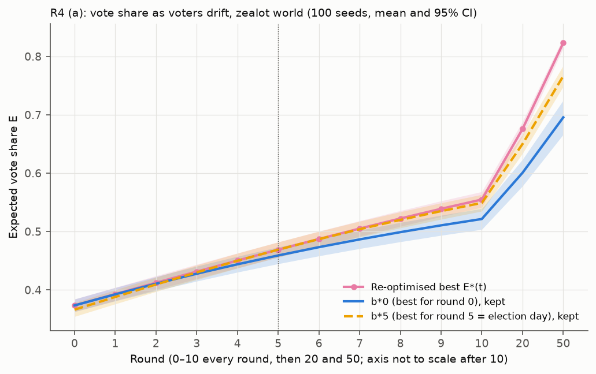

*Figure 11. Vote share over rounds of three manifestos:*
- *the manifesto designed for the start;*
- *the one designed for round 5;*
- *the best one at each round.*

*The start-of-game manifesto falls steadily behind.*

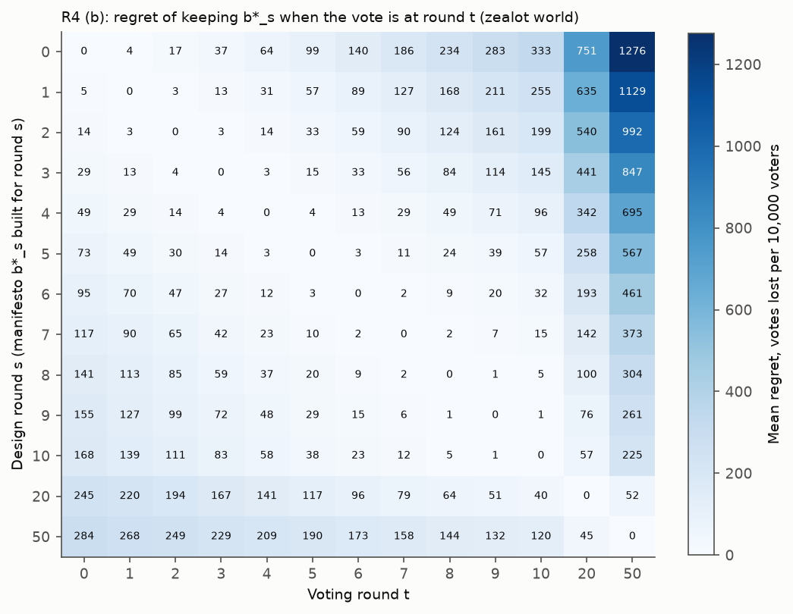

*Figure 12. Votes given away (colour) for each "designed for round" (rows) and "vote held at round" (columns). The
diagonal is zero. Manifestos designed for rounds 3–5 lose little across the whole 3–5 round band. A manifesto
designed for round 0 loses more and more as the vote moves later.*

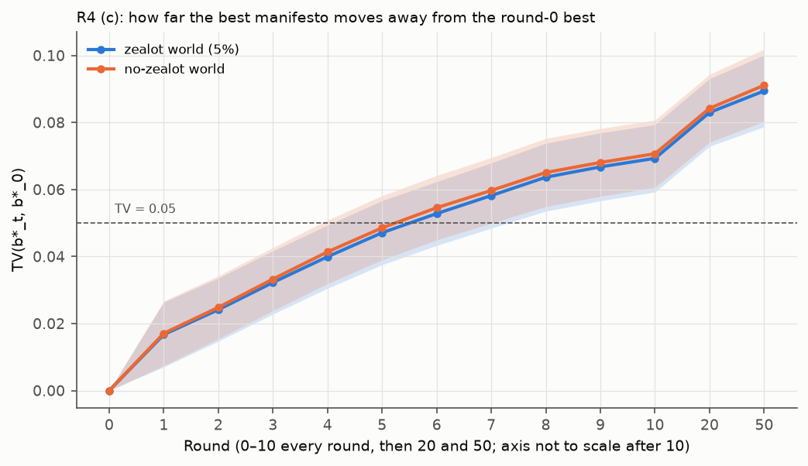

*Figure 13. Distance between the best manifesto at each round and the best manifesto at the start.*

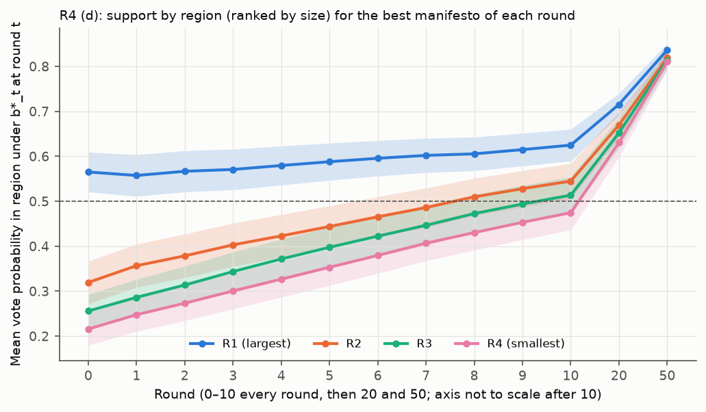

*Figure 14. Support in each region (largest to smallest) under the best manifesto of each round.*

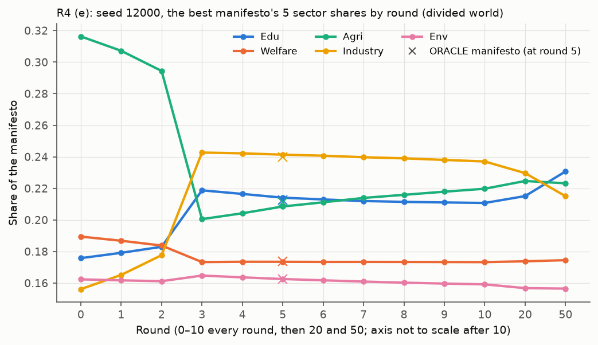

*Figure 15. The best manifesto's five budget shares, round by round, in one world.*

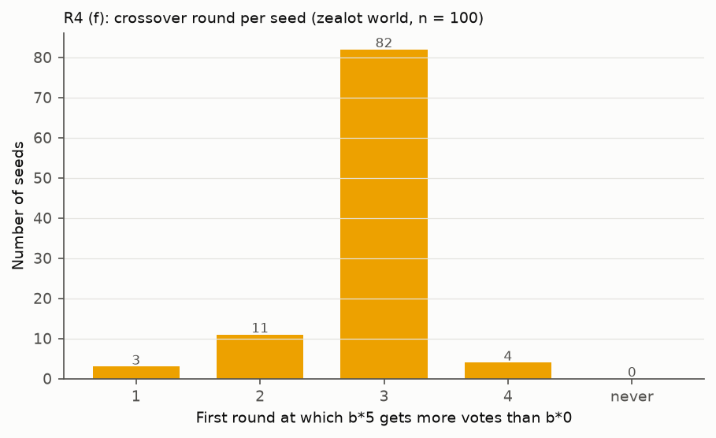

*Figure 16. The round at which the election-day manifesto first beats the best-for-today manifesto, across 100
worlds. Most often this is round 3.*

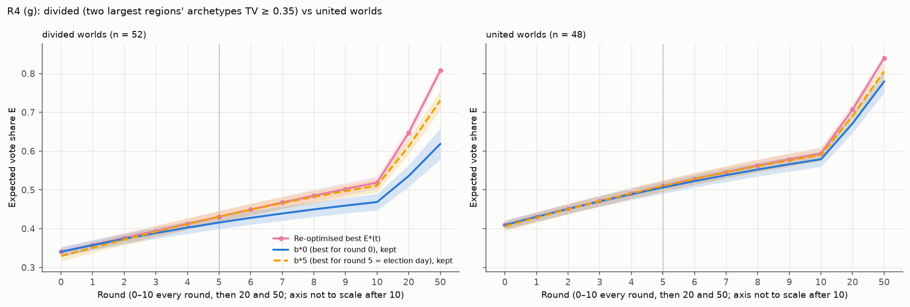

*Figure 17. The same comparison as Figure 11, split into divided and united worlds.*

### Takeaway

- **The best manifesto changes slowly, but the vote happens late, so it is worth anticipating the change.** A
  manifesto designed for today's voters gives away about 100 votes in a 5-round game. A manifesto designed for the
  final rounds gives away almost none.
- **Design for the end of the game, not for today.** For a game of 3–5 rounds, designing for round 4 or round 5 is
  safe whatever the actual length: at most about 15 votes lost.
- **This matters most when the two largest regions disagree.** There the best manifesto moves the most, and keeping
  the start-of-game manifesto costs about 150 votes.
- **This confirms the game's design advice.** It also shows why the benchmark's election-day manifesto, which already
  costs only about 80 votes at the start (Q1), is nearly the best choice throughout the game.

*Data: study R4. `r4.json`, `raw/r4.jsonl`, `logs/r4.log`; full write-up in [r4.md](r4.md).*

---

## 7. Q4: How does influence spread from party workers?

**The question.** When the party buys workers, how far does their persuasion travel through friendships, how much does
it change opinions, and what controls it?

**Why it matters.** Workers are the game's word-of-mouth tool. To use them well a player needs to know when a cascade
spreads, how far it goes, and when extra workers stop helping.

**What we did.** This question is answered by experiments already in our suite, each described below where it is used:
- a cascade experiment that varied how much the target region likes the manifesto;
- a worker-count experiment that bought 1 to 40 workers;
- an experiment that switched the cascade off;
- an experiment that changed the worker rules;
- an experiment that tracked opinions under different campaigns.

### What we found

**When does a cascade spread rather than fizzle out?**
- A cascade keeps growing if, on average, each convert persuades more than one new person. Epidemic theory predicts
  this from one number: the largest eigenvalue of the friendship network, with each voter weighted by their chance of
  converting.
- It predicts growth when that number is above 1. The measured switch point was 0.94, very close to the prediction
  (Figure 18).
- Simpler rules of thumb, such as "number of friends × average chance", put it at about half the true value.

*Meaning:* whether a cascade takes off can be predicted from the network and the manifesto. With the default rules and
a sensible manifesto, cascades take off in every region.

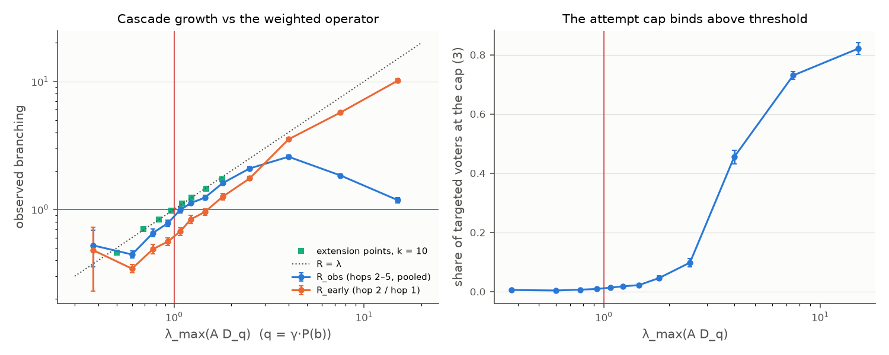

*Figure 18. Growth of the cascade per step against the predicted number. Growth passes 1 (take-off) where the
prediction is close to 1.*

**Table 8. The first workers are worth the most** (all bought in round 1, in one region).

| Workers bought | 1 | 2 | 3 | 5 | 10 | 20 |
|---|---|---|---|---|---|---|
| Votes gained (per 10,000) | about 770 | about 990 | about 1,070 | about 1,160 | about 1,230 | about 1,250 |
| Extra votes from the last worker added | about 770 | about 220 | about 90 | about 30 | about 5 | ≈ 0 |

*How to read it:* one worker already gets about 62% of everything workers can achieve, and five get 93%. Beyond about
five, extra workers add almost nothing.

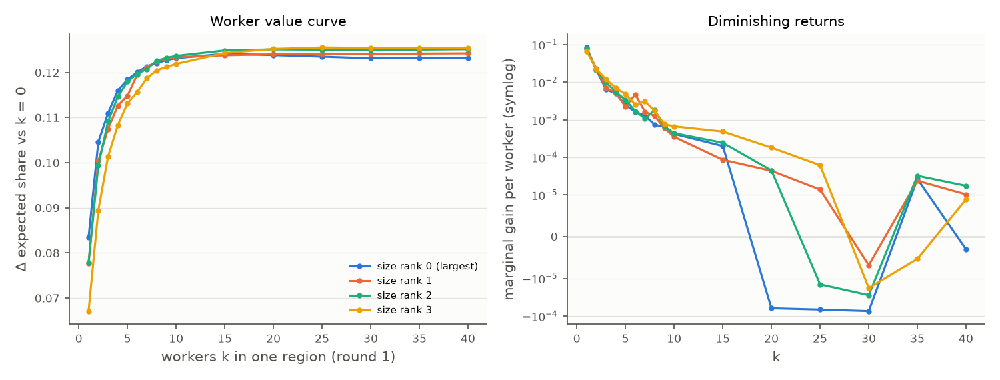

*Figure 19. Votes gained against the number of workers. The curve flattens quickly.*

**Table 9. The cascade is what matters.** Here the cascade was switched off, so workers only influenced their own
friends by holding the manifesto.

| Workers | Votes gained with the cascade | Votes gained without it |
|---|---|---|
| 5 | about 1,210 | about 3 |
| 20 | about 1,250 | about 12 (under 1% of the full effect) |

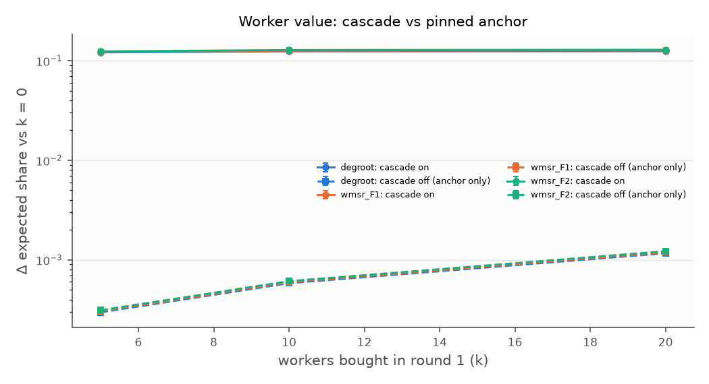

*Figure 20. A worker's own influence is tiny. Almost all of the value comes from the chain of persuasion it starts.*

**Table 10. How well the manifesto suits the targeted region matters** (5 workers in the largest region).

| Manifesto, compared with what the region wants | Voters converted | Converts outside the target region | Votes gained |
|---|---|---|---|
| Far from it | 936 | 85% | about 260 |
| Halfway | 2,630 | 56% | about 1,190 |
| Close, but not exact | 2,965 | 49% | **about 1,200** |
| Exactly what the region wants | 2,763 | 30% | about 750 |

*How to read it:*
- A manifesto that suits the region converts more people there and spills less elsewhere.
- One tailored *exactly* to that region gains less overall, because it alienates everyone else.

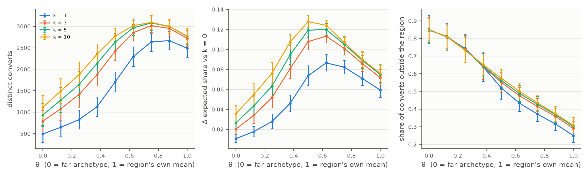

*Figure 21. Conversions, spill-over and votes gained as the manifesto moves closer to the target region's taste.*

**Other observations.**
- **What stops a cascade.** Once a cascade has taken off, 41% of the voters it targets reach the
  "3 approaches" limit, against under 1% when it has not. This limit, and running out of unconverted friends, are
  what stop a cascade.
- **Converts can drift back.** A convert starts with a 97% chance of voting for the party.
  - If their friends like the manifesto, they keep about 96% after five rounds.
  - If their friends dislike it, they fall to about 88%.
- **The rules are the strength dial** (Figure 22):
  - Allowing 1, 3, 5 or unlimited approaches per voter changes the benchmark's vote share from 0.568 to 0.638, 0.680
    and 0.752.
  - If conversion ignored how close voters are to the manifesto, the manifesto would barely matter: its effect would
    fall by about 70%.
- **How much opinions move.**
  - With workers only, average agreement with the manifesto rises from 0.783 to 0.866 in five rounds, and the share
    of voters won over from 34% to 61%.
  - In one example world, under the benchmark's full campaign (workers and media), 2,263 of the 10,000 voters hold
    exactly the party's manifesto after five rounds, against 1 at the start.

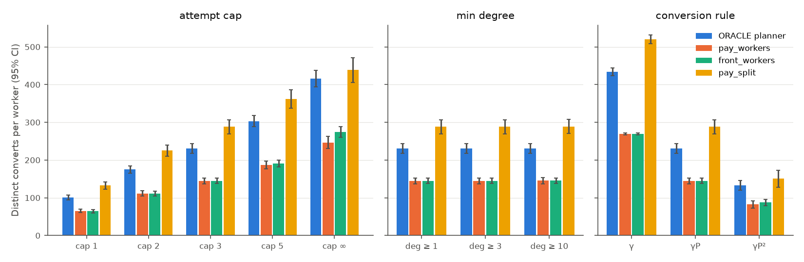

*Figure 22. How far a worker's cascade reaches under different rules. The limit on approaches is the main control on
worker strength.*

### Takeaway

- **A worker's value is the cascade it starts.** On its own, a worker barely moves anyone.
- **Whether a cascade takes off can be predicted,** from the friendship network and the manifesto, as epidemic theory
  suggests.
- **Cascades saturate fast.** The first worker is worth the most; beyond about five per region, extra workers are
  nearly wasted.
- **Cascades cross region borders.** 30–85% of converts live outside the region where the workers were placed. Q5
  shows why this makes placement matter little.
- **The manifesto shapes the cascade.** A manifesto that suits a region converts well there. One tailored exactly to
  that region gains less overall.

*Data: existing experiments on the cascade threshold, the worker value curve, workers without a cascade, rule
variants, and opinions under campaigns. Files are listed in the appendix.*

---

## 8. Q5: Given a fixed number of workers, which regions should they go to?

**The question.** A party has a fixed team of workers. Should they go to the **friendly** region (likes the manifesto
most), the **swing** region (closest to 50–50) or the **hostile** region (likes it least), or be spread out? Does the
answer change when regions are of similar size versus very unequal?

**Why it matters.** Placement is a decision a player makes every game. If it matters little, players can stop
worrying about it.

**What we did.**
- We bought **4 or 10 workers**, all in round 1, with no media, and compared six placements:
  - all in the friendly region;
  - all in the swing region;
  - all in the hostile region;
  - half friendly, half swing;
  - spread evenly over the four regions;
  - spread in proportion to region size.
- 50 worlds for each of three population layouts:
  - **balanced**: regions of similar size, 24–27% of voters each;
  - **default**: 19–33%;
  - **skewed**: 16–40%.

### What we found

**Table 11. Votes gained over no campaign, by placement** (per 10,000 voters; best per column in bold).

| Placement | Balanced, 4 workers | Default, 4 | Skewed, 4 | Balanced, 10 | Default, 10 | Skewed, 10 |
|---|---|---|---|---|---|---|
| All in friendly region | **1,280** | 1,210 | **1,120** | 1,330 | 1,240 | 1,160 |
| All in swing region | 1,220 | 1,160 | 1,080 | 1,320 | 1,240 | 1,150 |
| All in hostile region | 1,210 | *1,070* | *980* | 1,330 | 1,220 | 1,130 |
| Half friendly, half swing | 1,270 | **1,210** | 1,110 | 1,320 | **1,240** | 1,160 |
| Evenly over four regions | 1,270 | 1,180 | 1,100 | **1,340** | 1,240 | **1,160** |
| By region size | 1,270 | 1,180 | 1,110 | **1,340** | 1,240 | 1,160 |

*How to read it:*
- Every placement gains roughly 1,000–1,300 votes.
- The best and worst placements differ by at most about 150 votes with 4 workers, and about 30 with 10.
- With any placement the party won 42–43 of 50 elections, against 16–29 with no campaign.
- Placement never changed who won.

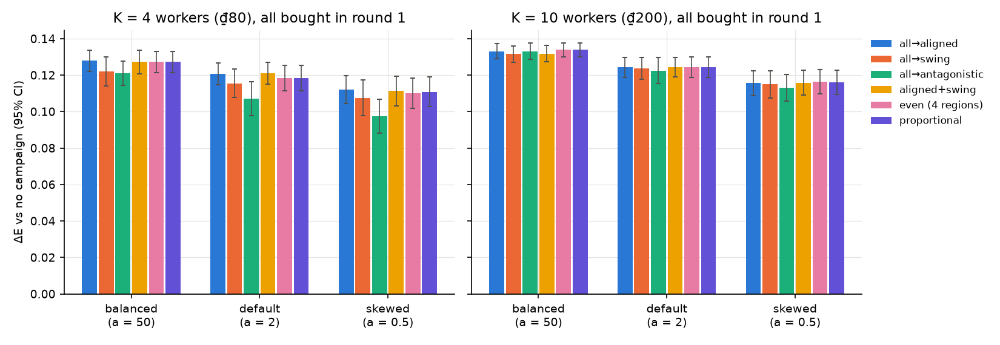

*Figure 23. Votes gained for each placement, layout and team size, with 95% ranges. The bars are of similar height;
only "all in the hostile region" with 4 workers is clearly lower.*

**Table 12. Where the converts end up** (default layout, 4 workers).

| Placement | Converts living outside the targeted region(s) |
|---|---|
| All in friendly region | 56% |
| All in swing region | 70% |
| All in hostile region | 93% |
| Half friendly, half swing | 26% |

*How to read it:* when workers are sent into the hostile region, almost all the people they eventually persuade live
somewhere else. The hostile region itself barely converts.

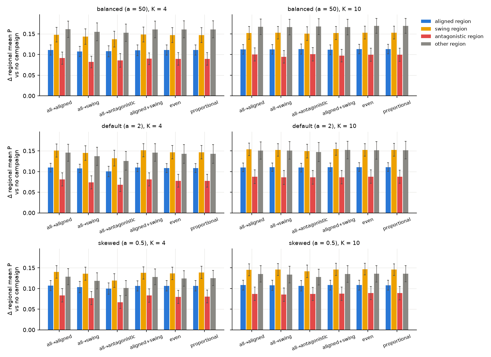

*Figure 24. Change in each region's support for every placement. Support rises in all four regions whichever region
was targeted, including the hostile one.*

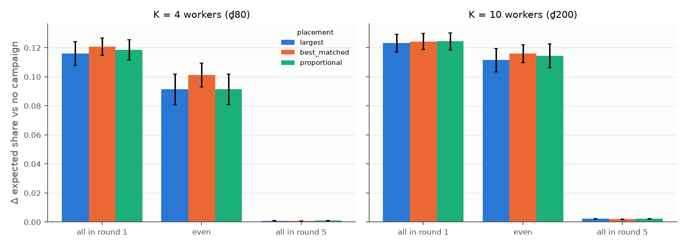

*Figure 25. From an earlier experiment on the same worlds: buying workers in round 1, spread over the game, or in
round 5. The choice of round changes the gain by up to about 1,200 votes. The choice of region changes it by at most
about 100.*

### Takeaway

- **When workers are bought matters far more than where they go.** Buying in round 1 rather than round 5 is worth
  about ten times more than the best placement choice.
- **The one mistake to avoid: a small team in the hostile region.**
  - With 4 workers it costs about 70–150 votes, more when region sizes are unequal.
  - Voters who dislike the manifesto rarely convert, so most of the cascade leaks away into other regions.
- **Hostile regions are won indirectly.** Their support rises about as much when workers go to the friendly region,
  because converts' friendships cross into the hostile region.
- **With a bigger team, placement stops mattering.** With 10 workers every placement is within about 30 votes.
- **Practical rule:**
  - buy all workers in round 1;
  - with a few workers, put them where the manifesto is already liked, or split them between the friendly and swing
    regions;
  - with ten or more, simply spread them out;
  - never send a small team into a hostile region, even if it is the largest.

*Data: study R3. `r3.json`, `raw/r3.jsonl`, `logs/r3.log`; full write-up in [r3.md](r3.md). Timing comparison:
existing timing-and-placement experiment.*

---

## 9. Q6: Media or party workers: where and when should money be spent?

**The question.** How do the two campaign tools compare? How should a budget be divided between them and across the
rounds, and does the answer depend on the kind of election?

**Why it matters.** Spending is most of what a player does during the game.

**What we did.** This question is answered by experiments already in our suite:
- fixed spending patterns at three budgets;
- a head-to-head comparison at equal spend;
- a computer search for the best complete spending plans (with full information), to see what the best campaigns
  look like;
- campaign types side by side;
- sensitivity to prices, electorate size, game length and network density.

### What we found

**Table 13. Win rate of fixed spending patterns** (100 worlds per budget; share of elections won).

| Spending pattern | ₫500 | ₫750 | ₫1000 |
|---|---|---|---|
| No campaign | 44% | 44% | 44% |
| All on media | 70% | 75% | 81% |
| All on workers | 86% | 86% | 87% |
| **Half workers, half media** | **88%** | **88%** | **95%** |
| Full-information benchmark | 94% | 98% | 99% |

*How to read it:* any campaign helps. Media alone is the weakest choice, and mixing the two tools is the best fixed
pattern.

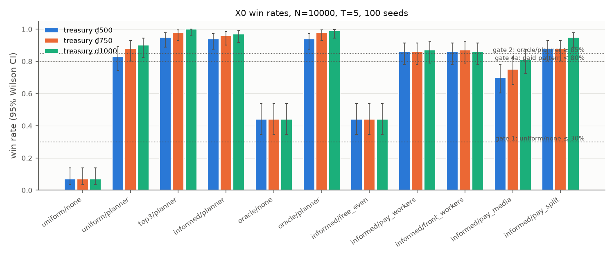

*Figure 26. Win rates of the fixed spending patterns at three budgets.*

**Head to head at equal spend** (about ₫50 of each, in one region):
- Workers gained about 1,040 votes; one media airing gained about 90, roughly 11 times less.
- Using both gave almost exactly the sum. The two tools neither boost nor hinder each other.
- **Order matters.** Workers first, then media, beat the reverse order by about 410 votes, in all 100 worlds. Buying
  workers a round later loses a whole step of the cascade.

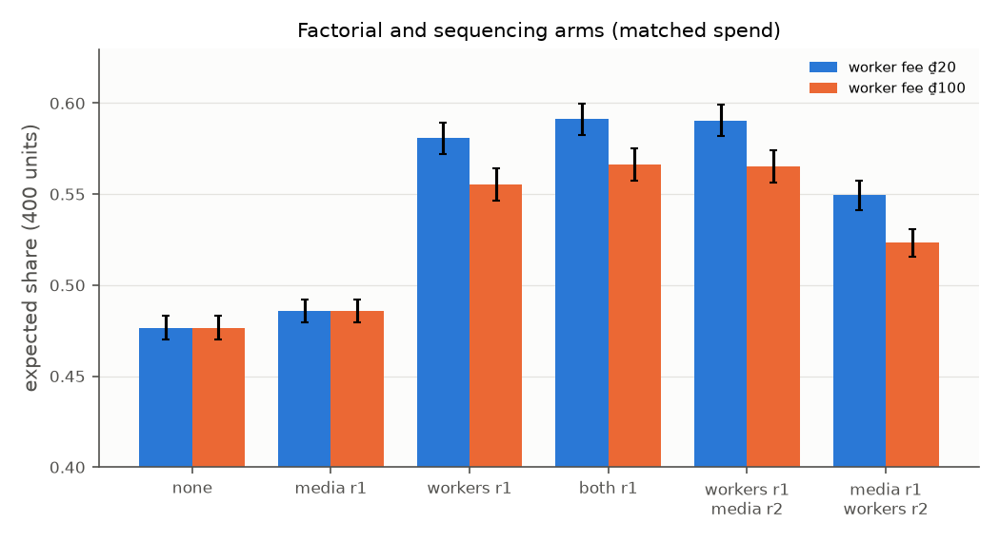

*Figure 27. Buying workers before media beats the reverse order in every world.*

**Table 14. What the best campaigns look like.** A computer search over complete 5-round spending plans (with full
information) compared with the benchmark's simple greedy rule.

| | Best plan found | Greedy benchmark |
|---|---|---|
| Vote share | **0.672** | 0.628 |
| Workers bought | about 3, almost all in round 1 | about 16, spread over rounds 1–3 |
| Share of budget on media | **89%** | 34% |
| Media airings per round (rounds 1→5) | 3.2, 2.8, 2.1, 0.9, 0.3 | 0, 0, 0.05, 1.6, 2.0 |

*How to read it:*
- The best plans gain about 440 more votes than the greedy rule, in all 100 worlds.
- They buy a few workers immediately and then spend heavily on media early, the opposite of the greedy rule.

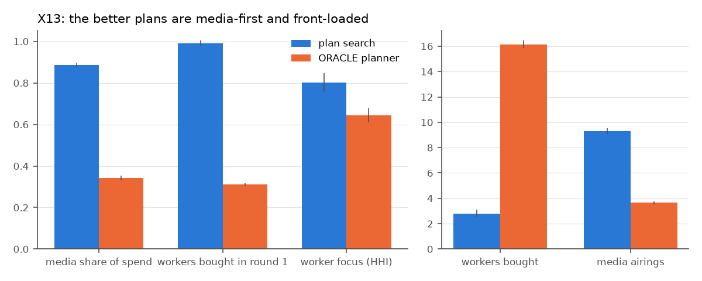

*Figure 28. How the best plans spend, compared with the greedy rule.*

**Table 15. Campaign types side by side** (same 50 worlds, 5 rounds).

| Campaign | Voters won over after 5 rounds | Elections won |
|---|---|---|
| None | 51% | 52% |
| Media only | 57% | 72% |
| Workers only | 61% | 86% |
| Half and half | 64% | 88% |
| Benchmark | 65% | 92% |

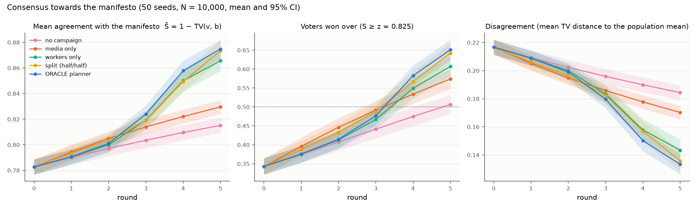

*Figure 29. Agreement with the manifesto, share won over, and disagreement over five rounds for each campaign type.*

**When does the answer change?**
- **Price.** Even at ₫100 per worker (five times the default), all-workers still beats all-media. But the best plans
  then shift more money to media.
- **Electorate size and game length** (Figure 30):
  - With 1,000 voters, workers dominate.
  - With 1,000,000 voters and a short game (3 rounds or fewer), workers are almost worthless: a cascade cannot reach a
    meaningful share of voters in time.
  - With 10 rounds, workers dominate again.
- **Network density.** With about 10 friends per voter instead of 30, media alone is the best pattern in about half
  the worlds. Workers need a well-connected network.

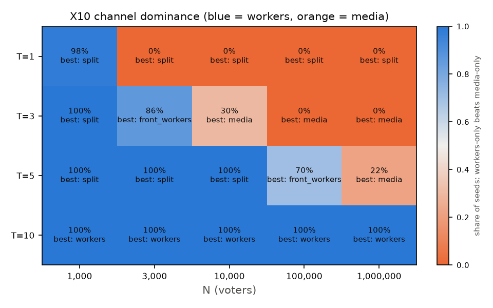

*Figure 30. Which tool wins across electorate sizes (1,000 to 1,000,000 voters) and game lengths (1 to 10 rounds).*

### Takeaway

- **Spend the first money on a few workers.** For a small amount, workers are far more effective than media (about
  11 times).
- **Then switch to early media.** Workers saturate quickly (Q4), so their value per ₫ soon falls below media's.
  - The 5th worker adds about 30 votes for ₫20 (about 1.6 votes per ₫).
  - A first media airing adds about 90 votes for ₫50 (about 1.8 votes per ₫).

  This back-of-envelope comparison combines two experiments. It explains why the best plans buy about three workers
  and then put about 89% of the budget into media.
- **Spend early.** Workers bought late are nearly worthless, and media aired early keeps spreading through
  friendships for the rest of the game. The greedy benchmark's late media is the main reason it falls short.
- **The two tools add up; they don't reinforce each other.** "Half and half" works because it combines the strong
  first few workers with media, not because of a synergy.
- **The best tool depends on the election.**
  - **Workers:** dense networks, small electorates, longer games.
  - **Media:** sparse networks, very large electorates, short games.

*Data: existing experiments on spending patterns, equal-spend comparison, plan search, campaign types, prices,
electorate size and game length, and network structure. Files are listed in the appendix.*

---

## 10. Summary of findings

1. **A manifesto alone cannot win.** At the start, even the best possible manifesto reaches only about 37% of the vote
   (Q1).
2. **The best manifesto is a compromise that leans towards the largest region.** Serving one region, or averaging
   everyone, gives votes away. When the two biggest regions disagree, a blend of those two is the worst choice (Q1).
3. **Opinions drift slowly towards agreement,** which helps a central manifesto: about +1,100 votes in five rounds with
   no spending. Stubborn voters prevent full agreement in the long run (Q2).
4. **Design the manifesto for the end of the game.** Designing for today gives away about 100 votes by election day.
   Designing for round 4 or 5 gives away almost none, for any game of 3–5 rounds (Q3).
5. **Party workers work through cascades** that can be predicted from the network, saturate after a few workers, and
   cross region borders (Q4).
6. **Timing beats placement.** Buy workers in round 1. Where they go hardly matters, except that a small team should
   not go into a hostile region (Q5).
7. **Spend a little on workers, then a lot on early media.** This is what the best campaigns found by search look like
   (Q6).

**Practical guidance for a player:**
1. Design the manifesto for election day.
2. Buy 3–5 workers in round 1 where the manifesto is already liked.
3. Air media in most regions in rounds 1–2.
4. Do not hold money back for the last rounds.

**Implications for the game's design:**
- The limit on approaches per voter is the main control on how strong workers are.
- Making conversion depend on how close voters are to the manifesto is what keeps the manifesto important.
- Electorate size and game length change which tool is best. This is one reason the game limits games to 3–5 rounds.

Ways to turn these findings into a complete strategy are discussed separately in [strategies.md](strategies.md).

## 11. Limitations

- **Synthetic electorates.** The model's settings were chosen to make the game playable, not fitted to real voters.
  Conclusions are about this model.
- **Default settings.** Most results use 10,000 voters, 5 rounds and about 30 friends per voter. Q6 shows that some
  conclusions change in very different settings.
- **Region labels are per world.** "Largest", "friendly" or "hostile" describe a region's role in its own world, not a
  fixed region.
- **Long horizons.** Results beyond 10 rounds (Q2, Q3) describe the model, not actual play, since games last at most
  10 rounds.
- **No campaign in Q1–Q3.** These isolate the manifesto and natural drift. A campaign also moves voters towards the
  manifesto, and choosing the manifesto together with the campaign gained a further ~80 votes (Section 3.1 e).
- **Example figures.** Figures 5, 8, 9 and 15 show one example world.
- **Small subgroups.** A few comparisons are too small to be conclusive, e.g. worlds where the largest region is
  hostile (7 worlds).
- **Back-of-envelope comparison.** The per-₫ comparison in Q6 combines two experiments and is indicative, not a
  separate measurement.

---

## Appendix: data, logs and reproducibility

**Studies run for this section** (results in this folder):

| Study | Question | Worlds | Data | Log | Full write-up |
|---|---|---|---|---|---|
| R1 | Q1: manifestos at the start | 100 | [r1.json](r1.json), [raw/r1.jsonl](raw/r1.jsonl) | [logs/r1.log](logs/r1.log) | [r1.md](r1.md) |
| R2 | Q2: drift with and without zealots | 50 × 2 | [r2.json](r2.json), [raw/r2.jsonl](raw/r2.jsonl) | [logs/r2.log](logs/r2.log) | [r2.md](r2.md) |
| R4 | Q3: does the best manifesto stay the best | 100 × 2 | [r4.json](r4.json), [raw/r4.jsonl](raw/r4.jsonl) | [logs/r4.log](logs/r4.log) | [r4.md](r4.md) |
| R3 | Q5: placing a fixed team of workers | 50 per placement × 3 layouts | [r3.json](r3.json), [raw/r3.jsonl](raw/r3.jsonl) | [logs/r3.log](logs/r3.log) | [r3.md](r3.md) |

**Existing experiments used** (from the main experiment suite, [`../report.md`](../report.md)):

| ID | Used in | What it does | Data | Log | Write-up |
|---|---|---|---|---|---|
| X19 | Section 3 | Compares four optimisation methods and manifesto shapes on the election-day electorate | [x19.json](../x19.json) | [x19.log](../logs/x19.log) | [x19.md](../sections/x19.md) |
| X12 | Section 3 | Chooses the manifesto together with the campaign | [x12.json](../x12.json) | [x12.log](../logs/x12.log) | [x12.md](../sections/x12.md) |
| X6 | Section 3 | Plays every player type on the same 100 worlds (strategy tournament) | [x6.json](../x6.json) | [x6.log](../logs/x6.log) | [x6.md](../sections/x6.md) |
| XC | Q2, Q4, Q6 | Tracks opinions under five campaign types | [x_consensus.json](../x_consensus.json) | [x_consensus.log](../logs/x_consensus.log) | [report.md](../report.md) |
| X1 | Q2, Q6 | Varies network density and cross-region ties | [x1.json](../x1.json) | [x1.log](../logs/x1.log) | [x1.md](../sections/x1.md) |
| X2 | Q4 | Compares workers with and without the cascade; zealots | [x2.json](../x2.json) | [x2.log](../logs/x2.log) | [x2.md](../sections/x2.md) |
| X3 | Q4 | Measures cascade take-off, reach and spill-over | [x3.json](../x3.json) | [x3.log](../logs/x3.log) | [x3.md](../sections/x3.md) |
| X18 | Q4 | Measures the value of each additional worker | [x18.json](../x18.json) | [x18.log](../logs/x18.log) | [x18.md](../sections/x18.md) |
| X23 | Q4 | Tests variants of the worker rules | [x23.json](../x23.json) | [x23.log](../logs/x23.log) | [x23.md](../sections/x23.md) |
| X4 | Q5 | Compares worker timing with worker placement | [x4.json](../x4.json) | [x4.log](../logs/x4.log) | [x4.md](../sections/x4.md) |
| X0 | Q6 | Plays fixed spending patterns at three budgets | [x0.json](../x0.json) | [x0.log](../logs/x0.log) | [x0.md](../sections/x0.md) |
| X11 | Q6 | Compares workers and media at equal spend, and their order | [x11.json](../x11.json) | [x11.log](../logs/x11.log) | [x11.md](../sections/x11.md) |
| X13 | Q6 | Searches for the best complete spending plans | [x13.json](../x13.json) | [x13.log](../logs/x13.log) | [x13.md](../sections/x13.md) |
| X7 | Q6 | Varies worker and survey prices | [x7.json](../x7.json) | [x7.log](../logs/x7.log) | [x7.md](../sections/x7.md) |
| X10 | Q6 | Varies electorate size and game length | [x10.json](../x10.json) | [x10.log](../logs/x10.log) | [x10.md](../sections/x10.md) |

**Commands for the four new studies:**

```bash
OMP_NUM_THREADS=4 python experiments/r1_manifesto_round0.py --seeds 100 --first-seed 12000 --device cuda:2
OMP_NUM_THREADS=4 python experiments/r2_drift_no_campaign.py --seeds 50 --first-seed 10000 --rounds 200 --device cuda:2
OMP_NUM_THREADS=4 python experiments/r4_best_over_time.py --seeds 100 --first-seed 12000 --device cuda:2
OMP_NUM_THREADS=4 python experiments/r3_worker_assignment.py --seeds 50 --first-seed 11000 --device cuda:0
# add --plot-only to redraw the figures from the saved data
python -m pytest -q tests/unit/test_r1_manifesto_round0.py tests/unit/test_r2_drift.py \
  tests/unit/test_r3_worker_assignment.py tests/unit/test_r4_best_over_time.py
```

The command for each existing experiment is at the end of its write-up in [`../sections/`](../sections/).
