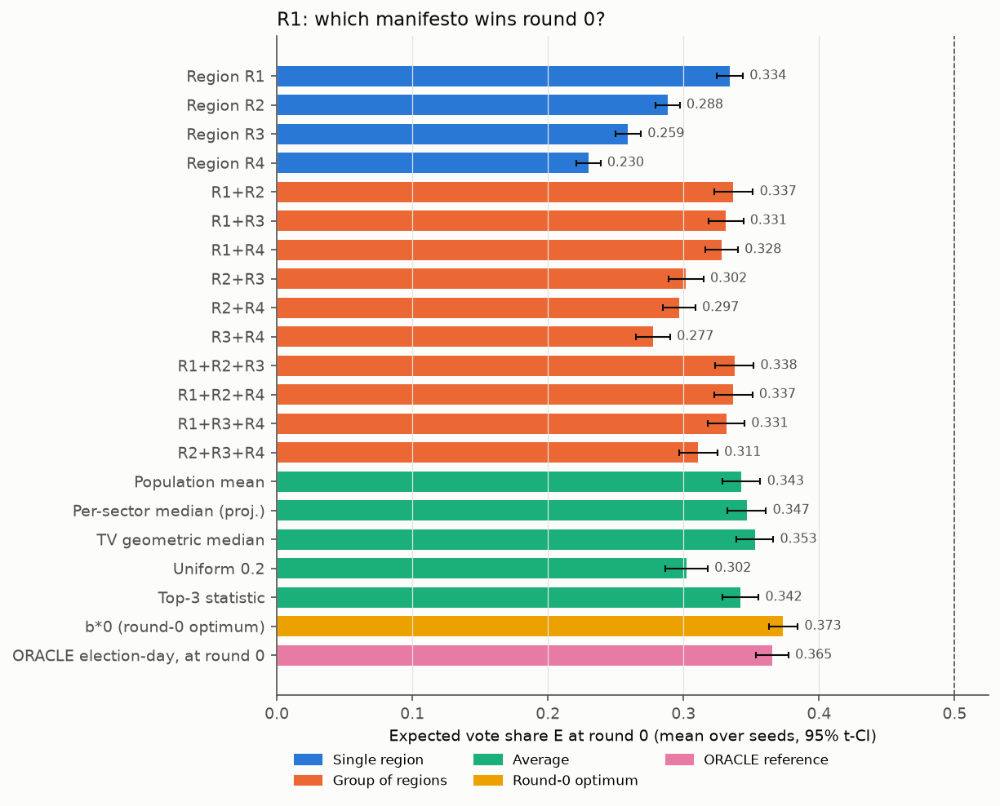
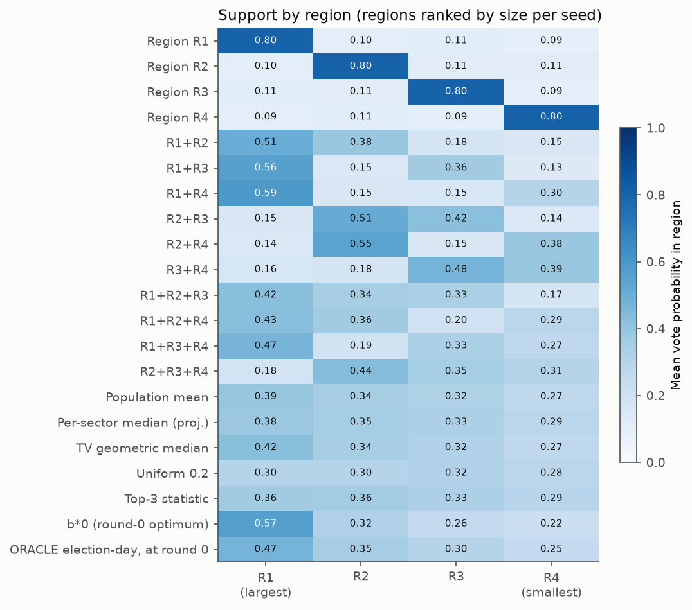
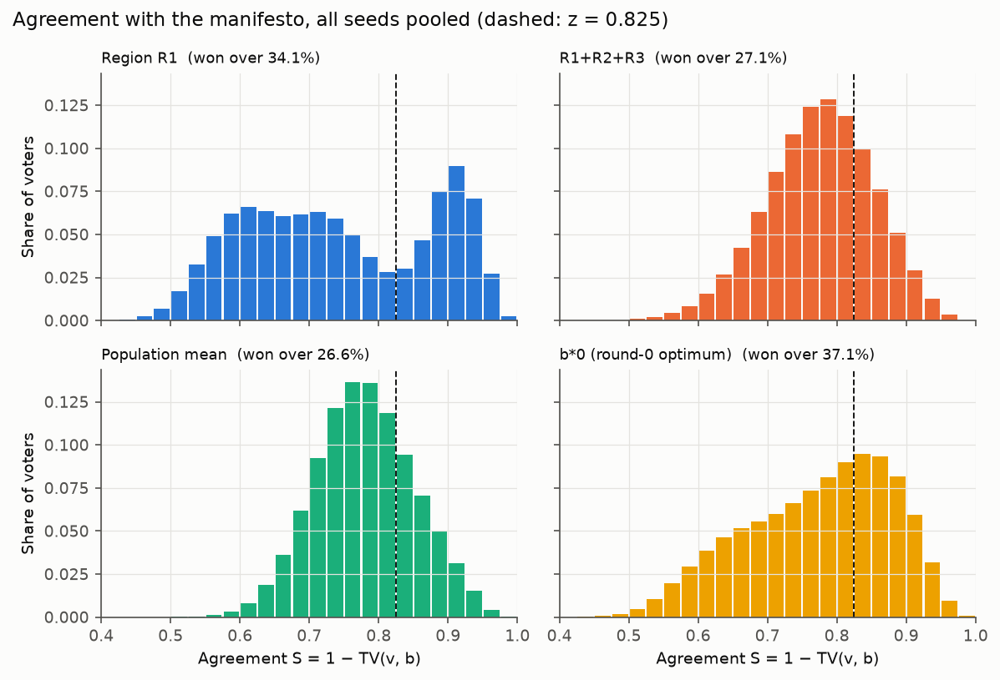
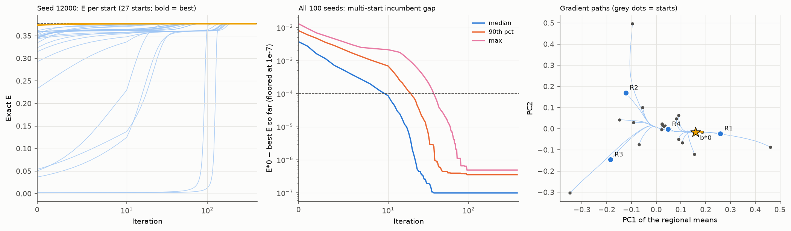
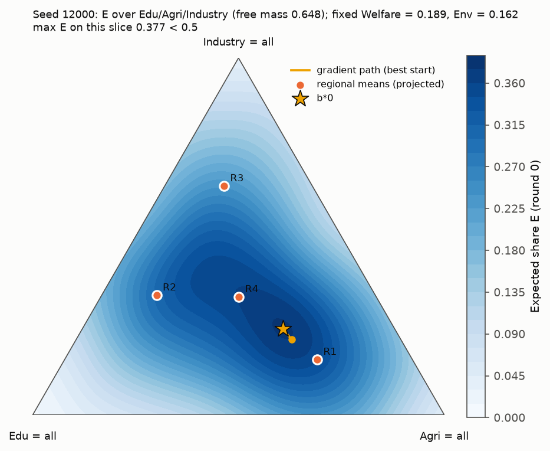
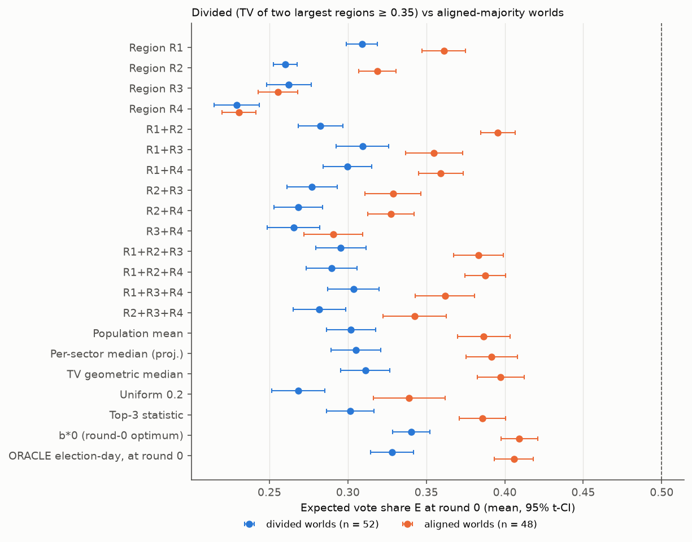

# R1 — Round-0 manifesto atlas

## Question

What does the ideal manifesto look like on the **initial electorate**? There is no campaign and no social drift.

We compare manifestos that serve:

- a single region;
- a group of regions;
- an average of the electorate;

with the round-0 optimum b\*0, found by projected gradient ascent on the known preferences v(0).

We also score the ORACLE election-day manifesto at round 0. This shows what aiming at election day costs today.

Every number below comes from `reports/v3/experimentation/r1.json`. The JSON key is given in brackets. Per-seed
counts come from `raw/r1.jsonl` and are marked as such.

## Setup

- **Seeds:** 12000–12099 (100 seeds). These are the same worlds as X19.
- **Electorate:** N = 10,000 and default `GameConfig`: β_v = 20, z = 0.825, zealots 5%. Zealots vote like everyone
  else.
- **Preferences:** we use only v(0) = `electorate.preferences`, from the canonical CPU draw, moved to cuda:2.
- **Region names:** regions are named by size rank within each seed: R1 is the largest and R4 the smallest. The
  compass letters mean nothing across seeds.
  - The largest region holds 33.4% of voters on average (`overall.manifestos.single_R1.coalition_voter_share`).
  - It never holds a majority (0/100).
- **Manifestos per seed (21):**
  - **single:** each region's mean preference (4).
  - **group:** every 2- and 3-region size-weighted blend of the regional means (6 + 4). A blend is flagged when its
    regions hold more than 50% of voters.
  - **average:** five rules.
    - the population mean (= the 4-region blend);
    - the per-sector median, projected to the simplex;
    - the L1/TV geometric median (X19's Weiszfeld iteration);
    - uniform 0.2;
    - `top3_manifesto(v0)`.
  - **optimum b\*0:**
    - Projected gradient with the same update as `optimise_manifesto`: step 0.02, pseudo-Huber δ = 1e-3, ≤ 400
      iterations.
    - It runs from 27 starts: the library's 7 default starts, top-3, and the 19 manifestos above.
    - b\*0 is the best **exact** E over every iterate.
  - **reference:** `oracle_manifesto(electorate, config)`, optimised on the 5-round social-drift forecast, scored at
    round 0.
- **Metrics:**
  - E;
  - the share "won over" (S ≥ 0.825);
  - mean P per region;
  - regions carried (regional mean P > 0.5) and the voter share they hold;
  - the TV distance to b\*0;
  - a 40-bin histogram of S.
- **Statistics:**
  - Means come with 95% t-CIs and rates with Wilson CIs.
  - Each manifesto is compared with b\*0 by a paired Wilcoxon test, with Holm correction within the family of 20.
  - The divided and aligned groups are compared by Mann–Whitney, with Holm correction.
- **Scenario split:** we measure the TV between the archetype means of the two largest regions.
  - A world is **divided** when it is ≥ 0.35: 52 seeds.
  - It is **aligned-majority** when it is < 0.35: 48 seeds (`scenario_counts`).
- **Compute:**
  - Device: cuda:2 (RTX A5000), as requested.
  - Wall time: 139.9 s (`provenance.compute.wall_seconds`).
  - Peak allocated memory: 0.62 GB (`peak_bytes` = 617,443,328).
  - Mean GPU utilisation: 17%.
  - PG and scoring ran in 4 batches of 25 seeds × 27 starts × 10,000 voters. That step took 15.3 s
    (`timing.batched_pg_and_scoring_seconds`).
  - The remaining 109 s was per-seed preparation (`timing.prepare_seconds`): the canonical CPU electorate draw, the
    ORACLE forecast and a library PG cross-check.
- **CPU↔GPU parity (seeds 12000–12002, `provenance.parity`):** passed.
  - Every metric agrees within 4e-6. The worst is TV(mean, b\*0) at 3.8e-6; E(b\*0) differs by 1e-8.
  - The agreement is this close because the electorate draw is canonical on the CPU, so only float order differs.
- **Library cross-check:** b\*0 is never below the library's `optimise_manifesto` (7 starts).
  - The largest value of (library − b\*0) is −1.5e-7 (`optimum.library_check`).
- **Deviations:** none from the brief.
  - Note: the ternary landscape (Figure e) is a 2-D slice through b\*0, not the full simplex.

## Results

### Expected share by manifesto (`overall.manifestos.<name>`; Δ = paired E − E(b\*0), `gap_vs_bstar0`)

| Manifesto | E mean [95% CI] | won over | regions carried (voter share) | TV to b\*0 | Δ vs b\*0 [95% CI] |
|---|---|---|---|---|---|
| Region R1 (largest) | 0.334 [0.324, 0.344] | 0.341 | 1.00 (0.334) | 0.127 | −0.040 [−0.045, −0.034] |
| Region R2 | 0.288 [0.279, 0.297] | 0.275 | 1.00 (0.261) | 0.221 | −0.085 [−0.094, −0.077] |
| Region R3 | 0.259 [0.250, 0.269] | 0.236 | 1.00 (0.219) | 0.239 | −0.114 [−0.125, −0.104] |
| Region R4 | 0.230 [0.221, 0.239] | 0.201 | 1.00 (0.186) | 0.253 | −0.144 [−0.155, −0.132] |
| R1+R2 | 0.337 [0.322, 0.351] | 0.293 | 0.93 (0.276) | 0.094 | −0.037 [−0.042, −0.031] |
| R1+R3 | 0.331 [0.318, 0.344] | 0.303 | 0.87 (0.270) | 0.107 | −0.042 [−0.049, −0.036] |
| R1+R4 | 0.328 [0.316, 0.340] | 0.303 | 1.02 (0.328) | 0.110 | −0.045 [−0.050, −0.041] |
| R2+R3 | 0.302 [0.289, 0.315] | 0.257 | 1.10 (0.274) | 0.177 | −0.072 [−0.080, −0.064] |
| R2+R4 | 0.297 [0.285, 0.309] | 0.257 | 1.01 (0.250) | 0.186 | −0.077 [−0.086, −0.068] |
| R3+R4 | 0.278 [0.265, 0.290] | 0.219 | 0.95 (0.209) | 0.194 | −0.096 [−0.105, −0.087] |
| R1+R2+R3 | 0.338 [0.324, 0.352] | 0.271 | 0.66 (0.179) | 0.093 | −0.036 [−0.041, −0.031] |
| R1+R2+R4 | 0.337 [0.322, 0.351] | 0.274 | 0.78 (0.218) | 0.096 | −0.037 [−0.042, −0.032] |
| R1+R3+R4 | 0.332 [0.318, 0.345] | 0.275 | 0.77 (0.219) | 0.101 | −0.042 [−0.047, −0.037] |
| R2+R3+R4 | 0.311 [0.297, 0.325] | 0.246 | 0.77 (0.196) | 0.155 | −0.063 [−0.071, −0.054] |
| Population mean | 0.343 [0.329, 0.357] | 0.266 | 0.62 (0.161) | 0.091 | −0.031 [−0.035, −0.026] |
| Per-sector median (proj.) | 0.347 [0.333, 0.361] | 0.274 | 0.63 (0.164) | 0.089 | −0.027 [−0.031, −0.022] |
| TV geometric median | 0.353 [0.339, 0.366] | 0.291 | 0.74 (0.203) | 0.076 | −0.021 [−0.025, −0.017] |
| Uniform 0.2 | 0.302 [0.287, 0.318] | 0.211 | 0.59 (0.149) | 0.141 | −0.071 [−0.080, −0.062] |
| Top-3 statistic | 0.342 [0.329, 0.355] | 0.279 | 0.63 (0.165) | 0.096 | −0.032 [−0.036, −0.027] |
| **b\*0 (round-0 optimum)** | **0.373 [0.363, 0.384]** | **0.371** | **1.31 (0.392)** | 0 | — |
| ORACLE election-day, at round 0 | 0.365 [0.354, 0.377] | 0.331 | 1.06 (0.303) | 0.050 | −0.008 [−0.010, −0.006] |

- b\*0 beats every other manifesto on all 100 seeds (`a_better` = 0 for all 20).
- Every Δ has Holm p ≤ 8e-17.
- **No manifesto wins round 0 on its own.** E > 0.5 happens on 0/100 seeds for every manifesto, b\*0 included.
  - The Wilson CI of that rate is [0, 0.037] (`win_alone_rate`).
  - E\*0 ranges from 0.249 to 0.487 (raw/r1.jsonl).

### Best of each family per seed (`overall.derived`)

| Family (best member per seed) | E [95% CI] | Δ vs b\*0 [95% CI] | most often best |
|---|---|---|---|
| best single region | 0.343 [0.334, 0.353] | −0.031 [−0.034, −0.026] | R1 on 67/100 |
| best group | 0.365 [0.354, 0.376] | −0.008 [−0.010, −0.007] | R1+R2 24, R1+R3 21 |
| best group holding > 50% of voters | 0.364 [0.353, 0.376] | −0.009 [−0.010, −0.008] | — |
| best average | 0.354 [0.341, 0.368] | −0.019 [−0.022, −0.016] | geometric median 59 |

All four have Holm p = 1.6e-17.

### The optimum b\*0 (`optimum`)

- **E\*0:** 0.373 [0.363, 0.384]. It wins over 37.1% of voters [36.0, 38.2].
- **Regions carried:** 1.31 [1.22, 1.40] regions, holding 39.2% of voters [36.8, 41.6].
  - It carries exactly 1 region on 69 seeds and 2 on 31 (raw/r1.jsonl).
  - The largest region is among those carried on 76/100 seeds (raw/r1.jsonl).
  - The carried regions hold a majority on 25/100 seeds (`carries_majority_of_voters_rate`).
- **Support profile:** R1 0.57, R2 0.32, R3 0.26, R4 0.22 (`support_by_rank`).
  - b\*0 leans towards the largest region but keeps every other region near 0.2–0.3.
- **Convergence:** the multi-start incumbent reaches E\*0 − 1e-4 after a median of 10 iterations (IQR 8–15, max 37).
  All 100 seeds reach it (`iterations_to_tol`).
- **Local optima:** there are 1.36 [1.25, 1.47] distinct end points per seed, and more than one on 33/100 seeds
  (`seeds_with_more_than_one_endpoint`).
- **The 19 variant starts add nothing:** the gain over the 8 standard starts is 4.9e-7 on average and never > 1e-4
  (0/100, `variant_starts_gain_gt_tol_rate`).
- **ORACLE manifesto:** it lies at TV 0.050 from b\*0 and costs 0.008 E at round 0. That is "what aiming at election
  day costs today": small, but it occurs on every seed.

### Divided vs aligned-majority worlds (`scenario_split`)

| | divided (n = 52) | aligned (n = 48) |
|---|---|---|
| E\*0 | 0.340 [0.328, 0.352] | 0.409 [0.398, 0.421] |
| population mean | 0.302 [0.286, 0.318] | 0.387 [0.370, 0.403] |
| TV geometric median | 0.311 [0.296, 0.327] | 0.397 [0.383, 0.412] |
| Region R1 alone | 0.309 [0.299, 0.319] | 0.361 [0.347, 0.375] |
| R1+R2 blend | 0.283 [0.268, 0.297] | 0.396 [0.385, 0.407] |
| best single (Δ vs b\*0) | −0.025 [−0.029, −0.020] | −0.037 [−0.043, −0.031] |
| best group (Δ) | −0.009 [−0.011, −0.007] | −0.008 [−0.010, −0.007] |
| best average (Δ) | −0.027 [−0.032, −0.022] | −0.010 [−0.014, −0.007] |
| ORACLE at round 0 (Δ) | −0.012 [−0.015, −0.009] | −0.0035 [−0.0046, −0.0025] |
| TV(mean, b\*0) | 0.119 [0.107, 0.131] | 0.060 [0.050, 0.071] |

- **E\*0 by world type:** 0.069 lower in divided worlds (Mann–Whitney p = 8.7e-11, `E_star_divided_vs_aligned`).
- **Gaps that differ by world type** (`gap_between_scenarios`, Holm):
  - **R1+R2 blend:** −0.058 divided vs −0.014 aligned (p = 2e-15). Blending two regions that disagree is the worst
    group choice.
  - **Population mean:** −0.038 vs −0.023 (p = 1e-3).
  - **Geometric median:** −0.029 vs −0.012 (p = 3e-6).
  - **ORACLE:** −0.012 vs −0.004 (p = 1e-6).
  - **Region R1 alone:** −0.032 vs −0.048 (p = 0.03). Serving only the largest region is *relatively* less bad when
    the world is divided.
- **Best group in divided worlds:** it is R1+R3 (19) or R1+R4 (12) (`scenario_split.divided.derived.best_group.which`).
  It is never R1+R2.
- **Best group in aligned worlds:** it is R1+R2 (24) or a triple containing R1 and R2 (21).

## Figures

- (a) Mean E per manifesto with 95% CIs, coloured by family: 
- (b) Mean vote probability per region (ranked by size) for each manifesto:
  
- (c) Agreement histograms, all seeds pooled: largest region, best group (R1+R2+R3), population mean and b\*0. The
  dashed line is z. 
- (d) Gradient ascent.
  - Left: E per start on seed 12000 (27 starts).
  - Middle: the multi-start incumbent gap E\*0 − best-so-far over all 100 seeds (median, 90th percentile, max).
  - Right: all paths on seed 12000, projected onto the first two principal axes of the regional means.
  
- (e) The landscape on seed 12000.
  - It shows E over Edu/Agri/Industry, the three sectors with the largest variance across regional means.
  - Welfare = 0.189 and Env = 0.162 are fixed at their b\*0 values.
  - The grid maximum, 0.3768, matches E\*0 = 0.3768 (`showcase.landscape.grid_max_E`).
  - The plot shows the regional means (projected), b\*0 and the best start's path.
  
- (f) Mean E per manifesto in divided vs aligned-majority worlds: 

## What it shows

1. **At round 0 nobody can win on a manifesto alone.**
   - The best possible static platform, with full knowledge of every voter's preferences, gets 37% of the expected
     vote on average.
   - It never gets more than 49%; E > 0.5 on 0/100 seeds.
   - The gap to a majority must come from the campaign and from drift. Compare X19: on the *anticipated* election-day
     electorate the same worlds give E\* = 0.469. Drift concentrates preferences.
2. **The optimum is a lopsided compromise, not a coalition platform.**
   - b\*0 wins about 57% of the largest region and keeps 22–32% of each of the others.
   - It carries 1 region on 69 seeds and 2 on 31; it never carries 3 or 4.
   - The carried regions hold a majority on only 25 seeds.
   - Its pull towards R1 is why it beats the symmetric averages, and its spread is why it beats R1's own platform.
3. **Pandering to one region is the worst family.** Serving only the largest region costs 0.040 E.
   - Serving a smaller region costs 0.085–0.144 E.
   - It does have the most polarised agreement: the bimodal histogram in Figure (c).
4. **Simple averages are decent but leave about 0.02–0.03 E on the table.**
   - The TV geometric median is the best rule of thumb (−0.021). This agrees with X19.
   - The uniform 0.2 manifesto is poor (−0.071).
   - Per-seed, the *best* group blend is within 0.008 of b\*0. But which group is best changes from seed to seed, so
     a fixed blend rule does worse (−0.036 at best, R1+R2+R3).
5. **The kind of world matters.**
   - In **aligned-majority** worlds the average-style manifestos and the R1+R2 blend are within about 0.01–0.02 of
     b\*0. Here "speak to the middle" works.
   - In **divided** worlds the optimum is 0.07 E lower. Averages lose 0.03–0.04, and blending the two big regions
     (−0.058) is worse than serving the largest region alone (−0.032).
   - **Advice:** when the two largest regions disagree, anchor on the largest region and add the closest *small*
     region (R1+R3 or R1+R4). Do not split the difference between the two giants.
6. **Optimising for election day costs little today.** The ORACLE manifesto loses only 0.008 E at round 0
   (0.012 in divided worlds).
   - A player who plans for drift is nearly optimal at round 0 too. This is a negative result for any "round-0
     versus election-day" dilemma.
7. **Optimisation is easy at round 0 as well.**
   - The landscape is close to uni-modal: a second, worse basin appears on 33% of seeds.
   - PG from the library's standard starts converges in about 10 iterations.
   - The 19 scenario starts never improved the optimum by more than 1e-4 (negative result: extra starts are
     unnecessary).

## Data

- Files (all under `reports/v3/experimentation/`):
  - `r1.json`: summary, per-manifesto statistics, tests, histograms, showcase seed (traces, paths, landscape) and
    provenance;
  - `raw/r1.jsonl`: 100 rows, one per seed, with all 21 manifestos and their metrics, plus the optimum's traces;
  - `figures/r1_*.png` (6);
  - `logs/r1.log`.
- Code: `experiments/r1_manifesto_round0.py`. Tests: `tests/unit/test_r1_manifesto_round0.py`.
- Command: `OMP_NUM_THREADS=4 python experiments/r1_manifesto_round0.py --seeds 100 --first-seed 12000 --device cuda:2`.
- Redraw the figures from the JSON with `python experiments/r1_manifesto_round0.py --plot-only`.
