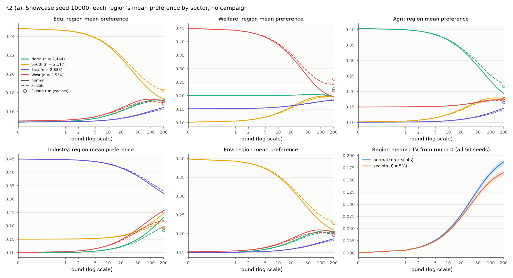
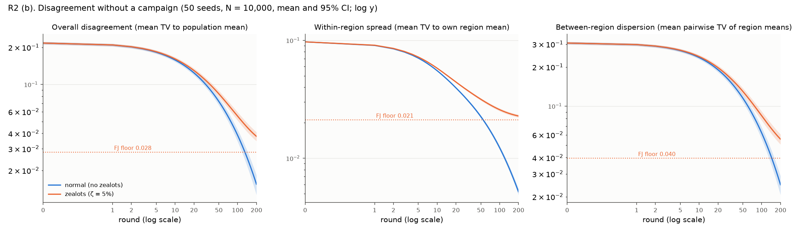
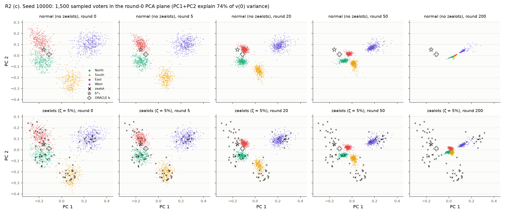
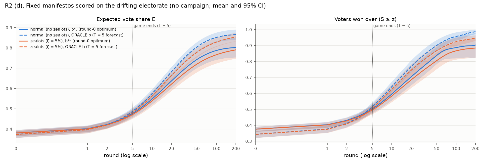

# R2: Opinion drift with no campaign (normal vs zealot population)

## Question

How does voter opinion change when there are no media and no party workers, after a given number of rounds? The
owner asked for two populations: a normal one and one that includes zealots.

## Setup

- **Worlds.** Seeds 10000–10049 (50 seeds, the same worlds as XC). N = 10,000, default config otherwise.
- **Two paired populations per seed.**
  - *normal*: `zealot_fraction = 0`.
  - *zealots*: the default `zealot_fraction = 0.05`, giving 498.7 zealots per world on average [491.6, 505.8] (`zealots`).
  - The zealot draw has its own seed stream. All 50 seeds were checked: v(0), the graph, the regions and the α of
    non-zealots are bit-identical between the two populations, and zealots have α = 0 (`identity_check`, all `true`;
    per seed in `identity_per_seed`). The only difference is that the 5% zealots never move.
- **Dynamics.** Social only, no campaign: v_i ← (1 − a_i) v_i + a_i · mean(friends' v), with a_i = 0.15·α_i. The
  script reuses `dynamics.social.aggregate` and `dynamics.update.step_preferences`, the same functions as
  `oracle.anticipate`. The run lasts 200 rounds and every round is measured.
  - Check: the first 5 rounds of the zealot population match `oracle.anticipate` to max |Δv| = 1.2·10⁻⁷
    (`t5_prefix_vs_anticipate_max_abs`, float32).
- **Metrics.** Definitions are in `metric_definitions`. TV = ½‖·‖₁. All voters are included, zealots too.
  - *disagreement*: mean TV to the population mean. This is the XC "spread".
  - *within*: mean TV to the voter's own region mean.
  - *between*: **plain (unweighted)** mean TV over the 6 pairs of region means.
  - *region mean*: the 4 × 5 per-region mean preference (raw rows).
  - *E* and *won*: computed for two fixed manifestos per seed. Both are computed from the zealot world and used
    unchanged for both populations:
    - b\*₀ = `optimise_manifesto` on v(0);
    - the ORACLE manifesto, `oracle_manifesto(electorate, config)`, which is optimal for the T = 5 social-only forecast.
- **Long-run references.** Both are scored with the same metrics in float64.
  - *Zealots*: the Friedkin–Johnsen (FJ) fixed point, with zealots stubborn at v(0). It is solved with
    `x2_stubborn.fj_solve` (Jacobi-CG on the GPU, 56 iterations, relative residual 9.9·10⁻¹¹; `limits.fj_solver`).
  - *Normal*: the consensus point c = Σ π_i v_i(0), with π_i ∝ d_i / a_i. This is the stationary law of the
    heterogeneous-step DeGroot walk. A unit test checks it against a 3,000-round run.
- **Statistics.**
  - Each value is the mean over 50 seeds with a 95% t-CI.
  - Paired differences (zealots − normal) use the Wilcoxon signed-rank test, with Holm correction over the family of
    7 metrics × 9 recorded rounds (63 tests; `tests.rows`).
  - At round 0 the two populations are identical: every tested metric differs by exactly 0 (`tests.round0_max_abs_diff`).
- **Compute.**
  - Device: cuda:2 (NVIDIA RTX A5000). All 50 worlds × 2 populations ran in one batch, a `[2, 50·10⁴, 5]` tensor on
    one disjoint-union graph (`provenance.batch_layout`, `batch_sizes` [50]).
  - Wall time: 81.6 s. Of that, 76.8 s was building the worlds and manifestos (CPU-canonical generation) and 2.6 s
    was the 200 rounds plus the FJ and consensus references (`provenance.timing_s`).
  - Memory: peak torch allocation 1.67 GB (`provenance.compute.peak_bytes`).
  - CPU↔GPU parity on 3 seeds at round 50 (10 metrics): passed, max |mean diff| 3.2·10⁻⁷ (`provenance.parity`).
- **Deviations.**
  - The game allows T ≤ 10, so rounds beyond 10 are experiment-side only. They use the same update functions; no
    `GameConfig` with T = 200 is created.
  - Figure (a) uses one showcase seed (10000). Region identities and archetypes are random per seed, so averaging
    "region r" across seeds would mix different archetypes. For the across-seed view of regional movement, see the
    region-drift panel in Figure (a) and `per_round.*.region_drift`.

## Results

Source: [r2.json](r2.json), `per_round.<population>.<metric>.<round>`. Values are mean [95% CI] over 50 seeds.

**Disagreement (mean TV to the population mean).**

| round | normal | zealots | Δ zealots − normal (`tests.rows`) |
|---|---|---|---|
| 0 | 0.217 [0.211, 0.222] | 0.217 [0.211, 0.222] | 0 (identical) |
| 5 | 0.183 [0.177, 0.188] | 0.184 [0.179, 0.190] | +0.0018 [0.0017, 0.0019] |
| 20 | 0.124 [0.119, 0.129] | 0.130 [0.125, 0.135] | +0.0058 [0.0055, 0.0060] |
| 50 | 0.073 [0.068, 0.078] | 0.084 [0.079, 0.089] | +0.011 [0.011, 0.012] |
| 100 | 0.039 [0.034, 0.043] | 0.055 [0.051, 0.059] | +0.017 [0.016, 0.017] |
| 200 | 0.015 [0.013, 0.018] | 0.038 [0.035, 0.041] | +0.022 [0.021, 0.023] |
| long run | 0 (consensus; `limits.normal_consensus`) | 0.028 [0.026, 0.030] (FJ; `limits.zealots_fj`) | |

At every recorded round from 1 to 200, the zealot population is more spread out in all 50 of 50 seeds. Holm
p ≤ 1.6·10⁻⁸ in each case.

**Within-region spread and between-region dispersion.**

| round | within, normal | within, zealots | between, normal | between, zealots |
|---|---|---|---|---|
| 0 | 0.097 | 0.097 | 0.306 [0.299, 0.313] | 0.306 [0.299, 0.313] |
| 5 | 0.071 | 0.072 | 0.268 [0.260, 0.275] | 0.270 [0.262, 0.277] |
| 20 | 0.040 | 0.044 | 0.191 [0.183, 0.199] | 0.198 [0.190, 0.206] |
| 50 | 0.023 | 0.032 | 0.115 [0.107, 0.123] | 0.130 [0.122, 0.138] |
| 200 | 0.0052 [0.0049, 0.0055] | 0.0228 [0.0221, 0.0235] | 0.025 [0.021, 0.029] | 0.056 [0.051, 0.061] |
| long run | 0 | 0.021 (FJ) | 0 | 0.040 (FJ) |

The within-region CIs are about ±0.0003 up to round 50 (see the JSON).

**How much opinion moves.**

- By round 200, the average voter has moved TV 0.209 [0.203, 0.214] from their v(0) in the normal population and
  0.187 [0.182, 0.191] with zealots (`moved`).
- Region means move 0.187 vs 0.165 (`region_drift`).
- The population mean itself barely shifts: 0.045 vs 0.029 (`mean_shift`).
- By round 5, the end of a game, voters have moved only 0.039 vs 0.037.

**Long-run floor.** Source: `floor`. Window: rounds 100–200.

- *Normal.* Disagreement keeps decaying geometrically: a factor of 0.990 [0.989, 0.991] per round, half-life 73
  [67, 78] rounds. d(200)/d(100) = 0.37. The limit is full consensus (disagreement ≈ 0).
  - At T = 200 the population mean is TV 0.013 from the predicted consensus point.
  - A few slow voters (small α) are still far from it: the maximum per-voter TV to the limit is 0.21.
- *Zealots.* Disagreement levels off towards the FJ floor of 0.028 [0.026, 0.030].
  - Raw decay is slow: a factor of 0.9962 per round, half-life 184 rounds, d(200)/d(100) = 0.68.
  - The excess above the floor decays at the normal-population rate: half-life 65 [62, 69] rounds
    (`excess_over_fj_half_life_rounds`).
  - At round 200 the zealot world is still 1.33× [1.30, 1.37] its floor (`ratio_d200_over_fj`). At round 100 it was
    1.95× its floor.

**Fixed manifestos on the drifting electorate.** Expected share E; won-over share in brackets.

| round | b\*₀ normal | b\*₀ zealots | ORACLE normal | ORACLE zealots |
|---|---|---|---|---|
| 0 | 0.381 (0.375) | 0.381 (0.375) | 0.374 (0.343) | 0.374 (0.343) |
| 5 | 0.477 (0.502) | 0.472 (0.496) | 0.487 (0.516) | 0.481 (0.507) |
| 20 | 0.637 (0.703) | 0.621 (0.684) | 0.682 (0.768) | 0.663 (0.744) |
| 50 | 0.743 (0.838) | 0.720 (0.805) | 0.805 (0.900) | 0.778 (0.867) |
| 200 | 0.802 (0.903) | 0.790 (0.884) | 0.865 (0.986) | 0.854 (0.947) |
| long run | 0.795 (`limits.normal_consensus.E_b0`) | 0.817 (FJ) | 0.853 | 0.887 (FJ) |

CIs on E are about ±0.02 for the ORACLE manifesto and ±0.02–0.05 for b\*₀ (`per_round`).

- **The ORACLE manifesto with zealots, paired.** E_oracle(zealots) − E_oracle(normal) = −0.0060 [−0.0063, −0.0056] at
  T = 5, −0.026 at round 50 and −0.012 [−0.019, −0.004] at round 200. All are Holm-significant (`tests.rows`).
- **The other manifesto metrics.** For b\*₀, won_b0 and won_oracle the zealot population is also lower at every
  recorded round, and every one of these differences is Holm-significant (Holm p ≤ 0.0054). At round 200 the
  normal population is lower in a minority of seeds (`a_better`):
  - E_b0: 14 of 50 seeds;
  - E_oracle: 12 of 50;
  - won_b0: 4 of 50.
  - The won_b0 t-CI also includes 0 (−0.019 [−0.051, 0.014]), while its Wilcoxon test is significant
    (`tests.rows`).
- **Long-run share with zealots.** In the zealot world the long-run (FJ) E_oracle = 0.887 is higher than at round 200
  (Δ = −0.034 [−0.044, −0.023]; `limits.zealots_E_oracle_T_vs_fj`). The share is still rising at round 200.
- **Long-run share without zealots.** In the normal world the long-run won share is 0 or 1 per seed, because everyone
  ends at one point. 98% of seeds end inside the ORACLE manifesto's threshold and 90% inside b\*₀'s
  (`limits.normal_consensus.won_*`). Their t-CIs exceed 1 because the outcome is binary.

## Figures

- (a) Each region's mean preference per sector, for showcase seed 10000. Solid lines: normal. Dashed lines: zealots.
  Circles: the FJ long-run state. The last panel shows region drift across all 50 seeds.
  
- (b) Disagreement, within-region spread and between-region dispersion against round, with log-x and log-y axes.
  The dotted lines are the FJ floors of the zealot world.
  
- (c) 1,500 sampled voters of seed 10000 in the round-0 PCA plane, at rounds 0, 5, 20, 50 and 200. PC1 and PC2
  explain 74% of the variance of v(0). Zealots are marked ×.
  
- (d) E and the won-over share for the two fixed manifestos, in both populations.
  

## What it shows

- **Within a game, voters do not drift much.** Without media or workers, a 5-round game moves the average voter
  only about 0.04 in TV. Disagreement falls from 0.217 to about 0.18, a drop of roughly 16%. Regions remain
  clearly separate clusters (Figure c, round 5).
- **Drift is local smoothing, not a move of the electorate.** Over long horizons, friends' averaging first
  collapses each region onto its own centre: within-region spread halves by about round 10. Next, the regions
  move towards each other through cross-region friendships: between-region dispersion falls from 0.31 to 0.025
  by round 200 without zealots. The population as a whole moves very little (mean shift ≤ 0.045).
- **Without zealots, opinion goes to full consensus.** The decay is geometric, with a disagreement half-life of
  about 73 rounds late in the run. The end point is a single opinion, the d/α-weighted average of v(0). Voters
  with many friends or low susceptibility pull it towards their view.
- **With 5% zealots, consensus never arrives.** Disagreement converges to a positive floor of about 0.028. This
  floor is the FJ equilibrium: each region settles near the views of its own zealots, and between-region
  dispersion stays at 0.040. Over the first 5 rounds the difference from the normal population is tiny
  (+0.002 disagreement), but it grows steadily, to +0.022 by round 200.
- **Drift alone raises the share of a central manifesto.** Consensus pulls voters towards the middle, so a fixed
  central manifesto gains support with no campaign. The ORACLE manifesto, tuned for round 5, rises from E 0.374
  to 0.487 at T = 5 and to 0.865 by round 200. Zealots keep part of the electorate away and cost it about
  0.6 percentage points at T = 5. The ORACLE manifesto beats the round-0 optimum b\*₀ from round 3 on (0.444 vs
  0.442). This supports the spec's advice to optimise against the anticipated electorate rather than v(0).

## Data and command

- Summary: [r2.json](r2.json). It contains per-round stats, the dense series (`dense`), tests, the floor, limits,
  the showcase data and provenance.
- Raw data: [raw/r2.jsonl](raw/r2.jsonl), one row per seed × population with all 201 rounds, region means at the
  recorded rounds, and both manifestos.
- Log: [logs/r2.log](logs/r2.log).
- Code: `experiments/r2_drift_no_campaign.py`. Tests: `tests/unit/test_r2_drift.py`.

```
OMP_NUM_THREADS=4 python experiments/r2_drift_no_campaign.py --seeds 50 --first-seed 10000 --rounds 200 --device cuda:2
python experiments/r2_drift_no_campaign.py --plot-only     # figures from r2.json only
```
