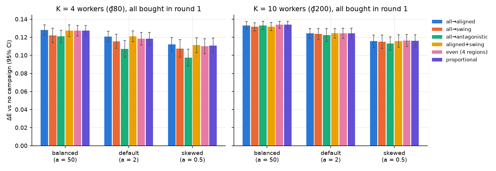
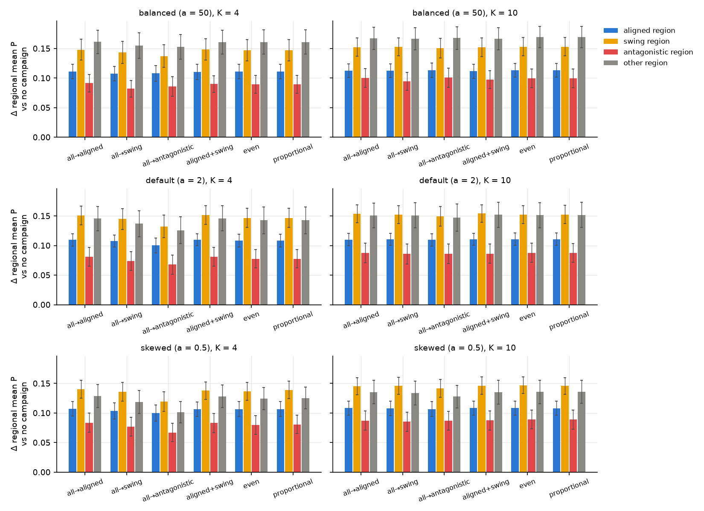
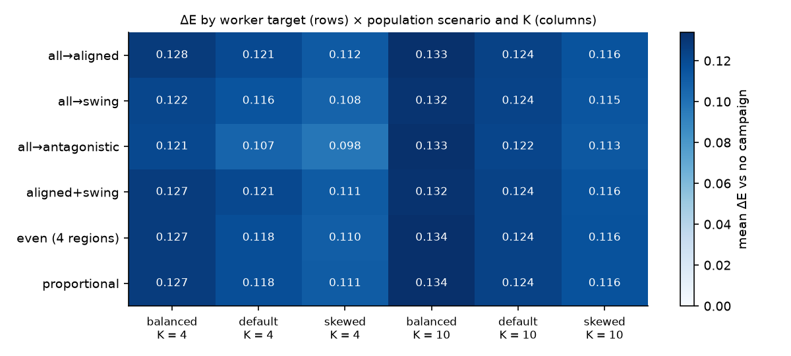
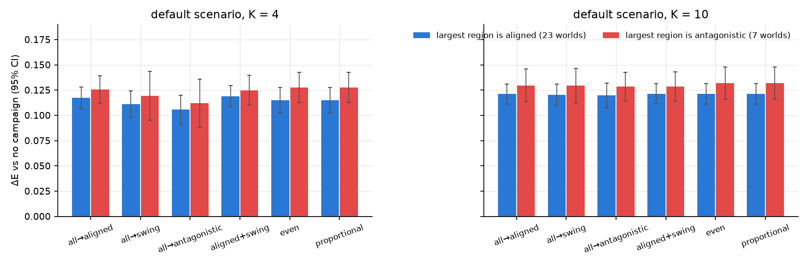

### R3 — Worker assignment scenarios

**Question.** The owner asked: "Given a certain population spread across the regions and a fixed number of party
workers, how do you assign/use the party workers in different scenarios such as antagonistic preference, aligned
preference, and so on?"

R3 fills a gap that X4 and X3 leave:
- X4 compared "largest", "best_matched" and "proportional" placement. It never sent workers into the region that
  dislikes the manifesto, and it never varied how voters are spread across regions.
- X3 swept the manifesto, not the placement.

**Setup.**
- **Seeds:** 11000–11049, 50 worlds per arm. This is the X4 block. All arms are paired: same world, same random
  streams.
- **Game:** N = 10⁴, T = 5, treasury ₫500, ₫20 per worker.
  - The manifesto is the ORACLE manifesto of each world (`strategies.oracle.oracle_manifesto`).
  - Workers only, no media. All K workers are bought in round 1 (X4: buying early dominates).
- **Population scenarios:** set by `ElectorateConfig.region_dirichlet_a`. The rule that every region holds at least
  15% of voters still applies.

  | scenario | a | Gini of region sizes | largest region | smallest region |
  |---|---|---|---|---|
  | balanced | 50 | 0.024 | 26.6% | 23.6% |
  | default | 2 | 0.113 | 33.0% | 19.0% |
  | skewed | 0.5 | 0.193 | 39.5% | 16.1% |

  Values are means over the 50 worlds (`scenarios.<sc>.gini`, `largest_share`, `smallest_share`). Region sizes per
  world are in `world_roles`.
- **Region roles per world.** Each region's mean P is computed at round 0 from the true preferences under that world's
  manifesto b (`definitions.roles`). Then:
  - **aligned** = the region with the highest mean P;
  - **antagonistic** = the region with the lowest mean P;
  - **swing** = of the two remaining regions, the one whose mean P is closest to 0.5;
  - **other** = the last region.

  Ties go to the lower region index, so the four roles are always four different regions.

  Mean round-0 P by role (`scenarios.<sc>.p0_by_role`):

  | scenario | aligned | swing | other | antagonistic |
  |---|---|---|---|---|
  | balanced | 0.617 | 0.378 | 0.295 | 0.140 |
  | default | 0.632 | 0.405 | 0.254 | 0.119 |
  | skewed | 0.645 | 0.407 | 0.219 | 0.101 |

  The ORACLE manifesto favours big regions. So in the skewed scenario the largest region is the aligned region in
  33/50 worlds, and the antagonistic region in only 2/50 (`largest_region_role_counts`).

- **Arms, for K = 4 (₫80) and K = 10 (₫200):**
  - none (no campaign);
  - all→aligned;
  - all→swing;
  - all→antagonistic;
  - aligned+swing (half each);
  - even over the 4 regions;
  - proportional to region size.

  Integer splits use largest remainder. Equal remainders go to the larger region.
- **Metrics:**
  - E (expected share) and the official win;
  - ΔE = E(arm) − E(none) in the same world;
  - change in each region's final mean P against the none arm, by role;
  - each region's share of ΔE, (n_r/N)·ΔP_r; the four shares sum to ΔE;
  - converts per region, counted with the per-round `converted` mask of `x_batch.run_batch`'s observer hook. No
    library or existing file was changed.
- **Tests:**
  - ΔE: mean with a 95% t-CI.
  - E differences: paired Wilcoxon tests.
  - Win differences: exact McNemar tests.
  - Holm correction within each family (scenario × K): 6 arms vs none plus the 15 pairs of arms, 21 tests in total.
- **Device and compute** (`provenance.compute`):
  - GPU: cuda:0 (RTX A5000).
  - Batching: all 13 arms × 50 worlds of a scenario go through one `run_batch` call (B = 650 games, 6.5·10⁶ voters).
    There were no out-of-memory back-offs.
  - Peak memory: 8.37·10⁹ bytes (7.8 GiB).
  - Wall time: 103 s. Building the worlds and their ORACLE manifestos took 31 s per scenario; the 650 games took
    1.5–1.6 s per scenario (`provenance.timings`).
- **Parity:** the CPU↔GPU check on 3 seeds passed (`provenance.parity.passed = true`). It uses `x_parity.parity_rel`
  with tolerance max(0.01, 3·SE, 5% of the mean), as in X4.
- **Cross-checks:**
  - **Against X4:** default-scenario E per seed matches X4's raw rows to ≤ 2.4·10⁻⁷ for "none", for "K10|proportional"
    (same as X4's front/proportional) and for "K4|aligned" (same as X4's front/best_matched). X4's mean of 0.479 for
    no campaign is reproduced (0.4787).
  - **Repeat runs:** two full GPU runs differ only in the last float bits (≤ 10⁻⁸ in mean E). Every number in this
    write-up is the same in both runs.
- **Deviations** (`deviations`):
  - The parity tolerance is the relative one described above.
  - With K = 4 and near-equal regions, "even" and "proportional" both give a 1/1/1/1 split, so they are the same games
    in the balanced and default scenarios.

**Results.** Source: reports/v3/experimentation/r3.json, `scenarios.<sc>.arms.<arm>.delta_vs_none`. Values are mean
ΔE vs no campaign [95% CI]. Bold marks the best arm in its column.

| arm | balanced K4 | default K4 | skewed K4 | balanced K10 | default K10 | skewed K10 |
|---|---|---|---|---|---|---|
| all→aligned | **0.128** [0.122, 0.134] | 0.121 [0.115, 0.127] | **0.112** [0.104, 0.120] | 0.133 | 0.124 | 0.116 |
| all→swing | 0.122 [0.114, 0.130] | 0.116 [0.108, 0.123] | 0.108 [0.098, 0.117] | 0.132 | 0.124 | 0.115 |
| all→antagonistic | 0.121 [0.114, 0.128] | 0.107 [0.098, 0.116] | 0.098 [0.088, 0.107] | 0.133 | 0.122 [0.115, 0.130] | 0.113 [0.106, 0.120] |
| aligned+swing | 0.127 | **0.121** [0.115, 0.127] | 0.111 | 0.132 | **0.124** | 0.116 |
| even (4 regions) | 0.127 | 0.118 | 0.110 | **0.134** [0.130, 0.138] | 0.124 [0.119, 0.130] | **0.116** [0.110, 0.123] |
| proportional | 0.127 | 0.118 | 0.111 | **0.134** | 0.124 | 0.116 |
| *none: E* | *0.466* | *0.479* | *0.503* | | | |
| *none: win rate* | *0.32* | *0.44* | *0.58* | | | |

The spread between the best and worst arm (`scenarios.<sc>.range_K<K>`):

| | balanced | default | skewed |
|---|---|---|---|
| K = 4 | 0.0069 | 0.0142 | 0.0146 |
| K = 10 | 0.0023 | 0.0020 | 0.0034 |

- **Tests:** source `tests.<sc>|K<K>`, Holm within each family.
  - **K = 4:** every surviving difference involves all→antagonistic losing.
    - aligned − antagonistic: balanced +0.0069 [0.0015, 0.0124], Holm p 0.010; default +0.0138 [0.0082, 0.0194],
      Holm p 1.5·10⁻⁵; skewed +0.0146 [0.0092, 0.0200], Holm p 1.4·10⁻⁵.
    - aligned+swing − antagonistic: default +0.0142 (Holm p 6.9·10⁻⁷); skewed +0.0139 (Holm p 4.1·10⁻⁵).
    - even/proportional − antagonistic: default +0.0114 (Holm p 4·10⁻⁴); skewed +0.013 (Holm p ≤ 9·10⁻⁵).
    - Aligned, aligned+swing, even and proportional never differ from one another after Holm.
  - **K = 10:** no pair of arms differs after Holm. The smallest Holm p is 0.11 (skewed: antagonistic − even, −0.0034).
- **Wins** (`arms.<arm>.win`, McNemar): every campaign arm wins 42–43 of 50 games, against 16, 22 and 29 for no
  campaign in the balanced, default and skewed scenarios.
  - Against none, every arm gains 27, 21 and 14 wins with 0 losses (McNemar Holm p ≤ 0.003).
  - Between any two campaign arms there is at most one discordant world. **Where the workers go never changes a win
    after Holm** (`mcnemar_holm_p = 1` for all pairs).
- **Where the gain lands** (`arms.<arm>.d_support_by_role`, `d_e_contribution_by_role`, `converts_by_role`,
  `converts_outside_target_share`). Default scenario, K = 4:
  - **Regional mean P rises in all four regions whatever the target.** The rise in the antagonistic region is +0.068
    when all workers are sent there, and +0.081 when they go to the aligned region.
  - **Most converts land outside the targeted regions.** The share outside is 56% for all→aligned, 70% for all→swing,
    93% for all→antagonistic and 26% for aligned+swing (pooled). For all→antagonistic this is 92–95% in every
    scenario.
  - **Antagonistic voters barely convert.** Sending all 4 workers into the antagonistic region yields 278 converts
    there out of 3,994. Sending them to the aligned region yields 335 antagonistic converts out of 4,428. Conversion
    needs γ·P, and P is near 0.12 there.
  - **The ΔE contribution by role is the same for every arm** to within 0.005 (e.g. aligned 0.028–0.030, swing
    0.035–0.039, antagonistic 0.015–0.018).
- **Post hoc, default scenario: role of the largest region** (`posthoc_largest_region`). The largest region is aligned
  in 23 worlds, antagonistic in 7, swing in 17 and "other" in 3.
  - **Largest region aligned, K = 4:** aligned+swing 0.119 [0.108, 0.129] and aligned 0.117 are best; antagonistic
    0.106 [0.092, 0.120] is worst.
  - **Largest region antagonistic, K = 4:** even and proportional 0.128 [0.113, 0.143] and aligned 0.126 lead;
    antagonistic 0.112 [0.089, 0.136] still trails. Even with the most voters there, putting every worker in the
    hostile region is the weakest choice.
  - **K = 10:** both groups are flat across arms (0.120–0.121 and 0.128–0.132). With 7 worlds the CIs are wide
    (±0.015), so this split is descriptive only.

**Figures.**
- ΔE by arm, per scenario, for K = 4 and K = 10 (95% CIs): 
- Change in final regional mean P by role, for each arm (where the gain lands): 
- Heat map of ΔE, target × (scenario, K): 
- Default scenario split by whether the largest region is aligned (23 worlds) or antagonistic (7 worlds): 

**What it shows.**
- **Workers are worth about +0.11 to +0.13 E and lift the win rate from 0.32–0.58 to 0.84–0.86, wherever they go.**
  Assignment is a second-order choice: the best and worst targets differ by at most 0.015 in E and by no wins.
- **The one assignment to avoid is putting all of a small team in the antagonistic region.** At K = 4 it costs
  0.007–0.015 E against the aligned region. The penalty grows as the population gets more skewed, because the
  hostile region's voters convert with chance γ·P, and P there is about 0.10–0.14. With 10 workers the penalty
  vanishes (≤ 0.003, not significant): the cascade saturates whatever its source (X4, X18).
- **Converts cross regions.** 45–95% of the cascade lands outside the target regions, as in X3 (30–85%).
  - The hostile region's support rises about as much when you target the aligned region as when you target it
    directly. It is won indirectly, through friends who have already converted.
  - So "aligned" vs "swing" vs "even" vs "proportional" hardly matters. This extends X4's finding that placement moves
    E by ≤ 0.010 to the antagonistic and swing targets and to skewed populations.
- **Player advice:**
  1. Buy every worker in round 1 (X4); that is worth about ten times more than any placement choice here.
  2. With few workers (about 4), put them where the manifesto is already liked: the aligned region, or split them
     between aligned and swing. Do not send them to the hostile region, even if it is the largest.
  3. With 10 or more workers, spread them evenly or by region size. It is as good as anything and needs no knowledge
     of regional preferences.
  4. Do not expect workers to "flip" a hostile region from inside. Support there rises through the cross-region
     cascade whichever target you choose.

**Data and command.**
- Summary, per-arm statistics, tests, per-world roles and provenance: `reports/v3/experimentation/r3.json`.
- One row per game (1,950 rows): `reports/v3/experimentation/raw/r3.jsonl`.
- Log: `reports/v3/experimentation/logs/r3.log`.
- Figures: `reports/v3/experimentation/figures/r3_*.png`.
- Command:

```
OMP_NUM_THREADS=4 python experiments/r3_worker_assignment.py --seeds 50 --first-seed 11000 --device cuda:0
python experiments/r3_worker_assignment.py --plot-only    # redraws the figures from r3.json
```
