# Dumbocracy: five questions about how the game works

**Consolidated experiment report. Date:** 2026-11-11.
**Sources:**
- three new runs (R1–R3) in this folder;
- the existing v3 suite (X0–X23 and XC; [`../report.md`](../report.md), [`../sections/`](../sections/)).

**How to read the numbers**
- Every number names the experiment it comes from. For R1–R3 the data file is `r<k>.json` in this folder; for an
  existing experiment it is `../x<k>.json`.
- Intervals are 95%: t-intervals for means, Wilson intervals for rates. Paired tests are Holm-corrected within each
  experiment.
- **E**: expected vote share, i.e. the mean over voters of each voter's chance of voting for the manifesto. A game is
  won with more than half the votes; E > 0.5 is the deterministic proxy.
- **Agreement** S = 1 − TV(voter, manifesto). TV is the total-variation distance, ½ × the sum of absolute
  differences over the 5 sectors. A voter is **won over** when S ≥ 0.825, i.e. their vote chance is at least ½.
- **Disagreement**: the mean TV distance of voters from the population's average opinion. It is 0 at full consensus.
- **ORACLE**: a full-information scripted baseline. Its manifesto is optimised on the forecast election-day
  electorate. It is a reference point, not a player, and its spending rule is a greedy heuristic (X13).

Default world unless stated: N = 10,000 voters in 4 regions, T = 5 rounds, treasury ₫500, workers ₫20 each, 5% zealots,
about 30 friends per voter.

---

## Summary of insights

1. **No manifesto can win on day one.** Even the best possible manifesto, built with full knowledge of every voter,
   gets only E = 0.373 at round 0 and never exceeds 0.5 (0 of 100 seeds; R1).
2. **The best manifesto is a lopsided compromise.** It leans towards the largest region (57% support there) while
   keeping 22–32% in every other region. Every simple rule is worse on every seed:
   - pleasing one region costs 0.04–0.14;
   - averaging the electorate costs 0.02–0.03;
   - the best 2–3-region blend comes within 0.008, but which blend is best changes from world to world (R1).
3. **When the two biggest regions disagree, don't split the difference between them.** Blending them is the worst group
   choice (−0.058). Anchor on the largest region and add the closest small one (R1).
4. **Opinion drift is slow within a game but decisive in the long run.**
   - In 5 rounds the average voter moves only TV 0.04 and disagreement falls 16%.
   - Over 200 rounds, a population without zealots heads to full consensus.
   - 5% zealots leave a permanent floor of disagreement, 0.028 by Friedkin–Johnsen theory (R2).
5. **Drift helps a well-chosen manifesto.** With no campaign at all, the ORACLE manifesto rises from E 0.374 to 0.487 by
   round 5 (R2). Aiming at election day costs only 0.008 at round 0 (R1), and that manifesto overtakes the round-0
   optimum from round 3 (R2).
6. **Worker cascades are powerful, quick to saturate, and leak across borders.**
   - One worker gives 62% of the attainable gain, and five give 93% (X18).
   - 30–95% of converts land outside the target region (X3, R3).
   - Whether a cascade takes off is predicted by the spectral radius of the friendship network weighted by
     conversion chance, crossing at about 0.94 (X3).
7. **When you buy workers matters 10–100× more than where you put them.** Buying in round 1 instead of round 5 is
   worth +0.12; placement changes E by at most 0.015 (X4, R3). The one placement mistake is sending a small team
   into the hostile region (R3).
8. **The first few ₫ should buy workers, and the rest should buy early media.** At equal spend, a first handful of
   workers beats media about 11× (X11). Workers saturate after about 3–5, and then early media gives the most votes
   per ₫: the best plans found spend about 89% on media in rounds 1–2 (X13).

---

## Sources

| ID | What it measured | Seeds | Data | Log |
|---|---|---|---|---|
| **R1** (new) | Q1: manifesto types at round 0, no campaign | 100 (12000–12099) | [r1.json](r1.json), [raw/r1.jsonl](raw/r1.jsonl) | [logs/r1.log](logs/r1.log) |
| **R2** (new) | Q2: no-campaign drift, normal vs zealot population, 200 rounds | 50 × 2 (10000–10049) | [r2.json](r2.json), [raw/r2.jsonl](raw/r2.jsonl) | [logs/r2.log](logs/r2.log) |
| **R3** (new) | Q4: assigning K workers by region role, 3 population spreads | 50 per arm (11000–11049) | [r3.json](r3.json), [raw/r3.jsonl](raw/r3.jsonl) | [logs/r3.log](logs/r3.log) |
| X19 | manifesto geometry on the election-day forecast; optimisers | 100 | [../x19.json](../x19.json) | [../logs/x19.log](../logs/x19.log) |
| XC | pull towards the manifesto under 5 campaign types, 5 rounds | 50 | [../x_consensus.json](../x_consensus.json) | [../logs/x_consensus.log](../logs/x_consensus.log) |
| X1 | network structure, mixing speed, best channel by density | 50 per cell | [../x1.json](../x1.json) | [../logs/x1.log](../logs/x1.log) |
| X2 | stubborn agents: zealots, worker "anchor" vs cascade, W-MSR | 50 per cell | [../x2.json](../x2.json) | [../logs/x2.log](../logs/x2.log) |
| X3 | cascade threshold, reach, cap, drift-back, spill-over | 50 | [../x3.json](../x3.json) | [../logs/x3.log](../logs/x3.log) |
| X4 | worker timing × placement; pick rule | 50 per arm | [../x4.json](../x4.json) | [../logs/x4.log](../logs/x4.log) |
| X18 | value of the k-th worker (submodularity) | 50 | [../x18.json](../x18.json) | [../logs/x18.log](../logs/x18.log) |
| X23 | worker-rule variants (cap, min degree, conversion rule) | 50 per arm | [../x23.json](../x23.json) | [../logs/x23.log](../logs/x23.log) |
| X0 | fixed spending patterns at ₫500 / 750 / 1000 | 100 per treasury | [../x0.json](../x0.json) | [../logs/x0.log](../logs/x0.log) |
| X7 | price sensitivity (worker ₫10–100, query ₫5–10) | 50 per cell | [../x7.json](../x7.json) | [../logs/x7.log](../logs/x7.log) |
| X10 | balance across N = 10³–10⁶ and T = 1–10 | 50 per cell | [../x10.json](../x10.json) | [../logs/x10.log](../logs/x10.log) |
| X11 | worker × media interaction and ordering at matched spend | 100 | [../x11.json](../x11.json) | [../logs/x11.log](../logs/x11.log) |
| X13 | best plans found by search vs the ORACLE planner | 100 | [../x13.json](../x13.json) | [../logs/x13.log](../logs/x13.log) |

**Shared conditions**
- Every run used an RTX A5000 GPU (R1 and R2 on cuda:2, R3 on cuda:0).
- Every run passed a CPU↔GPU parity check (`provenance.parity` in each JSON).
- R1–R3 add 66 unit tests, all passing.
- R1, R2 and R3 reuse the worlds of X19, XC and X4 respectively, so their results are directly comparable.

---

## Q1. What does the ideal manifesto look like? (round 0, no campaign)

**Question.** On the initial electorate, with no campaign and no social drift, how well do these manifesto types do:
pleasing a single region, a group of regions, an "average" voter, or the true optimum found by gradient ascent on the
known preferences?

**Method (R1).**
- Regions are ranked by size within each world: R1 is the largest and R4 the smallest. R1 holds 33.4% of voters on
  average and never a majority.
- Per world, 21 manifestos are scored on the true round-0 preferences:
  - 4 single-region means;
  - 10 size-weighted blends of 2 or 3 regions;
  - 5 averages: the mean, the per-sector median, the TV geometric median, uniform 20%, and the free top-3 statistic;
  - the round-0 optimum b\*₀: projected gradient ascent from 27 starts, keeping the best exact E;
  - the ORACLE's election-day manifesto, scored at round 0.
- Device: cuda:2, 140 s (`provenance.compute`).

### Results

**Expected share by manifesto** (r1.json → `overall.manifestos`). Δ is paired against b\*₀; every Δ has Holm
p ≤ 8·10⁻¹⁷, and b\*₀ is better on 100 of 100 seeds against every other manifesto.

| Manifesto | E [95% CI] | Won over | Regions carried (voter share) | Δ vs b\*₀ |
|---|---|---|---|---|
| **b\*₀ (round-0 optimum)** | **0.373 [0.363, 0.384]** | 0.371 | 1.31 (39.2%) | — |
| ORACLE election-day manifesto | 0.365 [0.354, 0.377] | 0.331 | 1.06 (30.3%) | −0.008 |
| TV geometric median | 0.353 [0.339, 0.366] | 0.291 | 0.74 (20.3%) | −0.021 |
| Per-sector median | 0.347 [0.333, 0.361] | 0.274 | 0.63 (16.4%) | −0.027 |
| Population mean | 0.343 [0.329, 0.357] | 0.266 | 0.62 (16.1%) | −0.031 |
| Top-3 statistic | 0.342 [0.329, 0.355] | 0.279 | 0.63 (16.5%) | −0.032 |
| R1+R2+R3 blend (best fixed group) | 0.338 [0.324, 0.352] | 0.271 | 0.66 (17.9%) | −0.036 |
| R1+R2 blend | 0.337 [0.322, 0.351] | 0.293 | 0.93 (27.6%) | −0.037 |
| Largest region (R1) alone | 0.334 [0.324, 0.344] | 0.341 | 1.00 (33.4%) | −0.040 |
| Uniform 20% each | 0.302 [0.287, 0.318] | 0.211 | 0.59 (14.9%) | −0.071 |
| R2 / R3 / R4 alone | 0.288 / 0.259 / 0.230 | 0.275 / 0.236 / 0.201 | 1.00 each | −0.085 / −0.114 / −0.144 |

**The best of each family, chosen per world** (`overall.derived`):

| Family | E | Δ vs b\*₀ | Most often best |
|---|---|---|---|
| best single region | 0.343 | −0.031 | R1 in 67/100 |
| best group | 0.365 | −0.008 | R1+R2 in 24, R1+R3 in 21 |
| best average | 0.354 | −0.019 | geometric median in 59 |

**Divided vs aligned worlds** (`scenario_split`). A world is "divided" when the archetypes of the two largest regions
are at TV ≥ 0.35: 52 divided, 48 aligned.

| | Divided | Aligned |
|---|---|---|
| E\*₀ | 0.340 [0.328, 0.352] | 0.409 [0.398, 0.421] |
| R1+R2 blend, Δ vs b\*₀ | **−0.058** | −0.014 |
| Largest region alone, Δ | −0.032 | −0.048 |
| Best average, Δ | −0.027 | −0.010 |
| ORACLE manifesto, Δ | −0.012 | −0.0035 |
| Most often best group | R1+R3 (19), R1+R4 (12); never R1+R2 | R1+R2 (24) or a triple with R1+R2 (21) |

E\*₀ is 0.069 lower in divided worlds (Mann–Whitney p = 8.7·10⁻¹¹).

**Gradient ascent** (`optimum`):
- The best start reaches within 10⁻⁴ of the optimum in a median of 10 iterations (IQR 8–15, max 37).
- A second, worse end point appears on 33/100 seeds.
- The 19 extra "scenario" starts never improved the optimum by more than 10⁻⁴ (0/100 seeds).
- b\*₀ is never below the library optimiser (`library_check`).

### Figures

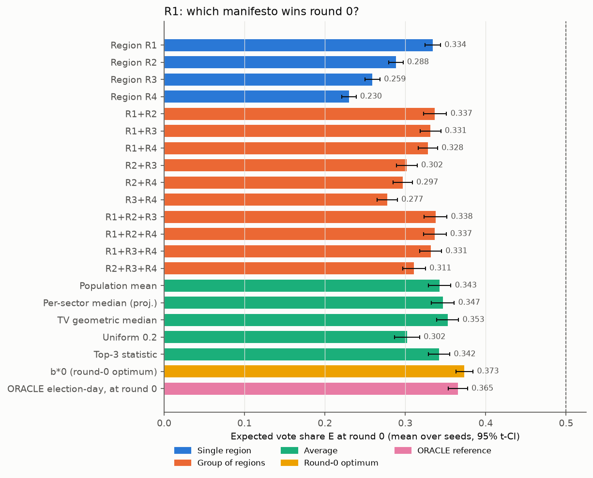
*Mean E per manifesto with 95% CIs, by family (single region, group, average, optimum, ORACLE).*

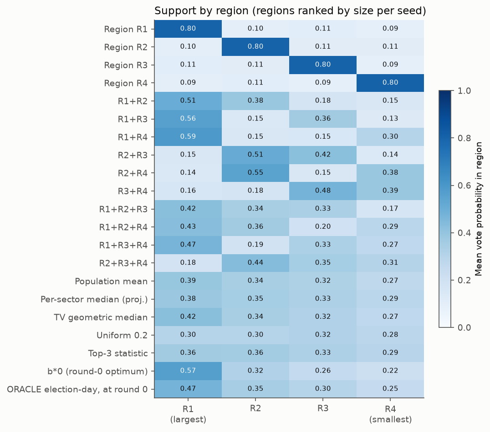
*Mean vote probability in each region (ranked by size) under each manifesto: who each manifesto pleases.*

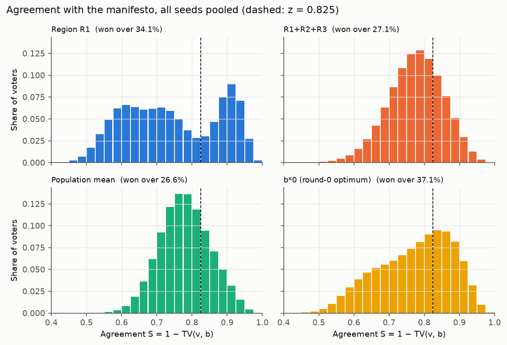
*Agreement with the manifesto, all seeds pooled: largest region alone, best group, population mean, b\*₀. The dashed
line is the 0.825 threshold.*

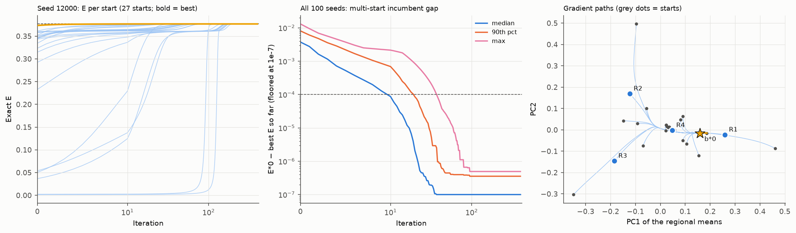
*Gradient ascent:*
- *left: E per start on seed 12000;*
- *middle: the gap of the best-so-far to E\*₀ over all seeds;*
- *right: the optimiser paths in 2D.*

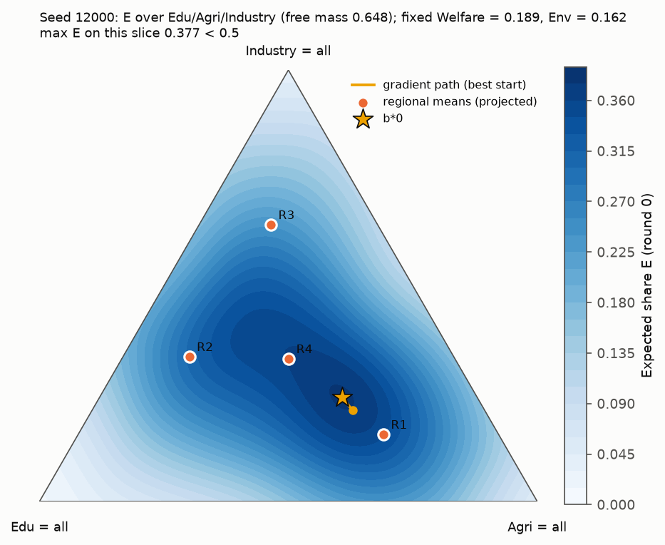
*The vote-share landscape on seed 12000 over Edu / Agri / Industry, with Welfare and Env fixed at b\*₀. It shows the
regional means, b\*₀ and the gradient path. The grid maximum (0.3768) equals E\*₀.*

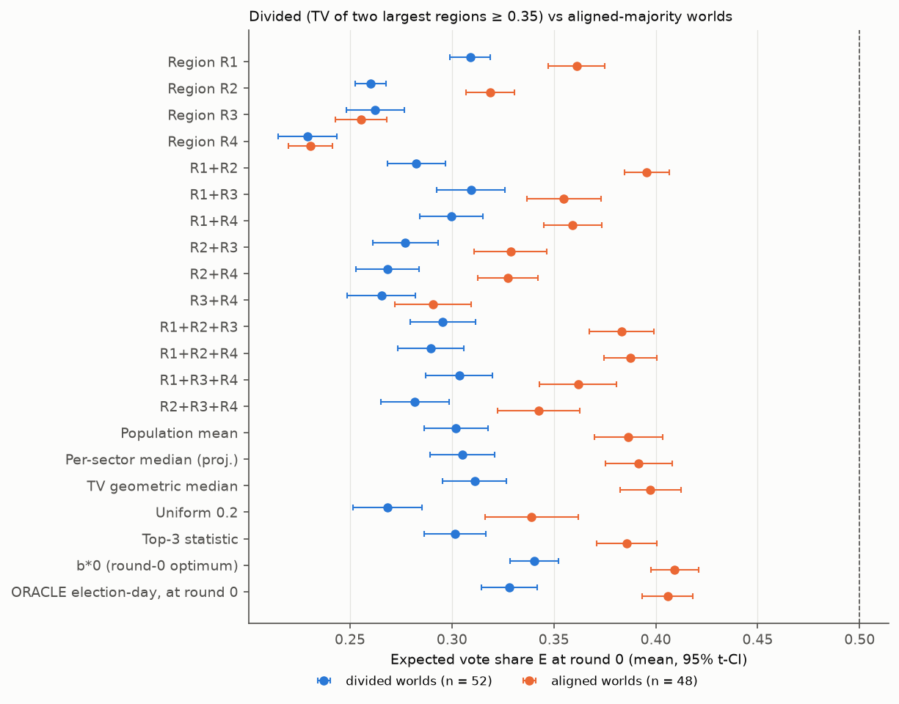
*Mean E per manifesto in divided vs aligned worlds.*

For contrast, the same comparison on the **election-day forecast** electorate (X19, same worlds; E\* = 0.469) is in
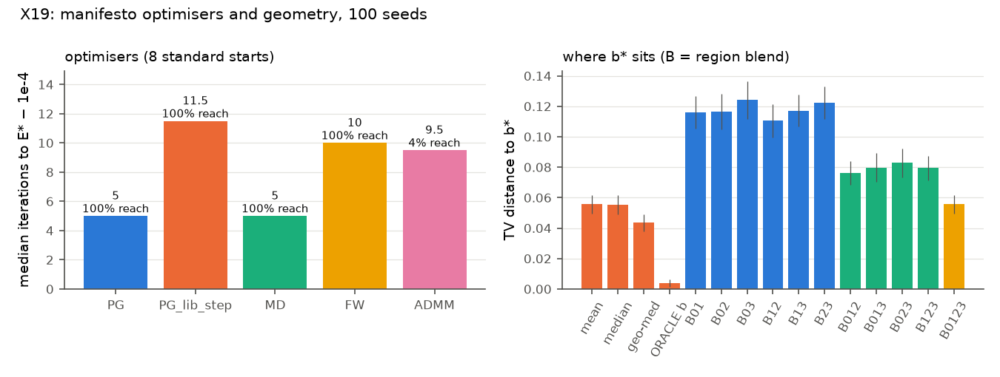

### Insights

- **A manifesto alone cannot win at round 0.** The ceiling is 37% on average and 49% at best. The missing votes
  must come from drift and from the campaign (Q2, Q3, Q5). On the same worlds, the election-day forecast lifts the
  optimum to 0.469 (X19).
- **The ideal manifesto is a lopsided compromise, not a coalition.**
  - It wins about 57% of the largest region and keeps 22–32% of each of the others (`support_by_rank`).
  - It carries 1 region on 69 seeds and 2 on 31, never 3 or 4.
  - Its carried regions hold a majority on only 25/100 seeds.
- **Pandering to one region is the worst strategy.** It is −0.040 even for the largest region and down to −0.144
  for the smallest. It does produce the most loyal, polarised support (the bimodal histogram).
- **"Speak to the middle" is a decent rule of thumb, but it leaves 0.02–0.03 on the table.**
  - The TV geometric median is the best single rule.
  - Uniform 20% is poor (−0.071).
- **The right group depends on the world.**
  - In aligned worlds, averaging and the R1+R2 blend are within about 0.01–0.02 of the optimum.
  - In divided worlds, blending the two giants (−0.058) is worse than serving the largest region alone (−0.032).
  - **Advice:** when the two biggest regions disagree, anchor on the largest and add the closest small region.
- **Planning for election day is nearly free today.** The ORACLE manifesto costs 0.008 at round 0 (0.012 in divided
  worlds), and drift soon repays it (Q2).
- **Finding the optimum is easy.** It takes about 10 iterations, and the landscape is close to unimodal. Extra
  starting points add nothing.

---

## Q2. How do opinions change with no media and no workers?

**Question.** With no campaign at all, how do voters' preferences evolve over a number of rounds? Compare a normal
population with one that includes zealots.

**Method (R2).**
- Each of the 50 worlds is run twice, as an otherwise identical pair:
  - **normal**: no zealots;
  - **zealots**: 5% zealots, who never change their own opinion.
- v(0), the graph, the regions and every non-zealot's susceptibility were verified bit-identical across the pair
  (`identity_check`, all true).
- Friend-averaging only: v_i ← (1 − a_i)·v_i + a_i·(mean of friends), with a_i = 0.15·α_i. This uses the game's own
  update functions, and the first 5 rounds match the game's forecast to 1.2·10⁻⁷.
- 200 rounds. Long-run references:
  - the Friedkin–Johnsen fixed point for the zealot world;
  - the consensus point for the normal world.
- Device: cuda:2, 82 s.

### Results

**Disagreement** (r2.json → `per_round.<pop>.disagreement`; `tests.rows`):

| Round | Normal | Zealots | Difference (zealots − normal) |
|---|---|---|---|
| 0 | 0.217 | 0.217 | 0 (identical) |
| 5 (end of a game) | 0.183 [0.177, 0.188] | 0.184 [0.179, 0.190] | +0.0018 |
| 20 | 0.124 | 0.130 | +0.0058 |
| 50 | 0.073 | 0.084 | +0.011 |
| 100 | 0.039 | 0.055 | +0.017 |
| 200 | 0.015 [0.013, 0.018] | 0.038 [0.035, 0.041] | +0.022 |
| long run | 0 (consensus) | **0.028** [0.026, 0.030] (Friedkin–Johnsen floor) | |

From round 1 on, the zealot population is more spread out on 50 of 50 seeds at every recorded round (Holm
p ≤ 1.6·10⁻⁸).

**Within-region spread and between-region dispersion:**

| Round | Within, normal | Within, zealots | Between regions, normal | Between regions, zealots |
|---|---|---|---|---|
| 0 | 0.097 | 0.097 | 0.306 | 0.306 |
| 5 | 0.071 | 0.072 | 0.268 | 0.270 |
| 50 | 0.023 | 0.032 | 0.115 | 0.130 |
| 200 | 0.0052 | 0.0228 | 0.025 | 0.056 |
| long run | 0 | 0.021 | 0 | 0.040 |

**Speed** (`floor`):
- Normal: disagreement shrinks by a factor of 0.990 per round, a half-life of 73 [67, 78] rounds.
- Zealots: the excess above the floor shrinks with a half-life of 65 rounds. At round 200 the zealot world is still
  1.33× its floor.

**How far opinion moves** (`moved`, `mean_shift`):
- The average voter moves TV 0.039 (normal) and 0.037 (zealots) by round 5, and 0.209 and 0.187 by round 200.
- The population's average opinion shifts by at most 0.045.

**A fixed manifesto on the drifting electorate.** E, with the won-over share in brackets (`per_round`):

| Round | b\*₀, normal | b\*₀, zealots | ORACLE, normal | ORACLE, zealots |
|---|---|---|---|---|
| 0 | 0.381 (0.375) | 0.381 (0.375) | 0.374 (0.343) | 0.374 (0.343) |
| 5 | 0.477 (0.502) | 0.472 (0.496) | **0.487** (0.516) | **0.481** (0.507) |
| 20 | 0.637 | 0.621 | 0.682 | 0.663 |
| 50 | 0.743 | 0.720 | 0.805 | 0.778 |
| 200 | 0.802 | 0.790 | 0.865 | 0.854 |

- Zealots cost the ORACLE manifesto 0.006 [0.0056, 0.0063] at round 5 and 0.026 at round 50.
- The ORACLE manifesto overtakes the round-0 optimum from round 3 on (0.444 vs 0.442).
- These worlds differ from R1's, so their round-0 values differ slightly from R1's.

### Figures

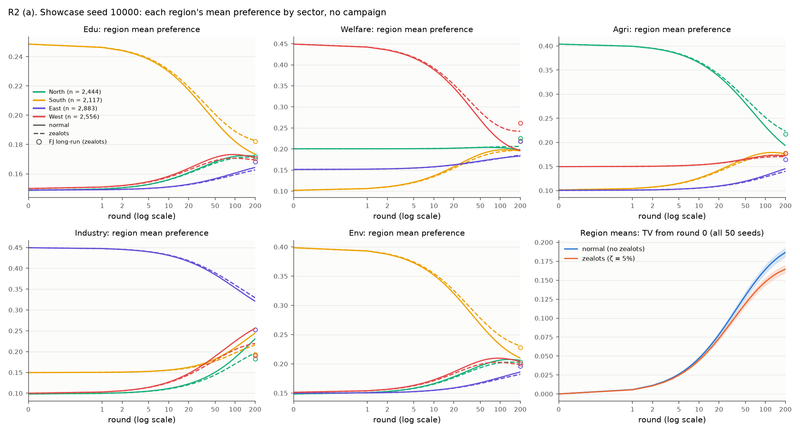
*Each region's mean preference per sector over the rounds, for seed 10000. Solid lines: normal; dashed lines: zealots;
circles: the long-run zealot state. The last panel shows region drift across all 50 seeds.*

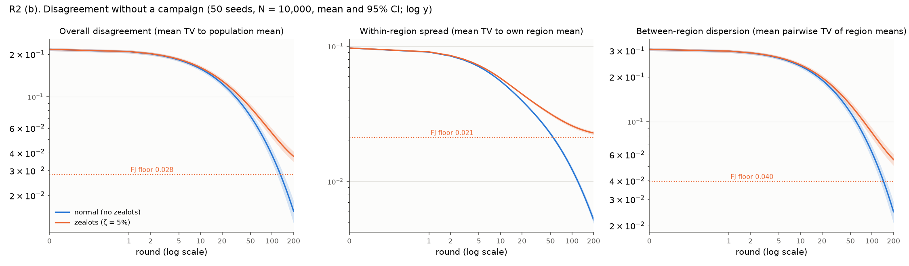
*Disagreement, within-region spread and between-region dispersion against round (log axes). Dotted lines: the
zealot world's floor.*

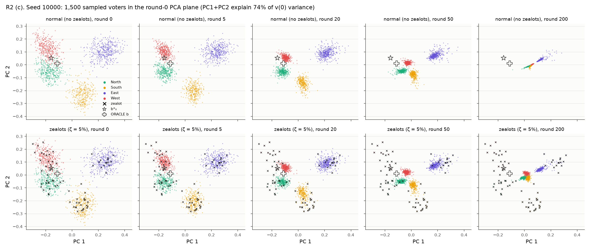
*1,500 voters of seed 10000 at rounds 0, 5, 20, 50 and 200, coloured by region. Zealots are marked ×.*

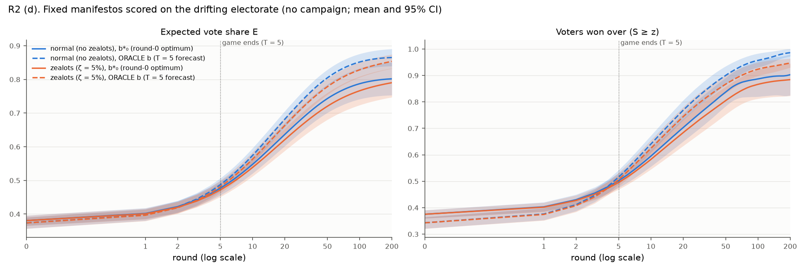
*E and the won-over share of the two fixed manifestos, in both populations.*

The same 5-round window **with** each kind of campaign (XC, 50 of the same worlds):
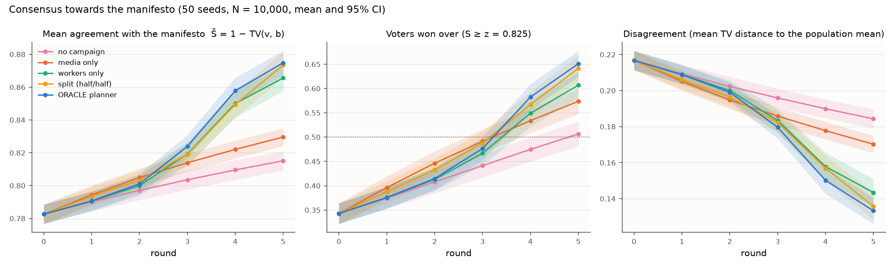

### Insights

- **Within a game, drift is gentle.**
  - Five rounds move the average voter only TV 0.04.
  - Disagreement drops 16%, from 0.217 to 0.183.
  - The regions stay clearly separate clusters.
- **Drift happens in two stages.** First each region collapses onto its own centre: within-region spread halves by
  about round 10. Then the regions slowly approach each other through cross-region friendships. The electorate's
  overall average barely moves (≤ 0.045).
- **Without zealots, the electorate converges to one opinion,** with a half-life of about 73 rounds. That opinion is
  a weighted average of the starting views, in which well-connected and less-susceptible voters count for more.
- **Zealots prevent consensus.** Disagreement settles at a floor of about 0.028, and between-region differences stay
  at about 0.040. Each region settles near its own zealots' views (Friedkin–Johnsen).
  - Within a 5-round game the effect is tiny (+0.002). It grows to +0.022 by round 200.
- **Drift works for a central manifesto.** As voters converge, a fixed, central manifesto gains support with no
  spending: the ORACLE manifesto goes from 0.374 to 0.487 by round 5, and to 0.865 by round 200.
  - This is why every optimiser in the game aims at the forecast election-day electorate rather than at round 0.
  - Zealots shave off about 0.6 points of vote share by round 5.
- **Context from existing runs:**
  - How fast regions mix depends on the network's spectral gap (X1, Spearman 0.997).
  - In 5 rounds regions mix only 5–20% of the way (X1).
  - The cross-region tie strength alone moves no-campaign wins from 0.12 to 0.70 (X1).

---

## Q3. How do party-worker cascades spread and move preferences?

**Question.** When workers are bought, how far does the cascade reach, how does it change voters' preferences, and
how does that depend on the manifesto, the rules and the network?

**Evidence:** the existing experiments X3, X18, X2, X23 and XC; no new run was needed.

**How a cascade works.**
- A worker is pinned at the manifesto b forever.
- In the round it is bought, it tries each friend once. Friend j converts with chance γ_j·P_j and is set exactly to b.
- Converts spread one hop per round.
- Each voter can be targeted at most 3 times.

### Results

**Take-off threshold** (X3; `threshold`): the cascade's growth per hop crosses 1 when the spectral radius of the
friendship network, weighted by each voter's conversion chance, reaches about 0.94. That radius is written
λ_max(A·D_q), with q_j = γ_j·P_j. Near threshold the weighted radius predicts growth almost one for one:

| Weighted radius | 0.50 | 0.69 | 0.83 | 0.97 | 1.10 | 1.23 | 1.48 | 1.79 |
|---|---|---|---|---|---|---|---|---|
| Observed growth per hop | 0.46 | 0.70 | 0.83 | 0.97 | 1.11 | 1.23 | 1.45 | 1.71 |
| Distinct converts (10 workers) | 3.4 | 6.4 | 9.7 | 14.4 | 21.3 | 30.6 | 57.3 | 117.7 |

The naive estimates (mean degree × mean chance) put the threshold at about half the right value.

**Reach depends on how well the manifesto suits the target region** (X3, 5 workers in the largest region). θ = 0 means
a manifesto far from that region; θ = 1 means its ideal.

| θ | Converts | Outside the target region | Cap binding | Δ E | Win rate |
|---|---|---|---|---|---|
| 0 (far) | 936 | 85% | 28% | +0.026 | 0.00 |
| 0.5 | 2,630 | 56% | 74% | +0.119 | 0.38 |
| 0.625 | 2,965 | 49% | 83% | **+0.120** | 0.59 |
| 0.75 | 3,078 | 43% | 86% | +0.105 | **0.64** |
| 1 (ideal for the region) | 2,763 | 30% | 83% | +0.075 | 0.26 |

**Saturation and the cap** (X3):
- The 3-attempt cap binds for 0.6% of targeted voters below threshold and 41.5% above it.
- With the cap included, the expected branching tracks the observed growth almost exactly.

**Drift-back** (X3): converts start at a vote chance of 0.971.
- If the manifesto suits their friends, they keep 0.956 after 5 social steps.
- If it does not, they fall to 0.88: early converts partly drift back.

**Value of the k-th worker** (X18; all bought in round 1 in one region):

| Workers k | 1 | 2 | 3 | 5 | 10 | 20 | 40 |
|---|---|---|---|---|---|---|---|
| Δ E | 0.077 | 0.099 | 0.107 | 0.116 | 0.123 | 0.1245 | 0.1245 |
| Marginal Δ E per extra worker | 0.077 | 0.022 | 0.0088 | 0.0032 | 0.00047 | 0.00005 | 0.00001 |

A full-information greedy pick of voters (CELF) beats the random pick in force by only about 0.005 for k ≥ 2.

**Cascade vs the worker's own pull** (X2, Arm B): workers bought in round 1, with the cascade switched on or off.

| Workers | Δ E, cascade on | Δ E, cascade off (worker pinned at b only) | Share from the pin alone |
|---|---|---|---|
| 5 | 0.121 | 0.00030 | 0.2% |
| 10 | 0.124 | 0.00058 | 0.5% |
| 20 | 0.125 | 0.00117 | 0.9% |

**Rule variants** (X23, ORACLE planner):

| Variant | Win | E | Voters reached per worker | Manifesto effect |
|---|---|---|---|---|
| cap 1 | 0.76 | 0.568 | 101 | 0.065 |
| **default** (cap 3, chance γ·P) | 0.92 | 0.638 | 231 | 0.062 |
| cap 5 | 0.98 | 0.680 | 303 | 0.060 |
| no cap | 1.00 | 0.752 | 416 | 0.066 |
| chance γ (ignores the manifesto) | 1.00 | 0.826 | 433 | **0.019** |
| chance γ·P² | 0.78 | 0.571 | 133 | 0.088 |

"Manifesto effect" is the E gained by using the ORACLE manifesto instead of the uniform one. The minimum-degree rule
for picking workers has no effect at the default size.

**How far preferences move** (XC, workers only, 5 rounds):
- Mean agreement with b goes from 0.783 to 0.866.
- The share won over goes from 34% to 61%.
- Disagreement goes from 0.217 to 0.143, against 0.184 with no campaign.
- On XC's example seed under the ORACLE planner (workers and media), 2,263 voters sit exactly at b by round 5,
  against 1 at round 0.

### Figures

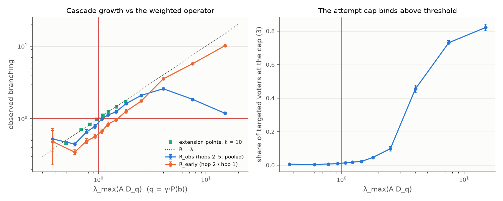
*Observed growth per hop against the weighted spectral radius and the naive estimates (X3).*

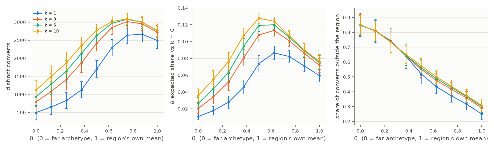
*Reach, spill-over and Δ E as the manifesto moves from far to ideal for the target region (X3).*

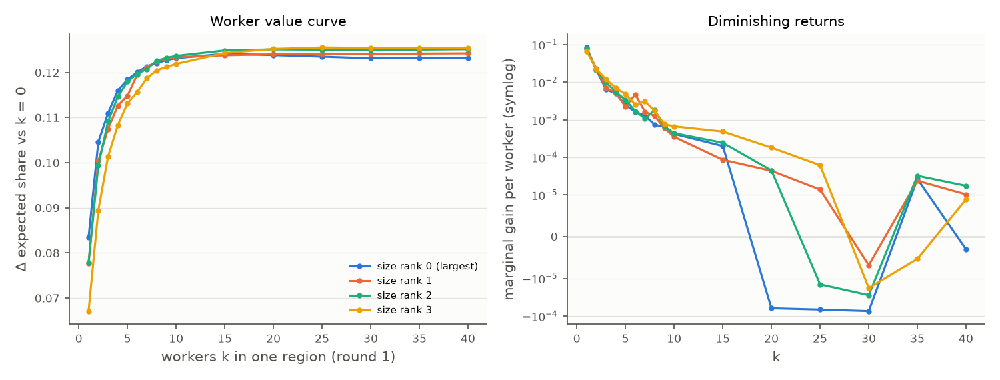
*Δ E and the marginal gain against the number of workers (X18).*

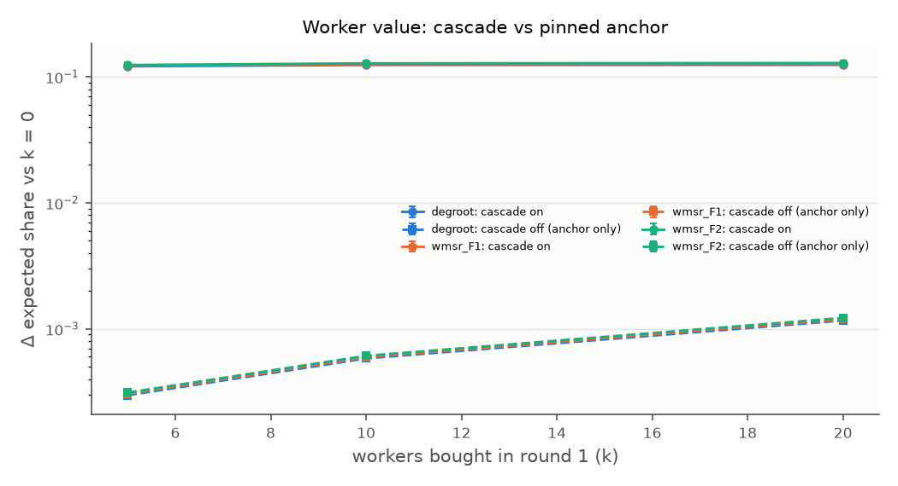
*The worker's pinned pull alone vs the full cascade (X2).*

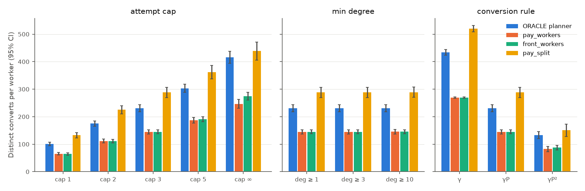
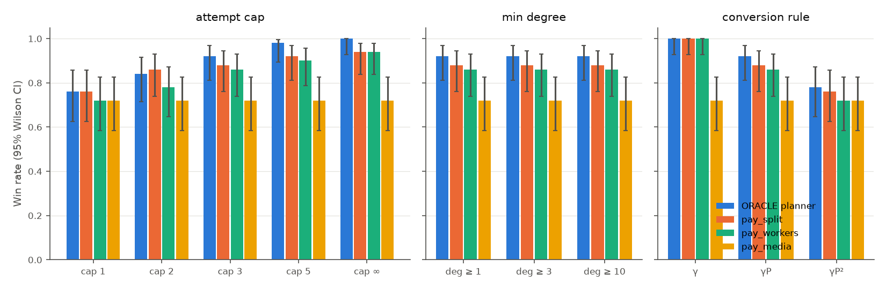
*Reach and win rate under rule variants (X23).*

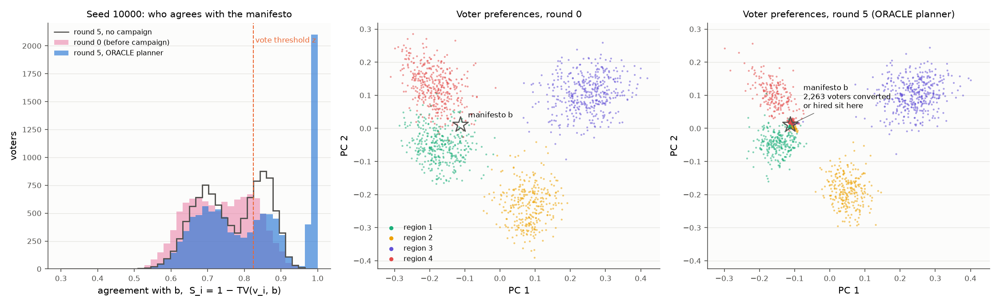
*One world before and after an ORACLE campaign: voters pulled to b, and the agreement distribution (XC).*

### Insights

- **The cascade is nearly all of a worker's value.** The worker's own pinned pull is under 1%. A worker matters
  because it converts friends, who then convert theirs.
- **Take-off is predictable from the network.** The weighted spectral radius predicts both where the threshold lies
  and how fast the cascade grows. Under default rules and a reasonable manifesto, every region is far above it, so
  cascades always take off.
- **Cascades saturate quickly.**
  - The 3-attempt cap and the shrinking pool of unconverted friends limit reach, not the threshold.
  - One worker gives 62% of the plateau, and five give 93%. Beyond about 5, extra workers are nearly wasted.
- **The manifesto shapes the cascade.**
  - A manifesto that suits the target region converts more there and leaks less (30% outside vs 85%).
  - A manifesto that is *too* narrow (θ = 1) gains less overall (+0.075 vs +0.120), because it alienates everyone
    else.
  - Converts whose friends disagree drift back.
- **Cascades leak across borders.** 30–95% of converts live outside the target region, depending on the manifesto
  (X3) and the target (R3). This is why placement matters so little (Q4).
- **The rules are the strength dial.** The attempt cap moves the ORACLE's E from 0.568 (cap 1) to 0.752 (no cap). The
  γ·P conversion rule is what keeps the manifesto relevant: with plain γ the manifesto effect collapses from 0.062 to
  0.019.

---

## Q4. How should a fixed number of workers be assigned across regions?

**Question.** Given how voters are spread over the regions and a fixed number of workers, where should the workers
go? The regions may be aligned with the manifesto, swing, or antagonistic.

**Method (R3).**
- K ∈ {4, 10} workers, all bought in round 1, no media, the ORACLE manifesto per world.
- Three population spreads:

  | Spread | Gini of region sizes | Largest region | Smallest region |
  |---|---|---|---|
  | balanced | 0.024 | 26.6% | 23.6% |
  | default | 0.113 | 33.0% | 19.0% |
  | skewed | 0.193 | 39.5% | 16.1% |

- **Region roles per world,** from the round-0 regional mean vote probability P:
  - **aligned** = highest P (0.62–0.65 on average);
  - **antagonistic** = lowest (0.10–0.14);
  - **swing** = of the other two, the one closest to 0.5 (0.38–0.41).
- **Assignments ("arms"):** none; all→aligned; all→swing; all→antagonistic; aligned+swing (half each); even over 4;
  proportional to size.
- 1,950 games. Device: cuda:0, 103 s. Its results reproduce X4's to 2.4·10⁻⁷.

### Results

**Gain over no campaign, Δ E** (r3.json → `scenarios.<spread>.arms.<arm>.delta_vs_none`; best in bold):

| Assignment | balanced K=4 | default K=4 | skewed K=4 | balanced K=10 | default K=10 | skewed K=10 |
|---|---|---|---|---|---|---|
| all → aligned | **0.128** | 0.121 | **0.112** | 0.133 | 0.124 | 0.116 |
| all → swing | 0.122 | 0.116 | 0.108 | 0.132 | 0.124 | 0.115 |
| all → antagonistic | 0.121 | **0.107** (worst) | **0.098** (worst) | 0.133 | 0.122 | 0.113 |
| aligned + swing | 0.127 | **0.121** | 0.111 | 0.132 | **0.124** | 0.116 |
| even over 4 | 0.127 | 0.118 | 0.110 | **0.134** | 0.124 | **0.116** |
| proportional to size | 0.127 | 0.118 | 0.111 | **0.134** | 0.124 | 0.116 |
| *no campaign: E (win rate)* | *0.466 (0.32)* | *0.479 (0.44)* | *0.503 (0.58)* | | | |

**Spread between the best and worst assignment** (`range_K4`, `range_K10`):
- K = 4: 0.0069 (balanced), 0.0142 (default), 0.0146 (skewed).
- K = 10: 0.0023, 0.0020, 0.0034.

**Tests** (`tests`, Holm):
- At K = 4, every significant difference involves all→antagonistic losing. Aligned − antagonistic is:
  - +0.0069 balanced (p 0.010);
  - +0.0138 default (p 1.5·10⁻⁵);
  - +0.0146 skewed (p 1.4·10⁻⁵).
- At K = 10, no pair of assignments differs (smallest Holm p 0.11).
- **Wins:** every assignment wins 42–43 of 50. No two assignments differ in wins (McNemar Holm p = 1).

**Where the converts land** (default spread, K = 4; `converts_outside_target_share`, `converts_by_role`):

| Assignment | Converts outside the targeted regions |
|---|---|
| all → aligned | 56% |
| all → swing | 70% |
| all → antagonistic | 93% (92–95% across spreads) |
| aligned + swing | 26% |

- Sending all 4 workers into the hostile region yields only 278 converts *there* out of 3,994.
- Sending them to the aligned region yields 335 hostile-region converts out of 4,428.
- The hostile region's support rises +0.068 to +0.081 whatever the target.

**When the largest region is hostile** (default spread, post hoc, 7 worlds): all→antagonistic is still the weakest at
K = 4 (0.112 vs 0.128 for even). With only 7 worlds this is descriptive.

**Timing vs placement** (X4, same worlds; Δ E vs no campaign):

| Workers | Timing | Largest region | Best-matched | Proportional |
|---|---|---|---|---|
| 4 | round 1 | 0.116 | **0.121** | 0.119 |
| 4 | spread over rounds | 0.091 | 0.101 | 0.091 |
| 4 | round 5 | 0.0009 | 0.0008 | 0.0009 |
| 10 | round 1 | 0.123 | 0.124 | **0.124** |
| 10 | round 5 | 0.0022 | 0.0020 | 0.0023 |

Picking the highest-degree voters instead of random ones adds at most 0.006 (X4).

### Figures

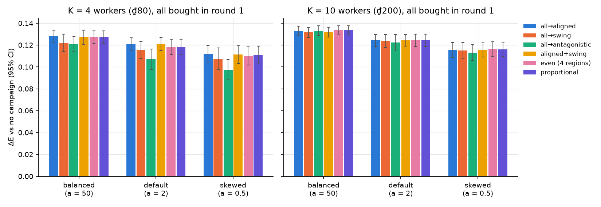
*Δ E by assignment for each population spread, K = 4 and 10, with 95% CIs (R3).*

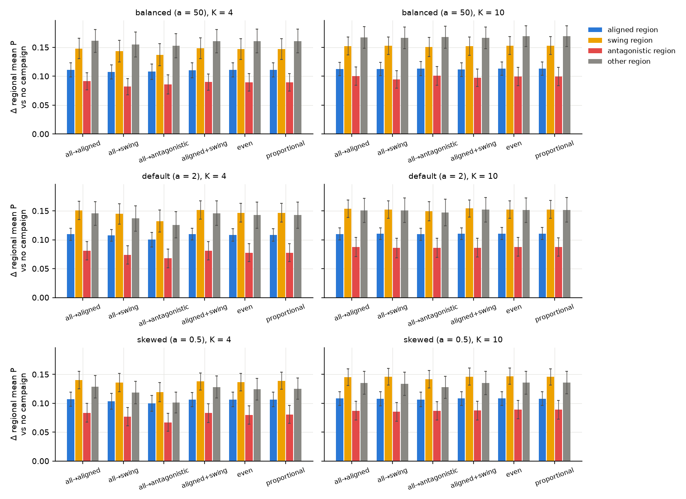
*Change in each region's final support by role, for each assignment (R3).*

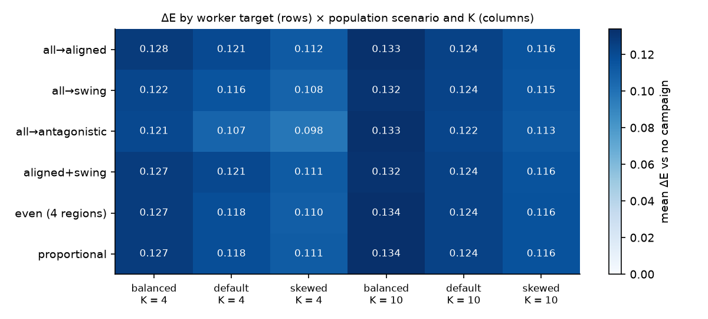
*Δ E by target × (spread, K) (R3).*

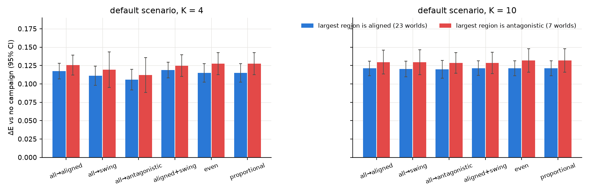
*Default spread, split by whether the largest region is aligned (23 worlds) or hostile (7 worlds) (R3).*

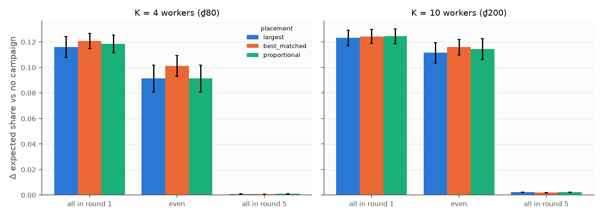
*Timing × placement at equal spend (X4).*

### Insights

- **Placement is a second-order decision.** Any assignment gains +0.10 to +0.13 and wins the same games. The best and
  worst placements differ by at most 0.015 in E, against 0.12 for buying in round 1 rather than round 5 (X4).
- **The one mistake: a small team in the hostile region.** At K = 4 it costs 0.007–0.015, and more as the population
  gets more skewed. Hostile voters convert with chance γ·P where P ≈ 0.10–0.14, so the cascade starts weak and leaks
  out (93% of its converts land elsewhere).
- **Hostile regions are won indirectly.** Their support rises about as much when you target the aligned region as
  when you target them, through friends who have already converted. Workers cannot flip a hostile region from inside.
- **With enough workers, placement stops mattering.** At K = 10 every assignment is within 0.003: the cascade
  saturates from any starting point (X18).
- **Player rules:**
  1. Buy every worker in round 1.
  2. With about 4 workers, target the aligned region, or split between aligned and swing.
  3. With 10 or more, spread them evenly or by region size; this needs no knowledge of regional preferences.
  4. Never send a small team into a region that dislikes the manifesto, even if it is the largest.

---

## Q5. Media vs party workers: where and when to invest?

**Question.** How do the two campaign channels compare? When and where should money go, and how does the answer
change with the scenario?

**Evidence:** the existing experiments X0, X11, X13, X7, X10, X1 and XC; no new run was needed.

### Results

**Fixed spending patterns** (X0; win rate with the informed manifesto; 100 seeds per treasury):

| Pattern | ₫500 | ₫750 | ₫1000 |
|---|---|---|---|
| no campaign | 0.44 | 0.44 | 0.44 |
| all media | 0.70 | 0.75 | 0.81 |
| all workers (even pace) | 0.86 | 0.86 | 0.87 |
| workers front-loaded | 0.86 | 0.87 | 0.86 |
| **split half / half** | **0.88** | **0.88** | **0.95** |
| ORACLE planner (ORACLE manifesto) | 0.94 | 0.98 | 0.99 |

Media-only is the best pattern on 0/100 seeds at ₫500 and ₫750. At ₫1000, workers-only is never best.

**Matched spend, one region** (X11; about ₫50 of each, 400 units):
- Workers: Δ E 0.104 [0.098, 0.110]. One media airing: 0.0092 [0.0090, 0.0095]. That is about **11×**.
- Interaction: +0.0011, under 1% of the joint effect. The channels simply add.
- Order: workers then media beats media then workers by **0.041** (100/100 seeds). Delaying workers by a round
  costs a whole cascade hop (converts 3,240 → 2,123).
- The extra value of combining channels is largest in media-savvy regions (+0.0016).

**The best plans found** (X13; full information; search vs the ORACLE's greedy rule; 100 seeds):

| | Search | ORACLE planner |
|---|---|---|
| E | **0.672** | 0.628 |
| Workers bought | 2.8 (99% in round 1) | 16.2 (31% in round 1) |
| Media airings | 9.3 | 3.7 |
| Media share of spend | **0.887** | 0.342 |
| Mean airings per round, rounds 1–5 | 3.21, 2.79, 2.06, 0.91, 0.32 | 0, 0, 0.05, 1.62, 2.01 |

The search beats the ORACLE planner on 100/100 seeds by +0.044.

**Media vs workers by campaign type** (XC, same worlds, 5 rounds):

| Campaign | Won over at round 5 | Disagreement at round 5 | Win rate |
|---|---|---|---|
| none | 0.506 | 0.184 | 0.52 |
| media only | 0.574 | 0.170 | 0.72 |
| workers only | 0.607 | 0.143 | 0.86 |
| split | 0.641 | 0.136 | 0.88 |
| ORACLE planner | 0.651 | 0.133 | 0.92 |

**How the answer changes with the scenario:**
- **Price (X7):** all-workers still beats all-media in all 12 price × treasury cells, even with workers at ₫100.
  - As the worker price rises, the ORACLE's worker share of spend falls from 0.73 (₫10) to 0.36–0.51 (₫100).
  - At ₫100 the best pattern switches from "split" to "front-loaded workers".
- **Game size and length (X10):**
  - At N = 1,000 workers beat media on 98–100% of seeds.
  - At N = 10⁶ with T ≤ 3, workers are near-worthless: Δ E 0.0001–0.0008 against 0.036–0.061 for media.
  - At N = 10⁶ with T = 10, workers dominate again (0.135 vs 0.046): given enough hops, a cascade reaches a fixed
    *share* of the electorate.
  - With T = 1, media wins whenever N ≥ 3,000.
- **Network (X1):** in sparse networks (10 friends per voter) media-only is best on 26–38 of 50 seeds. In the default
  dense network (30 friends) "split" is best on 39–47 of 50. Workers are a dense-network weapon.

### Figures

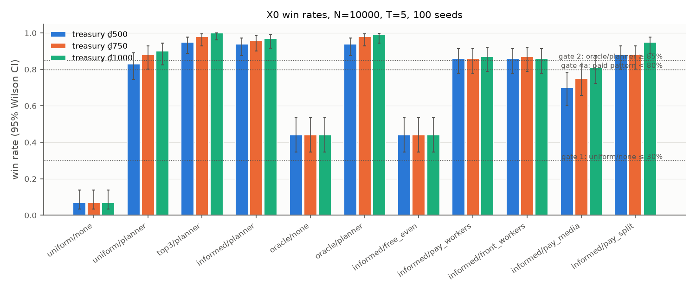
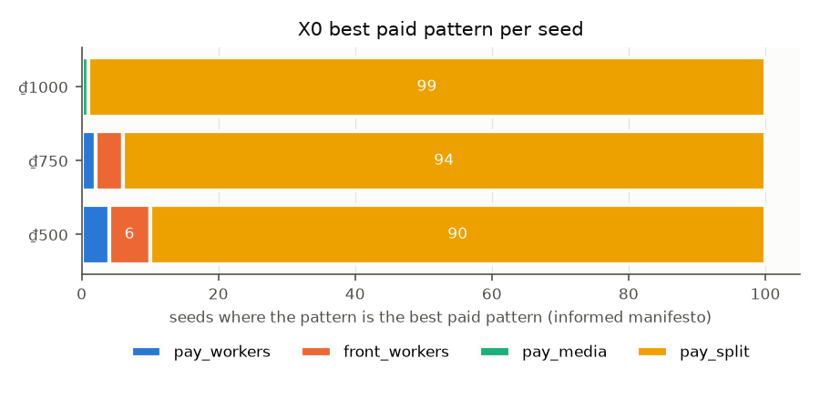
*Win rates of the fixed patterns, and which pattern is best per seed (X0).*

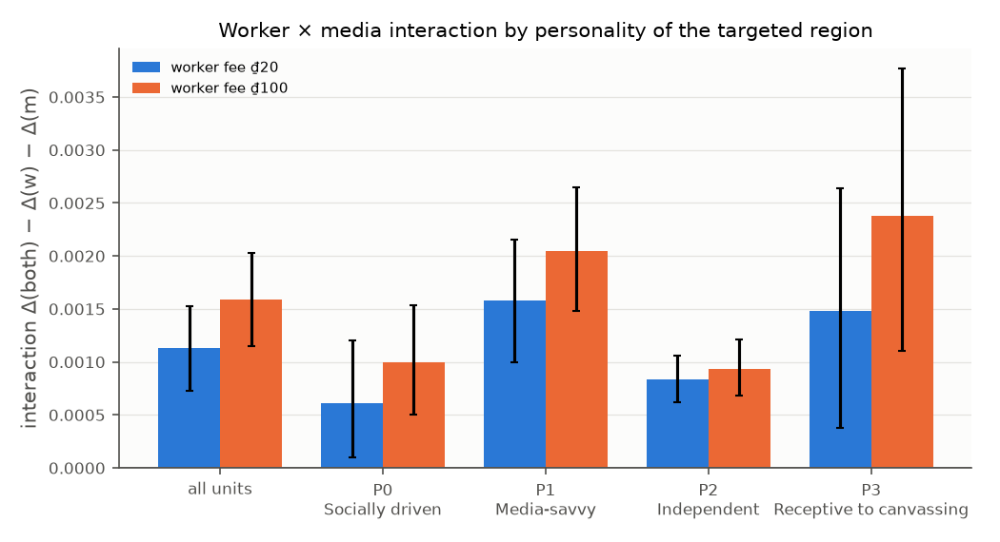
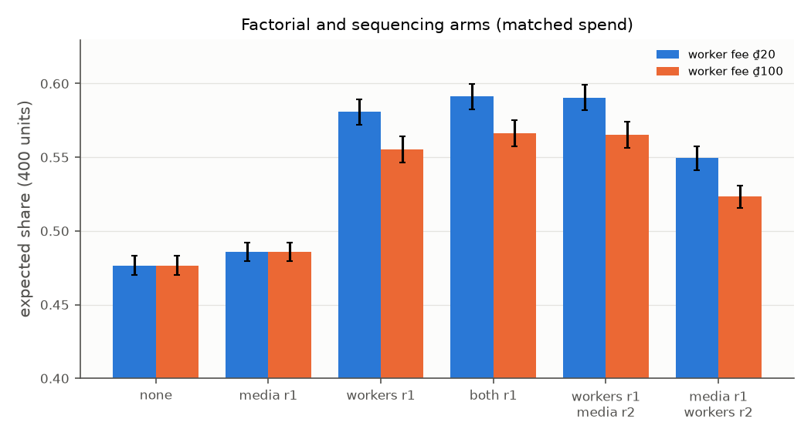
*Workers vs media at matched spend, their interaction, and the effect of ordering (X11).*

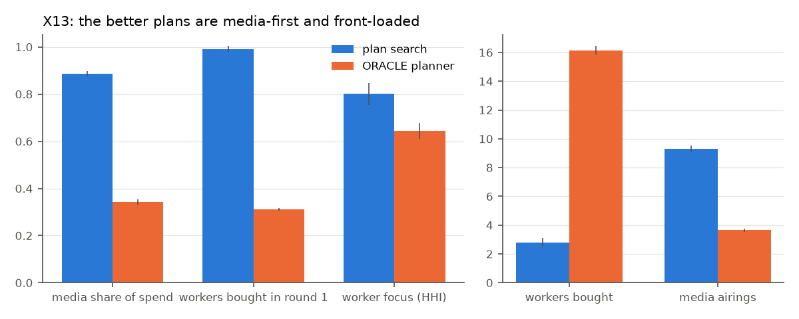
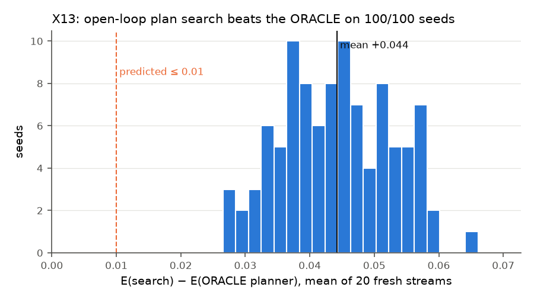
*What the best plans look like, and their gap to the ORACLE planner (X13).*

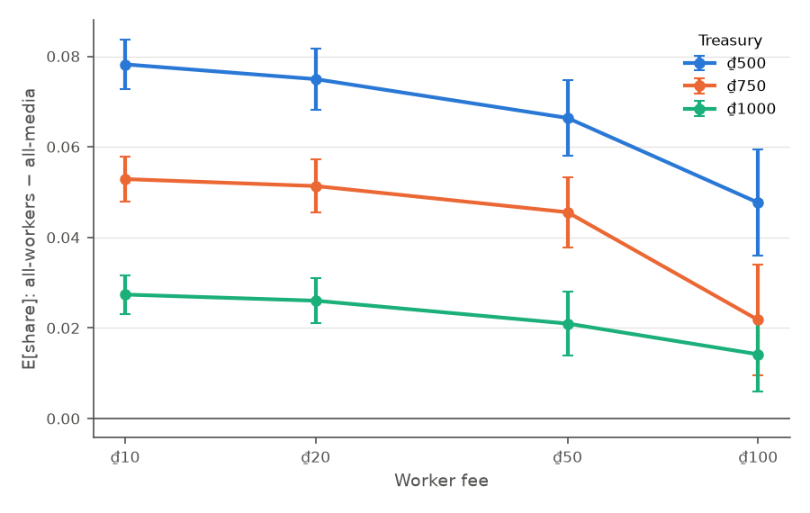
*Workers vs media across prices (X7).*

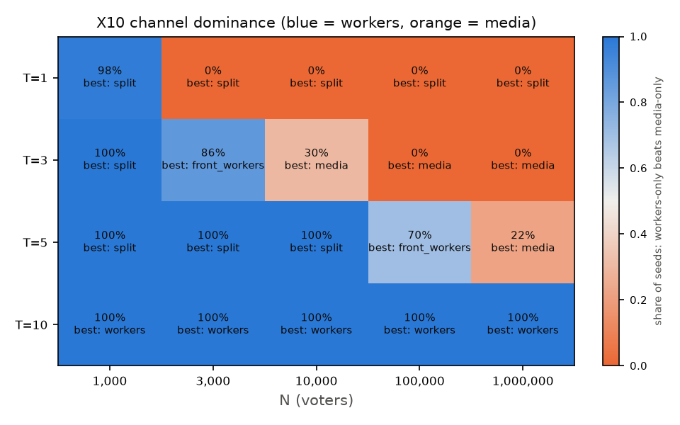
*Which channel dominates across N and T (X10).*

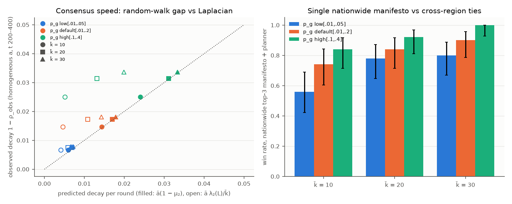
*Network structure and outcomes (X1).*

### Insights

- **The first ₫ should go to workers.** At equal spend, a handful of workers is worth about 11× a media airing (X11).
  Every worker-containing pattern beats media-only at every treasury (X0).
- **Then switch to early media.** Workers saturate fast (Q3). Combining X18 and X11 (derived arithmetic):
  - the 5th worker adds about 0.0032 per ₫20, i.e. about 1.6·10⁻⁴ per ₫;
  - the 10th adds about 0.00047 per ₫20;
  - a first media airing adds about 0.0092 per ₫50, i.e. about 1.8·10⁻⁴ per ₫.

  So after about 4–5 workers, media buys at least as many votes per ₫. Media aired early also keeps spreading through
  friends for the rest of the game. This is exactly what the best plans do: about 3 workers in round 1, then media in
  most regions in rounds 1–2, about 89% of spend (X13).
- **Spend early, in both channels.** Workers bought in round 5 are worthless (+0.001, X4). The ORACLE's late media is
  the main reason it trails the search by 0.044 (X13).
- **The channels add up but don't amplify each other.** The combination bonus is under 1% (X11). "Split" wins because
  it combines saturated workers with media, not because the channels reinforce each other.
- **The best channel depends on the world:**
  - **workers win** in dense networks, small electorates and long games;
  - **media wins** in sparse networks, very large electorates with short games, and 1-round games (X1, X10).
  - Prices shift the balance only gradually (X7).

---

## Player playbook

1. **Manifesto:** optimise it on the electorate you expect on election day, not today (Q1, Q2). It costs only 0.008
   now and drift repays it by round 3. If the two biggest regions disagree, anchor on the largest and add the
   closest small region. Never cater to one region only.
2. **Expect to need a campaign.** No manifesto wins alone at round 0, and drift alone adds about 0.11 by round 5 (Q1,
   Q2).
3. **Round 1:** buy about 3–5 workers. With about 4, put them in the region that already likes you, or split them
   between that region and a swing region. Also air media in most regions (Q4, Q5).
4. **Round 2:** keep airing media. After that, spend whatever is left; do not save money for the end (Q5).
5. **Ignore** fine placement details, picking voters by number of friends, and buying more than about 5 workers per
   region (Q3, Q4).

## Design implications for the game

- **The attempt cap is the main dial for worker strength.** The γ·P conversion rule is what keeps the manifesto
  relevant; removing it collapses the manifesto effect by about 70% (X23).
- **Worker value depends strongly on the electorate size and game length the player chooses** (X10). The current
  T = 3–5 restriction (R31) keeps the default game in range.
- **Zealots matter little within a game but a lot in the long run** (R2). A longer game would make them a real
  obstacle.
- **The ORACLE's greedy rule is a weak reference** (X13). Comparisons should use the X13 search bound.

## Limitations

- **Synthetic calibration.** Every parameter was tuned for playability, not fitted to real electorates.
- **Default world.** Most results are at N = 10⁴, T = 5, about 30 friends per voter and 5% zealots. X1, X7 and X10
  show the answers shift with network density, prices, N and T.
- **Role definitions in R1 and R3.** Regions are ranked by size (R1) or by support under the ORACLE manifesto (R3).
  Names like "R2" are not comparable across worlds.
- **Long horizons in R2.** Rounds beyond the game's maximum of 10 are experiment-side only.
- **Showcase figures.** Some figures (R1 landscape, R2 sector means and snapshots) show one world, chosen as an
  example.
- **Small subgroups.** The "largest region hostile" split in R3 has only 7 worlds and is descriptive.
- **Derived arithmetic.** The per-₫ comparison in Q5 combines X18 (one region, round 1) with X11 (one airing). It is
  indicative, not a separate experiment.

## Reproduce

New runs (outputs in this folder):

```bash
OMP_NUM_THREADS=4 python experiments/r1_manifesto_round0.py --seeds 100 --first-seed 12000 --device cuda:2
OMP_NUM_THREADS=4 python experiments/r2_drift_no_campaign.py --seeds 50 --first-seed 10000 --rounds 200 --device cuda:2
OMP_NUM_THREADS=4 python experiments/r3_worker_assignment.py --seeds 50 --first-seed 11000 --device cuda:0
# --plot-only on any of them redraws the figures from the saved JSON
python -m pytest -q tests/unit/test_r1_manifesto_round0.py tests/unit/test_r2_drift.py tests/unit/test_r3_worker_assignment.py
```

- **Existing runs:** each section in [`../sections/`](../sections/) gives the command for its experiment.
- **Detailed write-ups:** [r1.md](r1.md), [r2.md](r2.md), [r3.md](r3.md).
- **Index:** [README.md](README.md).
