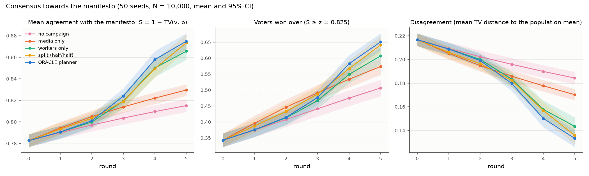
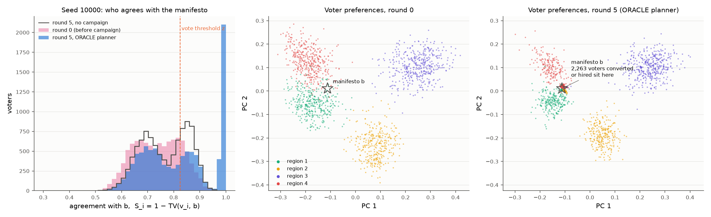
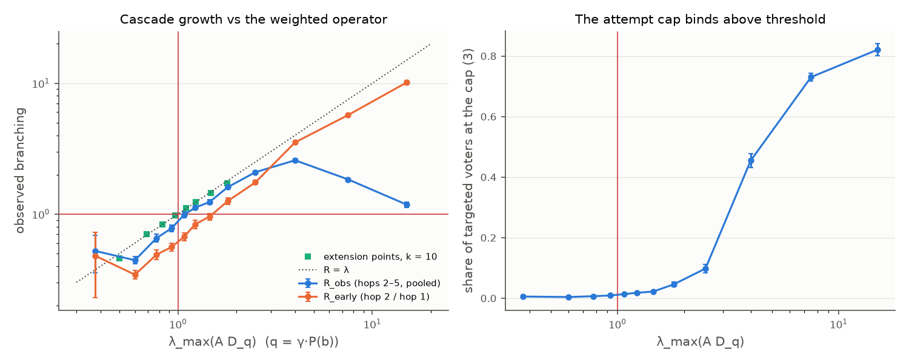
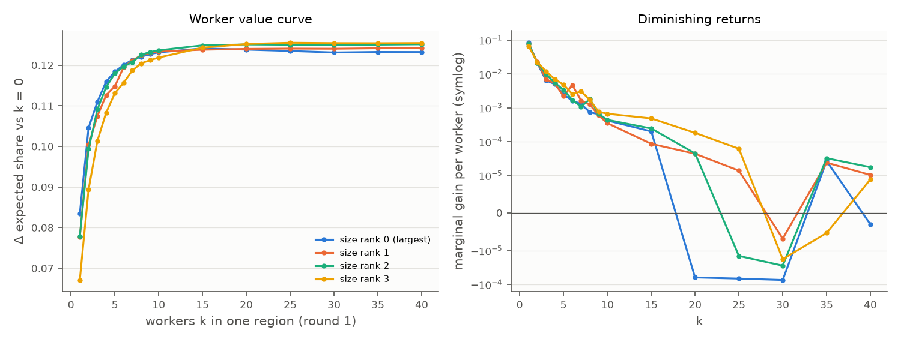
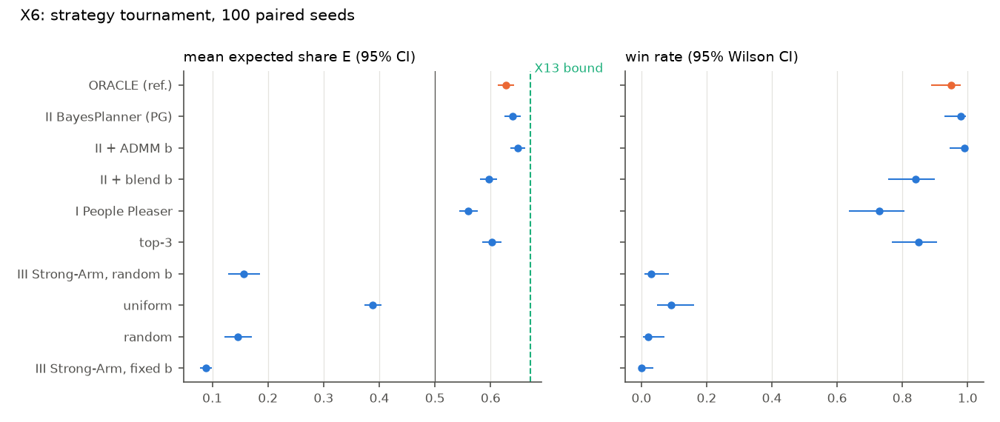
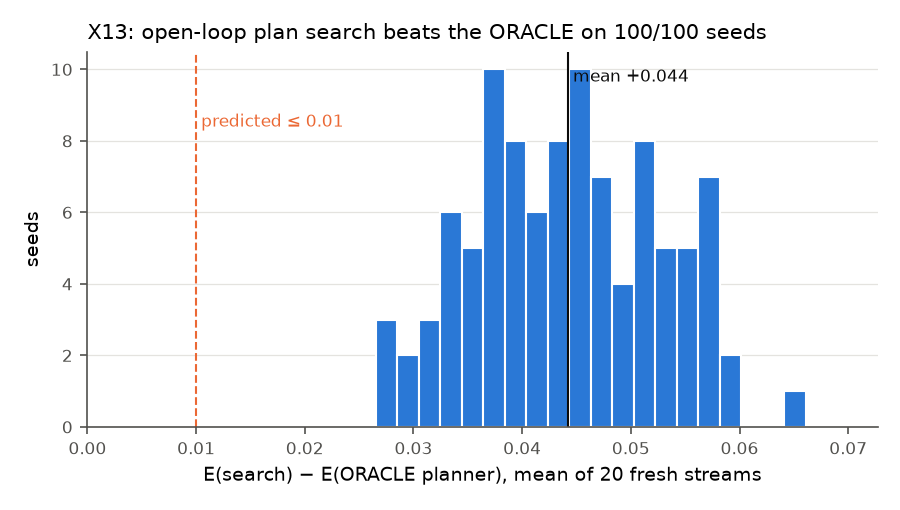
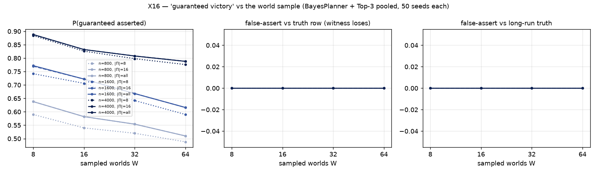
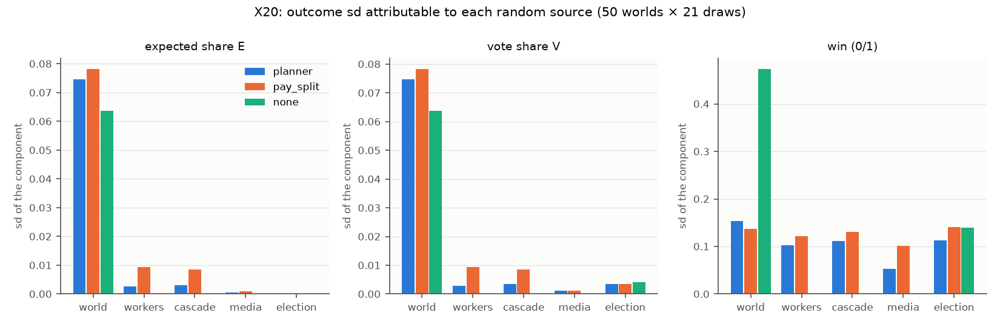
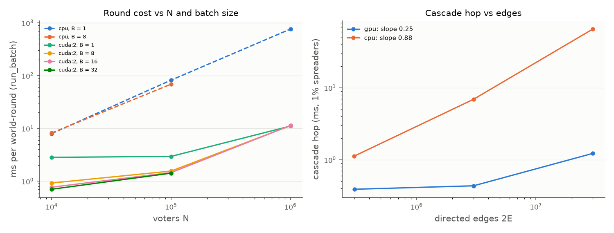

# Dumbocracy: Campaigning on a Social Network
### Cascades, consensus, planning under uncertainty and knowledge, studied with a GPU-batched election game

*Results of the v3 experiment suite (23 experiments, 2026-11-10 to 11). The full record, with every arm, test and
deviation, is [`reports/v3/report.md`](../report.md). Each number below comes from the JSON file of the experiment
named next to it (`reports/v3/x<k>.json`; see the table in Appendix A).*

---

## Abstract

Dumbocracy is a single-player election game played on a synthetic electorate of 10⁴–10⁶ voters, arranged in four
regions and linked by a friendship network. The player writes a five-sector budget manifesto, then has five rounds to
win a majority. Each round the player can buy permanent party workers, who start one-hop Independent Cascades; air
regional media; and pay for survey questions. Opinions meanwhile drift by DeGroot consensus. We ran 23 pre-registered
experiments, batched on the GPU, that test the game against course theory (consensus, cascades, influence
maximisation, proximal and ADMM optimisation, epistemic and temporal logic) and against its own design goals.

Over five rounds a good campaign raises the share of voters who would vote for the manifesto from 34% to 65%, and pulls
the electorate together around it (§4.0, Figures 1–2).

Five results stand out:
1. **The cascade obeys a spectral threshold.** Growth crosses 1 at λ_max(A·D_q) ≈ 0.94, where A is the friendship
   matrix and D_q holds each voter's conversion chance. Worker value is strongly submodular: one worker gives 62% of
   the plateau.
2. **Knowledge beats rules of thumb.** A Bayesian planner that infers the hidden world from polls and two survey
   questions wins 98% of games. A rule-of-thumb "People Pleaser" wins 73%, and a fixed-agenda "Strong-Arm" never
   wins.
3. **The game's full-information baseline (the "ORACLE") is not optimal.** An open-loop plan search beats it on
   100/100 seeds by +0.044 expected vote share, with media-heavy plans that buy workers early.
4. **Luck of the draw dominates.** The world draw explains 97–99% of the variance in vote share. Losses concentrate
   where the two largest regions want different things.
5. **The voting threshold z dominates the design,** while the worker price barely matters. At the chosen prices, a
   fixed "half workers, half media" plan wins 88–95% of games, so the balance gate fails.

---

## 1. Introduction

Campaigns spend money to move opinions that also move on their own, through friends. This pits two classical models
against each other:
- **opinion dynamics:** DeGroot averaging, plus stubborn agents (voters whose opinion never changes);
- **contagion:** the Independent Cascade model.

The player also does not know the electorate: which regions want what, and how persuadable they are. Every decision
is therefore taken under uncertainty, and the questions "what do I know?" and "what can I still guarantee?" have
precise answers in epistemic logic.

We built the game as a research instrument. The engine is a single torch code path that runs one world on the CPU
or hundreds of worlds in parallel on a GPU. This paper reports what the game teaches about its own mechanics and
about playing it well.

**Contributions**
1. **Theory checks.** Measured consensus speed, cascade thresholds, stubborn-agent equilibria and influence
   submodularity, each compared with its closed-form prediction (§4.1).
2. **A strategy ranking.** Scripted and planning players are ranked against a plan-search reference, which shows
   that the hand-built full-information baseline is a heuristic (§4.2).
3. **The value and limits of information.** How much surveying pays; whether probing reveals hidden types; how
   reliable sampled epistemic verdicts are (§4.3).
4. **Design analysis.** A balance audit, a luck-vs-skill decomposition, a misspecification study, a global
   sensitivity screen, and a model that predicts which elections cannot be won (§4.4).

Every experiment had a prediction written before it ran (`reports/v3/predictions.md`). Of the 22 experiments with a
prediction, **4 were confirmed, 17 partly confirmed and 1 refuted**. The refuted ones are reported as plainly as the
confirmed ones.

---

## 2. The model

| Component | Rule |
|---|---|
| **Electorate** | N voters (default 10⁴) in 4 regions, each region holding at least 15% of the voters. Voter i holds a preference v_i over 5 budget sectors (a point on the simplex). A hidden map σ gives each region one of 6 public *archetypes*; voters start near it (Dirichlet, κ = 60). A hidden map τ gives each region one of 4 *personalities*, which set every voter's susceptibility to friends (α), media (β) and canvassing (γ). 5% of voters are zealots who never move. |
| **Network** | Block-structured random graph with mean degree k̄ = 30: friends are likelier inside a region than across regions. |
| **Social step** | DeGroot: each voter moves towards the mean of their friends (step ω·α_i, ω = 0.15). |
| **Vote** | Agreement with the manifesto b is S_i = 1 − TV(v_i, b), where TV is the total-variation distance. Voter i votes for the party with chance P_i = σ(β_v(S_i − z)), with β_v = 20 and z = 0.825. **E** is the mean of P_i (the *expected vote share*). The official result is a seeded vote, won with more than N/2 votes. |
| **Turn structure** | Survey, then commit b once, then T = 5 campaign rounds (3–5 in the web game), then the election. Treasury ₫500 (₫500–₫1000 allowed). |
| **Workers (₫20)** | A bought worker is a random voter of the chosen region with ≥ 3 friends. It is pinned at b for the whole game and tries once to convert each of its friends. Friend j converts with chance γ_j·P_j and jumps to b. Converts spread one hop further in the next round (Independent Cascade, one hop per round). Each voter can be targeted at most 3 times. |
| **Media** | Region-targeted airings that pull voters towards b, priced by region size (₫50 for a quarter-sized region), with diminishing returns. |
| **Information** | Public: rules, prices, region sizes, the archetype and personality libraries, and a network census. Free each round: a 400-voter national poll and the national top-3 sectors. Paid (₫10): a sampled regional question, "what share prefers sector S2 over S1?". Hidden: σ, τ, the graph and every v_i. |

**Players compared**
- **ORACLE:** full information. A heuristic manifesto plus a greedy planner.
- **BayesPlanner (II):** keeps a posterior over hidden worlds, chooses survey questions by information gain, picks b
  by projected gradient (PG) or ADMM, and plans each round with rollouts on 8 sampled worlds.
- **People Pleaser (I):** a heuristic player that blends every region's wishes.
- **Strong-Arm (III):** pushes a fixed agenda.
- **Fixed patterns:** "split", "all workers", "all media", "none", and others.
- **Open-loop plan search (X13):** cross-entropy search plus hill climbing over whole 5-round plans, used as the
  reference for "how well can one do".

## 3. Method

- **Seeds.** Every arm of an experiment runs on the same seeds (paired design). Experiment groups use disjoint seed
  blocks. Core cells use 100 seeds and sweep cells 50, at N = 10⁴.
- **Statistics.**
  - 95% confidence intervals: Wilson for rates, t for means.
  - Paired tests: Wilcoxon for differences, exact McNemar for win counts.
  - Holm–Bonferroni correction within each experiment's family of tests.
  - E is the main outcome. Win rates are reported too, but they saturate near 1 in many arms.
- **GPU-first compute.**
  - A batched true-world runner plays B worlds per call, each with its own manifesto, policy and random streams.
  - On the CPU it is bit-identical to the reference simulator. On the GPU its discrete outcomes are identical and its
    floats agree to 6·10⁻⁸.
  - Every experiment passed a 3-seed CPU↔GPU parity check.
  - All runs used one or two NVIDIA RTX A5000 GPUs; the suite took about 7.6 hours of wall time.
- **Reporting.** Every number in the full report was machine-checked against its JSON source
  (`experiments/x_report_check.py`): 5,301 numbers, 0 unmatched.

---

## 4. Results

### 4.0 The goal: building consensus around the manifesto

A campaign wins by moving voters' preferences towards the manifesto b until more than half of them agree enough
to vote for it. We tracked every voter's preference after each round on 50 seeds (N = 10⁴, the ORACLE manifesto,
₫500), under five campaigns played on the same worlds (x_consensus.json). A voter is *won over* when their
agreement S_i = 1 − TV(v_i, b) reaches the vote threshold z = 0.825, i.e. they vote for b with chance ≥ ½.

| Campaign | Mean agreement S̄, round 0 → 5 | Voters won over, round 0 → 5 | Disagreement, round 0 → 5 | Election win rate |
|---|---|---|---|---|
| no campaign | 0.783 → 0.815 [0.809, 0.821] | 0.343 → 0.506 [0.481, 0.532] | 0.217 → 0.184 | 0.52 |
| media only | 0.783 → 0.830 [0.824, 0.835] | 0.343 → 0.574 [0.548, 0.600] | 0.217 → 0.170 | 0.72 |
| workers only | 0.783 → 0.866 [0.858, 0.873] | 0.343 → 0.607 [0.581, 0.633] | 0.217 → 0.143 | 0.86 |
| split (half / half) | 0.783 → 0.873 [0.866, 0.881] | 0.343 → 0.641 [0.615, 0.668] | 0.217 → 0.136 | 0.88 |
| ORACLE planner | 0.783 → 0.875 [0.868, 0.882] | 0.343 → 0.651 [0.624, 0.678] | 0.217 → 0.133 | 0.92 |

*Figure 1. Consensus towards the manifesto over the five rounds (50 seeds, mean and 95% CI).*
- **Left:** mean agreement with b.
- **Middle:** share of voters won over; the dotted line is a majority.
- **Right:** disagreement among voters (mean TV distance to the population mean).

Even without a campaign, friends' averaging drifts the electorate a little towards a well-chosen b: 34% → 51% of
voters won over. Every paid campaign turns that drift into a clear majority, and does more than the drift alone:
1. It moves voters *towards b*, raising agreement.
2. It pulls the electorate *together*: disagreement falls from 0.217 to 0.133 under the planner, against 0.184 with
   no campaign.

Workers move agreement more than media do, because a converted voter jumps all the way to b.

*Figure 2. One world (seed 10000) under the ORACLE planner.*
- **Left:** how many voters hold each level of agreement with b, at round 0 and at round 5. The pink bars are the
  electorate before the campaign, and the outline is round 5 with no campaign. With the planner, about 2,000 voters
  sit at S ≈ 1, and the mass right of the threshold z grows.
- **Middle and right:** 1,500 sampled voters projected on the first two principal components of their 5-sector
  preferences, coloured by region; ☆ marks b. In round 0 the four regions are separate clusters around their
  archetypes. By round 5, the two regions closest to b (regions 1 and 4) have moved towards it, and 2,263 voters
  converted or hired sit exactly on b. The two far regions barely move: the campaign builds a *coalition*, not a
  national consensus (cf. X15, X19).

### 4.1 The mechanics follow the theory

**Consensus speed is set by the second eigenvalue of the averaging matrix (X1).** The gap between regions decays at
the rate ā(1 − μ₂), where μ₂ is the second eigenvalue of D⁻¹A and ā the mean susceptibility. Across 450 worlds the
rank correlation is 0.997, with a +4.5% bias. The textbook form λ₂(L)/k̄ is off by about 1.9× (ρ = 0.62).

Consensus is slow at the game's time scale. Five rounds close only 5–20% of the gap between regions, and halving it
takes 18–108 rounds. A campaign therefore works on a *divided* electorate. With more cross-region links (higher
inter-region link probability p_g), one nationwide manifesto wins more often: 0.71 → 0.92 for the top-3 manifesto.

**The worker cascade has a spectral threshold (X3).** Let q_j = γ_j·P_j be voter j's conversion chance. Then the
expected cascade grows by the weighted operator A·D_q.

*Figure 1.*
- Observed branching crosses 1 at λ_max(A·D_q) ≈ 0.94 and tracks the operator closely near threshold: R_obs = 0.97
  at λ = 0.97, and 1.23 at λ = 1.23.
- Naive estimates (mean degree × mean chance) put the threshold at 0.48–0.53.
- Right panel: the 3-attempt cap binds for 0.6% of targets below threshold and 41.5% above it. That is why growth
  bends down at large λ.

Because P_j depends on b, **the manifesto itself moves a region above or below the epidemic threshold**. The
"policy" and "contagion" halves of the game are coupled through D_q.

**Pinned workers act through the cascade, not through the anchor (X2).** A worker pinned at b is a stubborn agent. In
the Friedkin–Johnsen equilibrium workers alone would eventually pull nearly everyone to b: the predicted share is 0.97, and
a simulation reaches 0.83 after 200 rounds. Within 5 rounds, however, the anchor contributes only 0.2–0.9% of a
worker's value; the cascade supplies the rest. The prediction was 20–60%, so it is refuted.

Zealots prevent consensus: disagreement plateaus at 0.018 instead of decaying to 0. Running W-MSR, the
resilient-consensus rule that drops extreme neighbours, slightly *raises* worker value (+0.001 to +0.004). We had
predicted it would act as the network's defence against the campaign.

**Influence is strongly submodular, and timing beats targeting (X18, X4).**
- **Diminishing returns:** one worker gives 62% of the plateau value and five give 93%. Only 1 of 15 adjacent pairs
  breaks diminishing returns, and only at a gain of about 10⁻⁵.
- **Random placement is nearly as good as optimised:** placing workers at random reaches 93–96% of the lazy-greedy
  (CELF) influence-maximisation choice from k = 2 workers on.
- **Timing matters most:** buying in round 1 instead of round 5 is worth +0.12 E, because early workers get more
  hops.
- **Placement matters little:** the choice of region changes E by at most 0.010, and picking high-degree voters
  gains at most 0.006 with no change in wins.

*Figure 2. Marginal value of the k-th worker in a region (X18).*

**Workers and media barely interact (X11).** Their interaction term is +0.0011 [0.0007, 0.0015] E, under 1% of
their joint effect. At matched spend, workers add 0.104 E and media 0.009 E. Order matters, though: workers in round
1 and then media beats the reverse by 0.041 E, on 100/100 seeds.

### 4.2 Strategy: knowledge wins, and the baseline is beatable

**The tournament (X6, 100 paired seeds).**

| Player | Expected share E [95% CI] | Win rate [95% CI] |
|---|---|---|
| II BayesPlanner + ADMM manifesto | 0.649 | 0.99 |
| **II BayesPlanner (PG manifesto)** | **0.639 [0.625, 0.654]** | **0.98 [0.93, 0.99]** |
| ORACLE (full information, heuristic) | 0.628 [0.613, 0.643] | 0.95 [0.89, 0.98] |
| top-3 sectors manifesto | 0.602 | 0.85 |
| I People Pleaser | 0.560 [0.544, 0.576] | 0.73 [0.64, 0.81] |
| III Strong-Arm, fixed agenda | 0.088 [0.077, 0.099] | 0.00 [0.00, 0.04] |

*Figure 3. Tournament results. The dashed line is the X13 plan-search reference.*

The predicted order II > I > III holds by wide margins: II − I = +0.079 E and I − III = +0.47 E, both with Holm
p ≤ 10⁻¹⁷. The surprise is that the BayesPlanner, which starts out *not knowing* the world, beats the
full-information ORACLE by 0.011 E [0.009, 0.014].
Tool
**The ORACLE is a heuristic (X13).** An open-loop search over whole campaign plans, run from the ORACLE's own
manifesto, beats the ORACLE planner on **100 of 100 seeds** by +0.044 E [0.043, 0.046]. The smallest gain is +0.027.
The prediction was a gap of at most 0.01, so it is refuted.

*Figure 4. Per-seed gain of the plan search over the ORACLE planner (X13).*

The better plans look different from what the ORACLE does:

| | Plan search | ORACLE planner |
|---|---|---|
| Workers bought | 2.8, all in round 1 | 16.2, spread over rounds 1–3 |
| Media airings | 9.3 | 3.7 |
| Share of spend on media | 89% | 34% |

No world feature predicts the size of the gap (all Holm p ≥ 0.13), so the improvement is systematic, not a tail
effect. Measured against this reference, the *price of not knowing* paid by the BayesPlanner is 0.033 E
[0.030, 0.035].

**The manifesto: coalitions, not averages (X12, X19).**
- **Joint choice:** choosing b and the spending plan together adds +0.008 to +0.011 E over choosing b first. The
  best manifesto found reaches E = 0.683.
- **Optimiser comparison (X19):** projected gradient and mirror descent tie, at a median of 5 iterations to 10⁻⁴.
  Frank–Wolfe takes 10 iterations and is the most accurate. ADMM stops about 0.006 E short of the optimum, its
  smoothing bias, yet in play ADMM beats PG by +0.0095 E (X6).
- **The landscape is benign:** there are 1.27 local optima per seed, and 92% of random starts reach the best b*.
- **Coalition geometry:** b* is closer to a blend of 2–3 regions than to the mean or median of all regions (−0.018
  TV, Holm p 6·10⁻⁶). It carries about 1.8 regions holding roughly half the voters. Winning means building a
  coalition, not pleasing everyone.

**Planner calibration (X14).** The rollout planner is *pessimistic*, not over-optimistic as predicted. Its round-1
bias is −0.024 E at N = 10⁴ and −0.047 at N = 10⁵, with a calibration slope of about 1. The bias shrinks as the
planner's sampled worlds grow (ρ = +0.42). This is what one expects when a fixed continuation scores a planner that
re-plans every round. At N = 10⁵, planning on full-size worlds instead of 1,600-voter samples adds +0.034 E, but
makes each decision 16× slower.

### 4.3 Information and knowledge

**About two questions are enough (X5).** At ₫10 per question, two questions maximise E. Twelve questions score
−0.0132 [−0.0176, −0.0087] E against two (Holm p 6·10⁻⁷), and every question beyond the second lowers E. After two
questions the posterior already puts 0.995 of its mass on the true archetype map σ, against 0.684 for two random
questions. At ₫5 the optimum moves to four questions.

**Personalities stay hidden, and probing does not pay (X17).** One idea was to spend round 1 on a single test airing
and read the next poll. This lowers uncertainty about personalities τ only briefly: soft-likelihood entropy drops by
0.030 at round 2, and the drop is gone by round 5. On the hard-filter metric it does not drop at all. The probe costs
−0.0127 [−0.0195, −0.0059] E: it lost 3 games and gained none. The cause is structural. The free poll is national
and has only 400 voters (SE ≈ 2.4 points), too coarse to tell regional personalities apart.

**Sampled epistemic verdicts are sound but conservative (X16).** After each game, the debrief evaluates verdicts such
as "*a win is guaranteed*" (some plan wins in every world consistent with what the player knows) over sampled
worlds and a finite plan set.
- **No false "guaranteed":** across 36 settings (8–64 worlds × 800–4000 voters × 8–21 plans, 500 decision points
  each), the debrief **never** asserted a false "guaranteed".
- **More worlds, fewer verdicts:** with more sampled worlds the verdict becomes rarer, from 0.772 of decision points
  at 8 worlds to 0.616 at 64 (Δ = −0.156 [−0.200, −0.110], Holm p 8·10⁻²³).
- **Missed wins grow:** the share of winnable positions it fails to flag rises from 0.21 to 0.37.
- **Graded confidence is well calibrated:** p̂ (the fraction of sampled worlds that win) has a Brier score of 0.032
  and is, if anything, *under*-confident (calibration slope 1.44).
- **Blind to τ (X17):** the poll-consistency check tolerates a 0.01 deviation, which is wider than the poll
  differences personalities cause. So the verdicts can never resolve τ.

*Figure 5. Rate and reliability of "guaranteed" verdicts as the number of sampled worlds grows (X16).*

**When is the game decided? (X8, temporal logic).** We replayed the 1,000 tournament games exactly and simulated 64
futures from every round.
- **Every winner came from behind:** this held in 548 of 548 wins (◇Lead after ¬Lead). It is structural: in these games the
  expected share at the manifesto commit never exceeded 0.485.
- **Weak players lose at the start:** their *point of no return* is round 1, the manifesto commit, in 77%
  [73%, 81%] of losses, not rounds 2–3 as predicted.
- **The round-1 knowledge state predicts the outcome:** if some plan wins every sampled future at round 1, the
  player goes on to win 89% of the time; otherwise 2.3%.

### 4.4 Design: luck, sensitivity, balance

**Luck vs skill (X20, 24,150 games).** We resampled one source of randomness at a time.
- **The world draw dominates:** it explains 99.4% of the variance of the vote share for the ORACLE and 97.2% for
  "split". Most of it is the voters' initial preferences (0.92), not the graph (0.064).
- **In-game randomness is small:** the standard deviation of the vote share is 0.0035 from the cascade, 0.0034 from
  election-day noise, 0.0028 from which voters become workers, and 0.0011 from media.
- **Skill still counts:** across planner, "split" and "do nothing", policy explains half the variance of E.

*Figure 6. Where the variance of the outcome comes from (X20).*

**Which elections cannot be won (X15).** Every ORACLE loss at ₫500 (11 of 100) happened where the two largest
regions' archetypes are at TV distance ≥ 0.35. There were 0 losses of 100 below that (Fisher p 0.0004). A logistic
model predicts ORACLE losses with cross-validated AUC 0.91; its strongest feature is the mean pairwise archetype
distance (+2.31 log-odds per SD). Every non-close loss falls into one category, the **divided majority**.

**What the design is sensitive to (X21, X22).**
- **Misspecification (X21):** the BayesPlanner assumes the public default parameters. When the true world differs,
  the planner is hurt most by a wrong voting threshold z (Δgap 0.034). Next come k̄ (0.014) and β_v (0.011); ζ
  matters least (0.0004).
- **Global screen (X22):** a Morris screen of 10 parameters in ±30% boxes finds z dominant for the ORACLE's win
  rate (μ* 0.88 [0.61, 1.16], against 0.087 for the next parameter). The worker fee sits at the noise floor.

**Balance (X0, X10, X7).**
- **The gate fails:** at the chosen prices (worker ₫20, question ₫10), the fixed "split" pattern wins 0.88 [0.80,
  0.93] at ₫500 and 0.95 [0.89, 0.98] at ₫1000. The design goal was below 80%, so criteria 4a and 4b fail at every
  treasury.
- **Re-pricing does not fix it (X7):** all-workers beats all-media in 12/12 price × treasury cells.
- **Game length matters (X10):** T = 1 is too short, with the ORACLE winning only 12–36%. T = 10 is too easy, with
  no campaign at all winning 38–44%. The web game was therefore restricted to T = 3–5.

### 4.5 Scale

The engine runs 10⁶ voters at **11 ms per round** on one RTX A5000. Against the CPU this is ×69 for one world, and
×11 / ×49 / ×69 when worlds are batched at 10⁴ / 10⁵ / 10⁶ voters. Up to 16 worlds of 10⁶ voters fit in 18 GB at
once. A cascade hop scales at most linearly in the number of edges (X9).

*Figure 7. Time per round vs N, single and batched, GPU vs CPU (X9).*

---

## 5. Connection to course concepts

| Concept | Where it appears | What we found |
|---|---|---|
| Spectral graph theory, consensus (DeGroot) | X1 | The decay rate is ā(1 − μ₂(D⁻¹A)) (ρ = 0.997), not λ₂(L)/k̄; consensus is slow at game time scales. |
| Stubborn agents, Friedkin–Johnsen, resilient consensus (W-MSR) | X2 | Zealots freeze disagreement at 0.018. W-MSR does not defend against pinned workers; the anchor effect is tiny in 5 rounds. |
| Epidemic thresholds, Independent Cascade | X3, X23 | The threshold is λ_max(A·D_q) ≈ 0.94; the manifesto enters through D_q. Without the attempt cap, cascades saturate. |
| Influence maximisation, submodularity | X18, X4 | Strongly submodular; random placement reaches 93–96% of CELF; timing matters more than targeting. |
| Proximal operators, mirror descent, Frank–Wolfe | X19 | All reach the same interior optimum; PG and mirror descent tie at a median of 5 iterations. |
| ADMM (distributed optimisation) | X6, X19 | A 0.006 E static shortfall from smoothing, but +0.0095 E better in play. |
| Epistemic logic (knowledge, guarantees) | X5, X16, X17 | Sampled "guaranteed" verdicts are sound but conservative; two questions suffice; τ is unknowable from national polls. |
| Temporal logic (LTL/CTL, STL robustness) | X8 | Every winner comes from behind; weak players' point of no return is the manifesto commit. |
| Planning under uncertainty (Bayesian rollouts) | X6, X13, X14 | Bayesian planning beats the full-information heuristic; rollout estimates are pessimistic. |

---

## 6. What this means

**For a player**
- Write the manifesto for a coalition of two or three regions, not for everyone.
- Ask about two survey questions, then stop. Do not spend a round probing.
- Spend early: buy a handful of workers in round 1 and air media widely in rounds 1–2. Late workers are almost
  worthless.
- Trust a "guaranteed" verdict, but read "not guaranteed" as weak evidence.
- A single loss says little about the play. The draw of the electorate decides most of the outcome.

**For the game designer**
- **Balance is governed by z, not by prices.** Re-pricing workers by ±30% or between ₫10 and ₫100 does not restore
  the gate. Retuning the voting threshold, or the shape of the vote curve, is the lever.
- **The full-information baseline should be replaced** by the plan-search reference (or something stronger) when
  judging difficulty.
- **The epistemic debrief cannot see personalities.** Either tighten the poll tolerance or regionalise the free poll
  if τ is meant to be learnable.

---

## 7. Limitations

- **The references are heuristics.** The ORACLE is beaten everywhere, so every "ORACLE win rate" is a lower bound on
  what is achievable. The X13 search is itself a heuristic; X12 finds a further +0.008–0.011 E by also moving b.
- **The calibration is synthetic.** Parameters were tuned to synthetic targets, and no human played the v3 rules.
  All advice comes from scripted and planning players.
- **Verdicts are statements about samples.** The epistemic and temporal verdicts are evaluated over sampled worlds,
  plans and futures, not exhaustively.
- **Statistical power is limited.** With 50-seed sweep cells, paired win-rate differences below about 8–10 points are
  not detectable, and many win rates sit near 1; E is the more sensitive outcome. Holm correction is applied within
  each experiment, not across the suite.
- **Most results come from the default cell.** That cell is N = 10⁴, T = 5, ₫500. X10 shows that balance depends on
  N and T.
- **Hardware and randomness.** The GPUs were shared, which affects timings. CPU and GPU use different random streams;
  every experiment passed its parity check.

## 8. Reproducibility

- **Code:**
  - experiment scripts: `experiments/x<k>_*.py`;
  - shared infrastructure: `experiments/x_common.py`, `x_batch.py`, `x_policies.py`, `x_streams.py`.
- **Commands:** each experiment's exact command is in its JSON (`provenance.command`) and in §15 of the full report.
- **Figures:** all 57 are redrawn from the JSON with `python experiments/plot_v3.py`.
- **Number check:** `python experiments/x_report_check.py` checks every number of the full report against its source.
- **Provenance:** every JSON records the git revision, torch/CUDA versions, device, seeds, batch sizes, peak memory
  and wall time.

---

## Appendix A. All experiments at a glance

Verdicts compare the result with the prediction registered before the run.

| ID | Question | Headline result | Verdict | Data |
|---|---|---|---|---|
| XC | Does the campaign build consensus around b? | voters won over 0.34 → 0.65 (planner) vs 0.51 (no campaign); disagreement 0.217 → 0.133 | — (descriptive) | [x_consensus.json](../x_consensus.json) |
| X0 | Is the game balanced at ₫20 / ₫10? | "split" wins 0.88–0.95; criteria 4a/4b fail | confirmed | [x0.json](../x0.json) |
| X1 | What sets consensus speed? | ā(1 − μ₂), ρ 0.997; p_g raises nationwide wins 0.71 → 0.92 | confirmed | [x1.json](../x1.json) |
| X2 | Stubborn agents, zealots, W-MSR | anchor share 0.002–0.009; W-MSR raises worker value | partial | [x2.json](../x2.json) |
| X3 | Cascade threshold | growth = 1 at λ_max(A·D_q) ≈ 0.94 | confirmed | [x3.json](../x3.json) |
| X4 | Timing vs placement | early +0.12 E; placement ≤ 0.010 | confirmed | [x4.json](../x4.json) |
| X5 | Value of information | 2 questions best; 12 vs 2: −0.0132 E | partial | [x5.json](../x5.json) |
| X6 | Strategy tournament | II 0.98 > I 0.73 > III 0.00 wins; II beats ORACLE | partial | [x6.json](../x6.json) |
| X7 | Price sensitivity | prices shift spend, not outcomes; workers > media in 12/12 | partial | [x7.json](../x7.json) |
| X8 | Temporal properties | all winners from behind; PNR = commit in 77% of weak losses | partial | [x8.json](../x8.json) |
| X9 | Scale | 10⁶ voters, 11 ms/round, ×69 vs CPU | — | [x9.json](../x9.json) |
| X10 | Balance across N × T | no cell passes; web game set to T = 3–5 | partial | [x10.json](../x10.json) |
| X11 | Worker × media interaction | +0.0011 E (< 1%); workers-then-media +0.041 | partial | [x11.json](../x11.json) |
| X12 | Viral (narrow) manifesto | joint b + plan +0.008–0.011 E | partial | [x12.json](../x12.json) |
| X13 | Is the ORACLE optimal? | search +0.044 E on 100/100 seeds | refuted | [x13.json](../x13.json) |
| X14 | Planner calibration | pessimistic (−0.024 E), shrinks with world size | partial | [x14.json](../x14.json) |
| X15 | Unwinnable elections | divided majority; AUC 0.91 | partial | [x15.json](../x15.json) |
| X16 | Verdict reliability | 0 false "guaranteed"; rarer with more worlds | partial | [x16.json](../x16.json) |
| X17 | Probing personalities | no lasting entropy drop; −0.0127 E | partial | [x17.json](../x17.json) |
| X18 | Submodularity | 1 worker = 62% of plateau; random ≈ CELF | partial | [x18.json](../x18.json) |
| X19 | Manifesto geometry | coalition blend; PG = MD; 92% of starts reach b* | partial | [x19.json](../x19.json) |
| X20 | Luck vs skill | world draw 97–99% of variance | partial | [x20.json](../x20.json) |
| X21 | Misspecification | z most harmful (Δgap 0.034) | partial | [x21.json](../x21.json) |
| X22 | Global sensitivity | z dominates; worker fee at noise floor | — | [x22.json](../x22.json) |
| X23 | Worker-rule ablations | γ-only and no cap saturate; γ·P² passes 4a/4b | partial | [x23.json](../x23.json) |

Not run: X24, a human playtest (dropped), and X25, a two-party meta-game (deferred: it needs multi-party voting).
