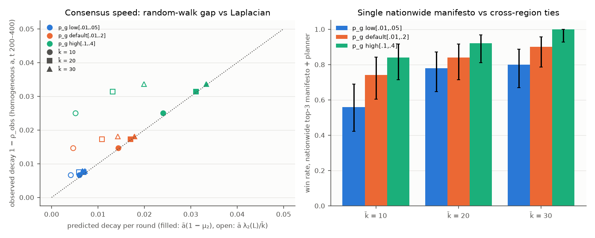
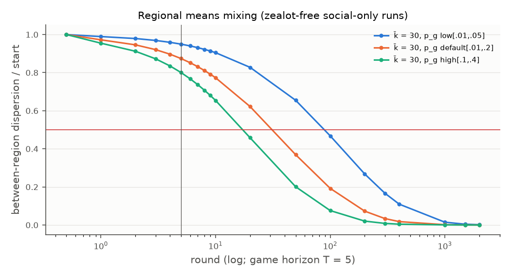

### X1 — Network structure and consensus speed

**Question.**
- Does the speed at which opinions mix follow the spectral gap, and which one?
- Do well-connected countries reward a single nationwide manifesto, while fragmented ones reward region-targeted
  play?

**Prediction (pre-registered).** Copied unchanged from reports/v3/predictions.md:
> the decay follows ā(1 − μ₂(D⁻¹A)), not λ₂(L)/k̄ (as E1 found). Under the P8 rules, high p_g raises
> the wins of a single nationwide manifesto.

**Setup.**
- **Seeds:** first seed 11000, 50 paired seeds per cell. The same seed gives the same regions, v(0) and
  susceptibilities in every cell; only the graph changes.
- **Grid:** k̄ ∈ {10, 20, 30} × p_g range ∈ {[.01, .05], [.01, .2] (default), [.1, .4]}.
- **Game:** N = 10⁴, T = 5, ₫500.
- **Spectra (SciPy on the CPU, giant component of the zealot-free copy):** λ₂(L); μ₂ and μ_min of D⁻¹A; ν₂ of the
  exact operator G^½ L G^½ with G = diag(a/d) and a_i = ω·α_i; cross-region conductance.
- **Long social-only runs (GPU, float64, all 50 worlds of a cell batched):**
  - zealot-free copy, x ← (1 − a)x + a·D⁻¹A x;
  - heterogeneous a for 2,000 rounds, homogeneous a = ā for 400 rounds.
- **Measures:**
  - observed contraction ρ_obs, from the slope of log‖x − 1c‖;
  - "rounds until the regional means move halfway to the global mean" (between-region TV dispersion ≤ ½);
  - the predictions ρ_rw = 1 − ā(1 − μ₂), ρ_L = 1 − ā·λ₂(L)/k̄ and ρ_exact = 1 − ν₂.
- **Game outcomes (T = 5, batched `run_batch`):** ORACLE manifesto with none / planner; the nationwide top-3 and
  uniform manifestos with the planner; the informed manifesto with pay_workers / pay_media / pay_split.
- **Device and compute:** cuda:2. Wall time 1,293 s (21.6 min), of which spectra took about 35 s per cell
  (`provenance.timing`); peak memory 1.2 GB; mean GPU utilisation 15% (the SciPy spectra and the planner's Python
  dominate).
- **Checks:**
  - CPU↔GPU parity (3 seeds, k̄ = 10, low p_g, ORACLE planner): passed (`provenance.parity`).
  - GPU `lobpcg` spectra vs SciPy on 3 worlds: max |Δ| = 5·10⁻⁹ (`provenance.spectra_gpu_vs_scipy`).
- **Deviations:**
  - The spectra use SciPy. At N = 10⁴ it is about 7× faster than the GPU path (0.3 s vs 2.3–2.5 s), which is the
    §1.1 "measured slower" exception.
  - The first full run was killed by a CUDA out-of-memory error after 3 cells, when it shared cuda:2 with X18's CELF
    batch. It was rerun alone from scratch; the JSON is from the complete rerun.
  - "Standard strategies" are the X0 policy set. The observation-only players are X6's job.
  - At k̄ = 10 the graphs have 2.3–6 components on average, so the spectra use the giant component.

**Results.** Source: reports/v3/x1.json (`cells`, `theory_vs_obs`, `nationwide`).

*Consensus speed.* Predictions vs observed decay rates over all 450 worlds (`theory_vs_obs`):

| Observed decay 1 − ρ | vs ā(1 − μ₂): Spearman / mean log(obs/pred) | vs ā·λ₂(L)/k̄ | vs exact 1 − ν₂ |
|---|---|---|---|
| homogeneous a, t 200–400 | **0.997 / +0.044** (RMSE 0.07) | 0.616 / +0.648 (RMSE 0.84) | −0.03 / +3.47 |
| homogeneous a, between-region dispersion | **0.926 / −0.018** | 0.698 / +0.587 | — |
| heterogeneous a, first 5 rounds | **0.939** / +0.66 | 0.483 / +1.27 | −0.05 / +4.08 |
| heterogeneous a, t 1500–2000 (asymptotic) | −0.29 / −2.86 | −0.15 / −2.26 | **0.896** / +0.56 |

- With a uniform step the random-walk gap predicts the observed decay within 4.5% on average. λ₂(L)/k̄
  under-predicts it by about 1.9× and fails to rank the worlds (ρ = 0.62).
- With the game's heterogeneous steps, the game-horizon decay ranks with the random-walk gap (ρ = 0.94). The slow
  asymptotic tail is set by the exact operator (ρ = 0.90), and it is still about 1.8× faster than 1 − ν₂ at
  t = 2,000: the tail has not converged.

*Regional mixing vs the 5-round game* (`cells.*.het_between_rel_mean`, `*_t_half_between`, `t_half_pred_rw`):

| p_g | μ₂ (k̄ = 30) | between-region dispersion left after 5 rounds | rounds to halve it (observed, heterogeneous a) | predicted ln 2/−ln ρ_rw |
|---|---|---|---|---|
| [.01, .05] | 0.892 | 0.95 | 93.5 (k̄ = 30); 97–108 (k̄ = 10–20) | 101 |
| [.01, .2] | 0.731 | 0.87 | 32.5 | 42 |
| [.1, .4] | 0.500 | 0.80 | 18.5 | 21 |

Within 5 rounds the regional means move only 5–20% of the way to the global mean (E1 found 1–5% per round).

*Game outcomes: nationwide manifestos and cross-region ties.* Win rates by p_g (`nationwide`; paired by seed,
high − low p_g, Holm over 12):

| Run | p_g low → high, k̄ = 10 | k̄ = 20 | k̄ = 30 | pooled | discordant (high-only / low-only) | ΔE pooled |
|---|---|---|---|---|---|---|
| top-3 manifesto + planner | 0.56 → 0.84 | 0.78 → 0.92 | 0.80 → 1.00 | 0.71 → 0.92 | 31 / 0 (Holm p 10⁻⁸) | +0.079 [0.075, 0.083] |
| ORACLE manifesto + planner | 0.70 → 0.90 | 0.80 → 0.96 | 0.84 → 1.00 | 0.78 → 0.95 | 26 / 0 (Holm p 3·10⁻⁷) | +0.083 [0.078, 0.087] |
| uniform manifesto + planner | 0.34 → 0.60 | 0.48 → 0.68 | 0.60 → 0.98 | 0.47 → 0.75 | 42 / 0 (Holm p 6·10⁻¹²) | +0.088 [0.085, 0.092] |

- All 12 Wilcoxon Holm p ≤ 2·10⁻¹⁴.
- With no campaign, the ORACLE manifesto wins 0.12 at low p_g and 0.70 at high p_g, for every k̄ (`cells.*.oracle/none`).
- **The best paid pattern depends on density** (`cells.*.best_paid_pattern`):
  - at k̄ = 10, pay_media is best in 26–38 of 50 seeds;
  - at k̄ = 30, pay_split is best in 39–47 of 50.
  - In sparse graphs the cascade is weaker: the ORACLE planner converts 740–1,640 voters at k̄ = 10 vs 4,175–4,928
    at k̄ = 30.

Figures:
- 
- 

**Theory vs observation. Confirmed.**
- **"The decay follows ā(1 − μ₂(D⁻¹A)), not λ₂(L)/k̄": confirmed.** It holds near-exactly for a uniform step
  (Spearman 0.997, bias +4.5%), and as a ranking at the game horizon with the real heterogeneous steps (0.94).
  λ₂(L)/k̄ misses by about 2× and misranks. The asymptotic tail with heterogeneous steps belongs to the exact
  operator ν₂, not to either lecture form.
- **"High p_g raises the wins of a single nationwide manifesto": confirmed.** The nationwide top-3 manifesto goes
  from 0.71 to 0.92 (31 vs 0 discordant seeds), and the same holds for the ORACLE and uniform manifestos.

**What it means.**
- **For the game design:**
  - In 5 rounds the network barely mixes regions (5–20% of the way). Social dynamics alone cannot unify a
    fragmented country within the game, so region structure stays visible to the player.
  - The cross-region tie strength p_g is a strong hidden difficulty knob: +0.08 in expected share between the low
    and high ranges.
  - Sparse graphs (k̄ = 10) flip the best pattern from split to media. Workers are a dense-network weapon.
- **For a player:** in a well-connected country, one nationwide manifesto plus workers is enough. The network carries
  it, and even no campaign wins 70%. When polls show regions staying apart (low p_g), target the manifesto and the
  spending, and lean on media if the network seems sparse.

**Data.** reports/v3/x1.json, reports/v3/raw/x1.jsonl (450 world rows with spectra, long-run curves and the 7 game
runs), log reports/v3/logs/x1.log. Command:
`OMP_NUM_THREADS=4 python experiments/x1_topology.py --seeds 50 --first-seed 11000 --device cuda:2 --out reports/v3/x1.json`.
